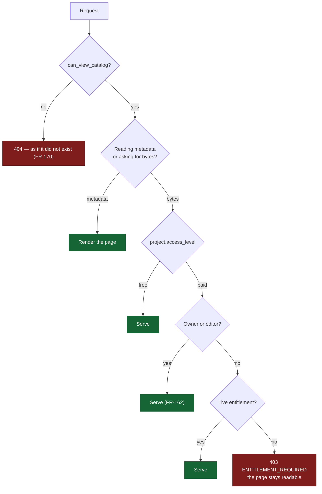
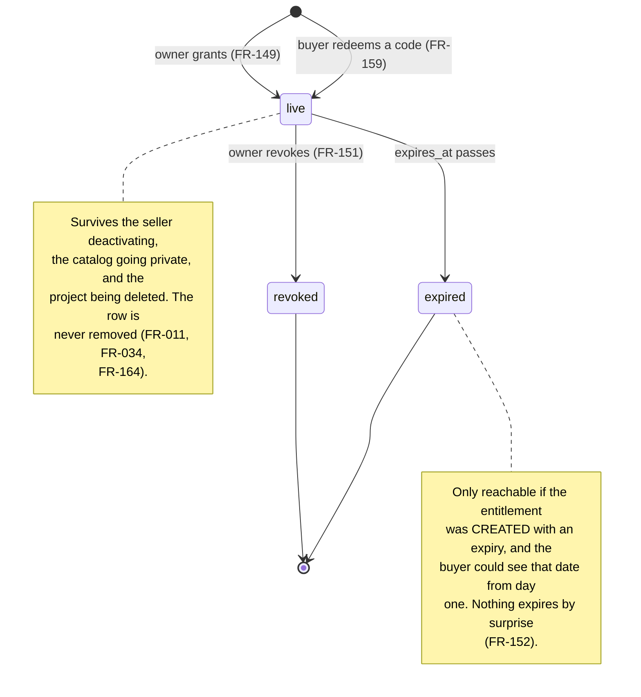
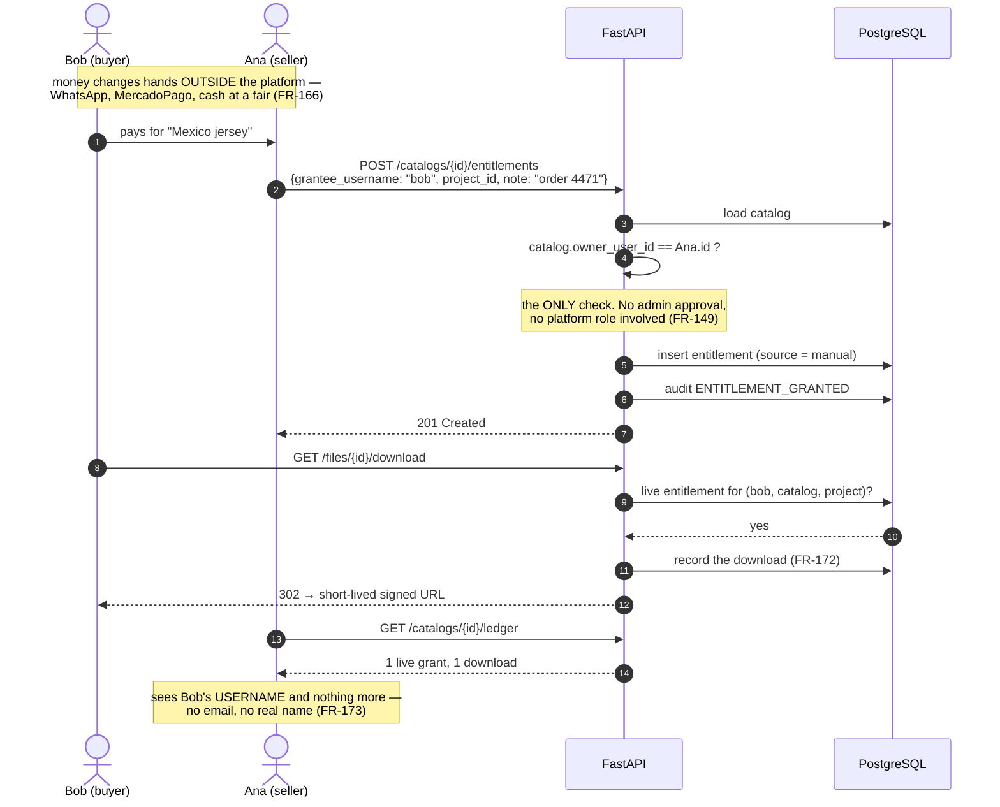
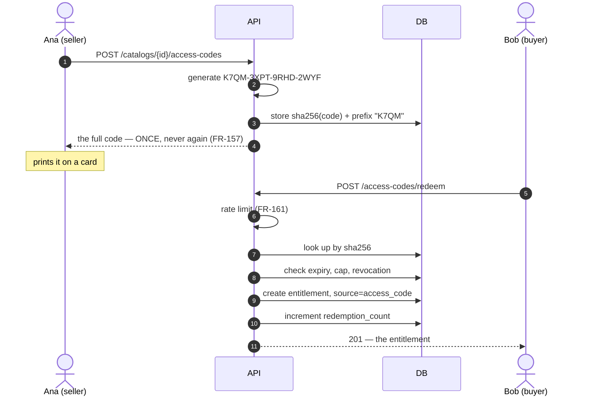
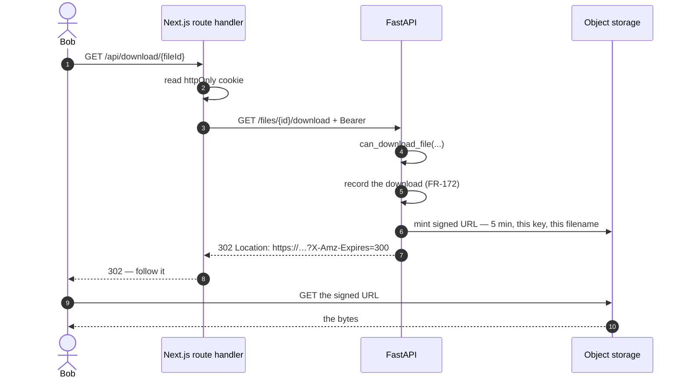

# Access & Entitlements

How a maker sells a design without a payment gateway, an admin, or a
marketplace taking a cut — and how the platform makes sure that a file
someone paid for reaches them, and only them.

This page is written for **catalog owners and the people implementing
the download gate**. The rule everything else follows:

> **The catalog owner is the authority over their own paid content.**

Not an admin. Not a maintainer. Not us.

---

## The three questions

Access in this product is not a role matrix. It is three questions,
asked in order, each answered in exactly one function in
`app/permissions.py`.



Three things about that diagram are deliberate and easy to get wrong.

**Visibility and access are different axes.** A `public` catalog can be
full of `paid` projects; a `private` catalog's projects are unreachable
whatever their access level (FR-025). Catalog visibility answers "may
you see this at all"; project access answers "may you have the bytes".

**The gate governs Piezario, not the universe.** It decides who
downloads *from us*. Whether the same bytes are obtainable elsewhere —
because they also sit in a public GitHub repository — is a separate
question, answered per file by the `protection` classification in
[`catalog-sources.md`](catalog-sources.md#what-the-gate-can-and-cannot-protect).
Paid projects are allowed either way (FR-210); the platform's obligation
is to tell the owner which of their files it can actually keep exclusive
(FR-215), not to refuse the sale.

**404 for invisible, 403 for withheld.** If the caller cannot see the
catalog, everything about it returns `404` — the detail page, its
projects, its files, its comments. A leaked private link must be worthless
(FR-170). `403` appears only in the one case where the caller genuinely
can read the project and genuinely cannot have its files, because that is
the case where the UI needs to offer a redeem form.

**A paid project is still a real page.** Cover, description, tags, badges,
components, comments — all of it renders for everyone (FR-148). Only the
file table is replaced, by an explicit panel naming what is withheld.
Hiding the project entirely would make it unsellable; pretending the files
do not exist would make the platform feel broken.

---

## What a maintainer cannot do

This is the section to read twice.

Maintainers and admins have a global override for **moderation**: they
can see an unpublished catalog, act on a report, take a catalog down,
adjust a quota, change a role. Every use of it is audited with actor,
target and reason (FR-017).

They **cannot**:

- grant or revoke an entitlement on someone else's catalog (FR-149)
- issue or revoke an access code on someone else's catalog (FR-155)
- download a paid file they hold no entitlement for (FR-163)
- read a maker's cost figures, inventory, or sales notes (FR-018)

```python
# app/permissions.py
def can_download_file(db, project, catalog, user) -> bool:
    """Note what is absent: has_global_override.

    A maintainer moderates metadata and reports, not geometry. A platform
    role that can read every paid file on the platform is precisely the
    thing a seller is trusting us not to build (FR-163).
    """
```

The temptation to add the override here is real — it makes moderation
easier, and every takedown request will make someone want it. Resist
it. Moderation needs the README, the images, the reports and the
metadata, all of which a maintainer already has. It does not need the
STL.

| Action | Guest | Buyer w/ entitlement | Editor | Owner | Maintainer | Admin |
|---|---|---|---|---|---|---|
| Read a public project's page | ✅ | ✅ | ✅ | ✅ | ✅ | ✅ |
| Download a free file | ✅ | ✅ | ✅ | ✅ | ✅ | ✅ |
| Download a paid file | ⛔ | ✅ | ✅ | ✅ | ⛔ | ⛔ |
| Read an unpublished catalog | ⛔ | ⛔ | ✅ | ✅ | ✅ | ✅ |
| Grant / revoke entitlements | ⛔ | ⛔ | ⛔ | ✅ | ⛔ | ⛔ |
| Issue / revoke access codes | ⛔ | ⛔ | ⛔ | ✅ | ⛔ | ⛔ |
| Mark a project paid | ⛔ | ⛔ | ⛔ | ✅ | ⛔ | ⛔ |
| See the sales ledger | ⛔ | ⛔ | ⛔ | ✅ | ⛔ | ⛔ |
| Take a catalog down | ⛔ | ⛔ | ⛔ | ✅ | ✅ | ✅ |
| Change a storage quota | ⛔ | ⛔ | ⛔ | ⛔ | ✅ | ✅ |

Note that an **editor** can download paid files (FR-162) but cannot
grant access to them. Editing a catalog requires working with its
contents; selling from it is the owner's business.

---

## Entitlements

An entitlement is a row saying *this user may download this thing*. It
has a scope, a source, an optional expiry, and a grantor.

**Scope** is either one project or a whole catalog. `project_id IS NULL`
means the catalog — everything in it, including projects added later.
That is the shape most bundle sales take: "everything in my Halloween
catalog for $15."

**Source** records how it came to exist — `manual`, `access_code` or
`transfer` — so a seller can always trace access back to the act that
granted it (FR-159).

**Entitlements are revoked, never deleted.** There is no `active`
column: there is `revoked_at`, which is a visible, timestamped act
(FR-151). Nothing in the system removes an entitlement row — not
deactivating the seller (FR-011), not hiding the catalog (FR-034), not
deleting the project.



### Granting, end to end



That last set of rules is the platform's core promise to a buyer. Money
changed hands outside the system, so the system cannot refund anyone.
The least it can do is never quietly take away what it granted:

- **The seller deactivates their account.** The buyer keeps access.
- **The seller makes the catalog private.** The buyer keeps access —
  `can_view_catalog` treats a live entitlement as read access precisely
  so the page stays reachable.
- **The seller deletes the project.** The row survives; the buyer is told
  the seller withdrew it, rather than getting a 404 with no explanation.
- **The entitlement expires.** Only if it was created with an expiry,
  and the buyer can see that date from the day it is granted (FR-152).

---

## Access codes

Granting to a username works when the seller knows who bought. At a
fair, over Instagram DMs, or on a printed card in a box, they do not.

An access code is a redeemable string carrying the same scope an
entitlement would.



The mechanics that matter:

- **Only the hash is stored** (FR-157). The code is shown at creation
  and never again; later reads return the four-character prefix so the
  issuer can tell their codes apart. Lost a code? Revoke it, issue
  another. There is no recovery, by design — a code is a bearer secret,
  and a database that can print bearer secrets back out is a database
  worth stealing.
- **The alphabet excludes `I`, `O`, `0` and `1`.** These get read off
  cards, out loud, over a phone.
- **Redemption is idempotent per user** (FR-158). Redeeming twice
  returns the same entitlement with `200`, not an error. Buyers double-
  click.
- **Redemption is rate-limited harder than login** (FR-161) — 5/minute
  per account, 20/hour per IP. A session token is unguessable; a
  16-character code from a 32-symbol alphabet is merely expensive, and
  the difference is worth respecting.
- **Revoking a code does not revoke what it produced** (FR-160). The
  card you lost stops working; the twelve people who already redeemed it
  keep what they bought.

Distinct failures get distinct codes, because "invalid" for four
different reasons is a support burden: `ACCESS_CODE_INVALID` (unknown),
`ACCESS_CODE_EXPIRED` (410), `ACCESS_CODE_EXHAUSTED` (409, cap
reached), `ACCESS_CODE_REVOKED` (410).

---

## Serving the bytes

An authorized download never streams through the application, and the
bucket is never public (NFR-007).



The signed URL is short-lived, bound to one object key and one download
filename, and is not a general-purpose credential (FR-169). The browser
never sees a bearer token, and the application never proxies gigabytes.

The route handler on the Next side exists because the JWT lives in an
httpOnly cookie the browser cannot attach itself — and because a
relative URL is the only kind `<a download>` respects.

**Rate limiting** (FR-174) is what stops someone with one entitlement
from methodically pulling an entire catalog. It is per account and per
IP, and it is a blunt instrument on purpose: anything cleverer would
punish a legitimate buyer downloading a twelve-file kit.

---

## The seller's view

A seller needs to answer three questions without leaving the app: who
has access, where did it come from, and is anyone abusing it.

- **Entitlement list** (FR-153) — every grant on this catalog,
  filterable by project and grantee, exportable. The private `note` field
  is theirs: "Paid via MercadoPago, order 4471" is the only bridge
  between the platform and the money, and it is never shown to the
  buyer.
- **Code manager** — issued codes by prefix, with redemption counts,
  expiry and revoke.
- **Ledger** (FR-165) — per project: live grants, how many came from
  codes, how many downloads each has produced.

What a seller does **not** get is a buyer's email, real name, or
anything beyond the username the buyer chose (FR-173). Downloads are
reported in aggregate.

---

## Deliberately out of scope for v1

**Payments.** No gateway, no checkout, no webhooks (FR-166). Money moves
over WhatsApp, MercadoPago, a bank transfer or cash at a fair, and the
seller records the outcome. This is what the seller already does; the
platform's job is to make the *delivery* work, which is the part that is
currently broken.

The data model leaves exactly one hole for this:
`entitlements.external_order_ref`. A future gateway integration writes
the provider's order id there when its webhook creates the entitlement
(IR-003), and it needs no migration to the entitlement table to do it.

**Refunds and disputes.** Not modelled. Revoking an entitlement is the
mechanism; whether money goes back is between the two people.

**Cross-catalog kits.** A kit referencing a project in another catalog
raises an access question that has no good answer yet — a kit must not
become a way to price, or reveal, a project the viewer is not entitled to.
Deferred (FR-101).

---

## Failure modes

| Situation | What the platform does |
|---|---|
| Guest opens a paid project | Full page, file table replaced by an access panel |
| Guest requests a paid file | `403 ENTITLEMENT_REQUIRED`, with a link to redeem |
| Anyone requests a file in a catalog they cannot see | `404`, identical to a file that never existed |
| Buyer's entitlement expired | `403`, with the expiry date named |
| Seller deactivates their account | Buyers keep access (FR-011) |
| Seller makes the catalog private | Buyers keep access and can still reach the page |
| Seller deletes a sold project | Row retained; buyer told it was withdrawn |
| Code redeemed twice by the same user | `200` with the existing entitlement |
| Code redeemed past its cap | `409 ACCESS_CODE_EXHAUSTED` |
| Code revoked after 12 redemptions | Those 12 keep access; the code stops working |
| Someone brute-forcing codes | `429` after 5/minute, 20/hour per IP |
| Maintainer tries to download a paid file | `403` — same as anyone else |

## Related requirements

Access levels and entitlements: §3.11 (FR-147 – FR-166). Downloads and
delivery: §3.12 (FR-167 – FR-176). Roles and the override boundary:
§3.2 (FR-013 – FR-018). The tables are in
[`database-schema.md`](database-schema.md#entitlements); the endpoints
are in
[`api-specification.md`](api-specification.md#7-entitlements-access-codes).
