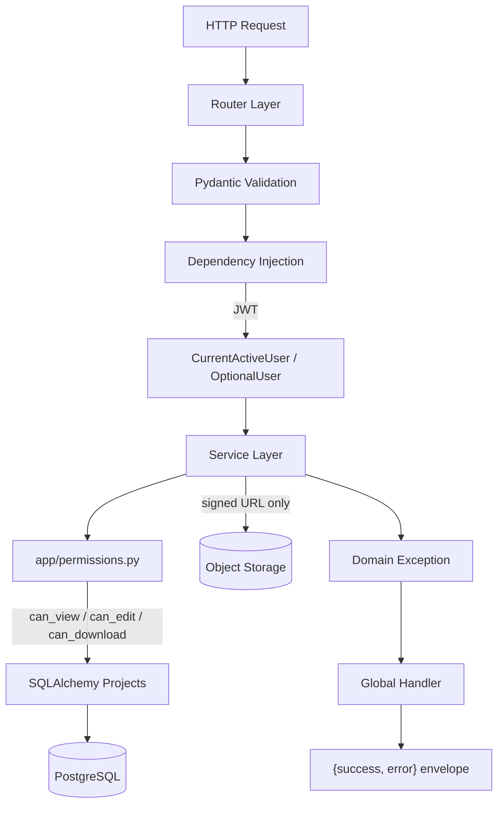
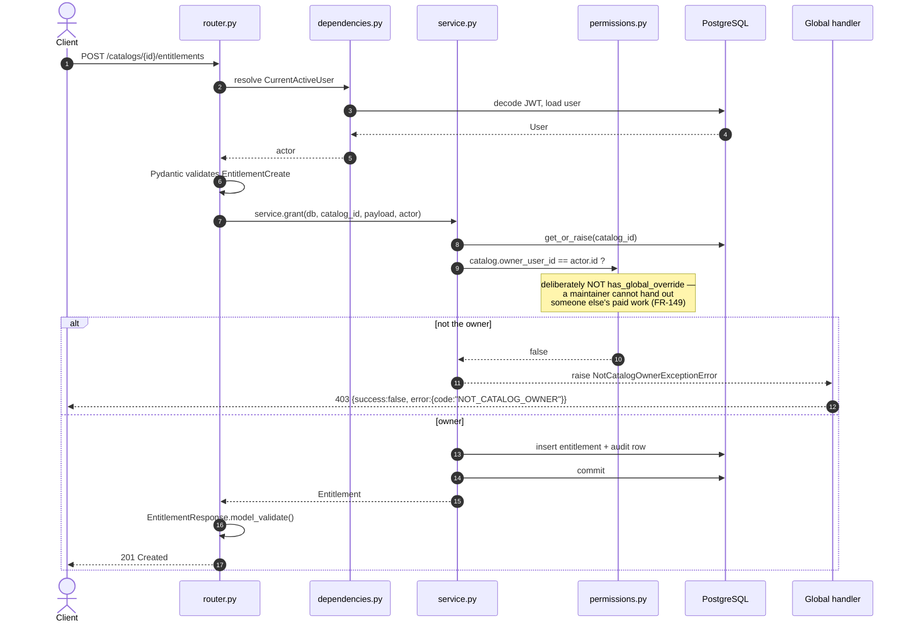
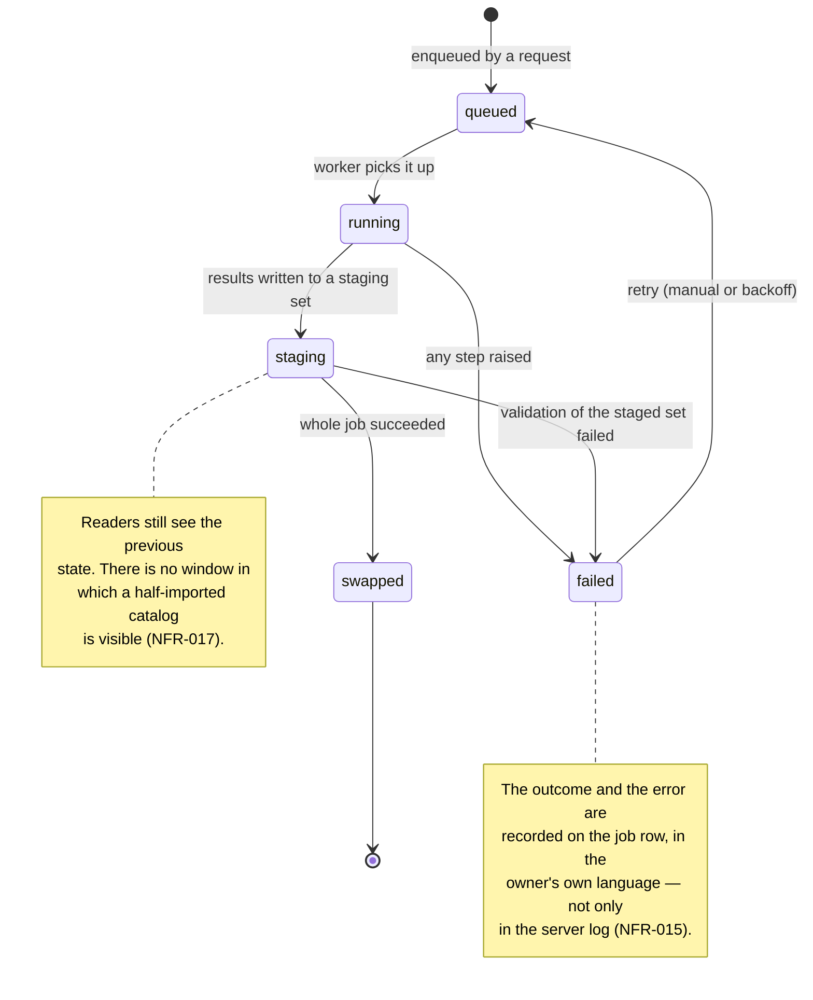

# Backend Architecture

The backend is a FastAPI application over PostgreSQL, organized into
domain modules — `auth`, `users`, `catalogs`, `sources`, `projects`,
`files`, `uploads`, `imports`, `inventory`, `costing`, `entitlements`,
`downloads`, `contributions`, `activity`, `audit_log`, `scheduled` —
each with the same internal shape. The schema modelled in
[`database-schema.md`](database-schema.md) is implemented one domain at
a time, behind the REST surface defined in
[`api-specification.md`](api-specification.md).

## Architecture Overview

- **Domain-Driven Layout** — each business domain is a folder holding
  the same canonical files (router · schemas · projects · service ·
  exceptions · constants, plus `dependencies.py` where a domain needs
  its own injectables). Adding a domain is mechanical.
- **Thin routers, fat services** — a route function resolves
  dependencies, calls one service function, and serializes the result.
  Business rules live in `service.py` and are unit-testable without HTTP.
- **Domain exceptions, never `HTTPException` in services** — services
  raise subclasses of `AppExceptionError`; a global handler renders them
  into the standard `{success, error}` envelope.
- **Soft deletes only** — the shared `BaseModel` supplies `id`,
  `created_at`, `updated_at` and `active`. Nothing user-created is ever
  passed to `db.delete()`. Entitlements and download records must
  outlive the things they point at (NFR-018).
- **The database is the catalog** — object storage holds bytes and is
  never scanned to answer a question. Every field a page renders comes
  from a row (NFR-019, NFR-004).
- **Authorization is one function per resource kind** — `can_view_catalog`,
  `can_edit_catalog`, `can_download_file`. Every read and write path
  goes through them; nothing re-derives the rule inline (NFR-006).

## Project Structure

```text
backend/
├── pyproject.toml              # deps + ruff + pytest + coverage + pyright
├── Dockerfile
├── alembic.ini
├── alembic/
│   ├── env.py                  # imports every projects module for autogenerate
│   └── versions/               # 0001_… linear chain, human-readable revision ids
├── app/
│   ├── main.py                 # app factory, lifespan, router mounting
│   ├── config.py               # Settings(BaseSettings) + module-level `settings`
│   ├── database.py             # engine, SessionLocal, get_db
│   ├── models.py               # Base + BaseModel (uuid pk, timestamps, active)
│   ├── exceptions.py           # AppExceptionError + global handlers
│   ├── dependencies.py         # CurrentUser / CurrentActiveUser / OptionalUser / …
│   ├── permissions.py          # can_view_catalog, can_edit_catalog, can_download_file
│   ├── storage.py              # Storage Protocol + LocalDisk + S3 implementations
│   ├── ratelimit.py            # slowapi limiter + per-endpoint limit strings
│   ├── bootstrap.py            # default admin, dev seed — run in lifespan
│   ├── auth/                   # JWT issuance, login, password reset
│   ├── users/                  # profile, role management, storage quota
│   ├── catalogs/               # catalog CRUD, visibility, editors, transfers
│   ├── sources/                # GitHub link + sync orchestration
│   ├── imports/                # the walker, frontmatter parser, derivation rules
│   │   ├── walker.py           # THE core invariant — one implementation
│   │   ├── frontmatter.py      # 24 fields + legacy aliases + unknown-key capture
│   │   ├── derive.py           # title / description / cover / kinds / capabilities
│   │   └── threemf.py          # slice-summary extraction
│   ├── projects/          # Project, ModelFile, components, path history
│   ├── uploads/                # multipart + zip ingest, quota enforcement
│   ├── inventory/              # filaments, supplies, purchases (per user)
│   ├── costing/                # the pricing engine — pure functions, no I/O
│   ├── entitlements/           # entitlements + access codes
│   ├── downloads/              # signed URLs, the download gate, records
│   ├── contributions/          # submit / review / accept
│   ├── activity/               # timeline + comments (polymorphic)
│   ├── reactions/              # likes, polymorphic
│   ├── notifications/          # feed, prefs, email outbox, unsubscribe
│   ├── audit_log/              # append-only; no router
│   └── scheduled/              # sync jobs, thumbnail jobs, transfer expiry
└── tests/                      # mirrors app/, one package per domain
```

## Domain Module Layout

Every domain has the same files. Copy a folder, swap the names, write
the requirements.

### `router.py`

Declares an `APIRouter(prefix=..., tags=[...])`. Each route resolves
dependencies, calls one service function, and converts the ORM object
to a schema. The `/api/v1` prefix is added centrally in `main.py`.

```python
# app/entitlements/router.py
router = APIRouter(prefix="/catalogs", tags=["entitlements"])


@router.post(
    "/{catalog_id}/entitlements",
    response_model=schemas.EntitlementResponse,
    status_code=201,
)
async def grant_entitlement(
    catalog_id: UUID,
    payload: schemas.EntitlementCreate,
    db: Annotated[Session, Depends(get_db)],
    actor: CurrentActiveUser,
) -> schemas.EntitlementResponse:
    """FR-149. Grant access to a project or a whole catalog.

    Requires ownership of the catalog and nothing else — no platform
    role is involved.
    """
    entitlement = service.grant(db, catalog_id, payload, actor)
    return schemas.EntitlementResponse.model_validate(entitlement)
```

### `schemas.py`

Pydantic v2. `XResponse` carries
`model_config = ConfigDict(from_attributes=True)`; `XCreate` / `XUpdate`
do not. Update schemas make every field optional and the service applies
`model_dump(exclude_unset=True)`, so "not sent" never means "set to
null".

```python
# app/entitlements/schemas.py
class EntitlementCreate(BaseModel):
    """Grant access to one user. `project_id` null means the whole catalog."""

    grantee_username: str = Field(min_length=1, max_length=64)
    project_id: UUID | None = None
    expires_at: datetime | None = None
    note: str | None = Field(default=None, max_length=500)


class EntitlementResponse(BaseModel):
    model_config = ConfigDict(from_attributes=True)

    id: UUID
    catalog_id: UUID
    project_id: UUID | None
    grantee_user_id: UUID
    source: EntitlementSource
    expires_at: datetime | None
    revoked_at: datetime | None
    created_at: datetime
    # `note` is deliberately absent: it is seller-private and is served
    # only on the owner's own listing schema (FR-150).
```

### `models.py`

SQLAlchemy 2.0 declarative, `Mapped[...]` / `mapped_column(...)`,
inheriting `app.projects.BaseModel`. Table names are plural snake_case.
`__table_args__` carries `CheckConstraint` and `Index`, each with a
comment naming the requirement it enforces.

```python
# app/projects/models.py
class Project(BaseModel):
    """One printable thing: the unit with a page, a cover and a price.

    Identity is the surrogate `id`, never the path. The desktop app used
    the folder path as identity, which meant renaming a folder silently
    broke every kit referencing it (FR-062). Here `path` is a mutable
    unique field and superseded values live in `project_path_history`.
    """

    __tablename__ = "projects"
    __table_args__ = (
        CheckConstraint("yield_units >= 1", name="model_yield_positive"),
        Index(
            "model_catalog_path_active",
            "catalog_id",
            "path",
            unique=True,
            postgresql_where=text("active"),
        ),
    )

    catalog_id: Mapped[uuid.UUID] = mapped_column(
        UUID(as_uuid=True), ForeignKey("catalogs.id"), nullable=False, index=True
    )
    path: Mapped[str] = mapped_column(String(500), nullable=False)
    access_level: Mapped[AccessLevel] = mapped_column(
        Enum(
            AccessLevel,
            name="access_level",
            values_callable=lambda e: [m.value for m in e],
        ),
        nullable=False,
        default=AccessLevel.FREE,
        index=True,
    )
    # Unrecognized frontmatter, preserved verbatim so a generator's own
    # config survives a round trip (FR-074).
    extra_frontmatter: Mapped[dict] = mapped_column(
        JSONB, nullable=False, default=dict
    )
```

### `service.py`

All business logic. Takes `db: Session` first, returns ORM objects,
never touches HTTP. The universal lookup helper is
`get_or_raise(db, id)`.

```python
# app/entitlements/service.py
def grant(
    db: Session,
    catalog_id: UUID,
    payload: schemas.EntitlementCreate,
    actor: User,
) -> models.Entitlement:
    """FR-149/FR-150. Grant an entitlement. Catalog owner only."""
    catalog = catalogs_service.get_or_raise(db, catalog_id)
    # Deliberately NOT has_global_override: a maintainer must not be able
    # to hand out someone else's paid work (FR-149, FR-163).
    if catalog.owner_user_id != actor.id:
        raise NotCatalogOwnerExceptionError(catalog_id)

    grantee = users_service.get_by_username_or_raise(db, payload.grantee_username)
    if payload.project_id is not None:
        project = models_service.get_or_raise(db, payload.project_id)
        if project.catalog_id != catalog_id:
            raise ModelNotInCatalogExceptionError(payload.project_id, catalog_id)

    existing = _find_active(db, grantee.id, catalog_id, payload.project_id)
    if existing is not None:
        raise EntitlementExistsExceptionError(existing.id)

    entitlement = models.Entitlement(
        grantee_user_id=grantee.id,
        catalog_id=catalog_id,
        project_id=payload.project_id,
        granted_by_user_id=actor.id,
        source=EntitlementSource.MANUAL,
        expires_at=payload.expires_at,
        note=payload.note,
    )
    db.add(entitlement)
    audit_log.record(db, actor, "ENTITLEMENT_GRANTED", "entitlement", entitlement.id)
    db.commit()
    db.refresh(entitlement)
    return entitlement
```

### `exceptions.py`

One class per error. `__init__` takes only the dynamic parts and
hard-codes the code, message, status and details.

```python
# app/entitlements/exceptions.py
class NotCatalogOwnerExceptionError(AppExceptionError):
    """Raised when a non-owner tries to grant or revoke access (FR-149)."""

    def __init__(self, catalog_id: UUID) -> None:
        super().__init__(
            error_code=ErrorCode.NOT_CATALOG_OWNER,
            message="Only the catalog's owner can manage access to it.",
            status_code=403,
            details={"catalog_id": str(catalog_id)},
        )
```

### `constants.py`

`StrEnum`s for domain states, a per-domain `ErrorCode(StrEnum)`, and
tunables as module constants.

```python
# app/entitlements/constants.py
ACCESS_CODE_LENGTH = 16
ACCESS_CODE_ALPHABET = "ABCDEFGHJKLMNPQRSTUVWXYZ23456789"  # no I/O/0/1


class EntitlementSource(StrEnum):
    MANUAL = "manual"
    ACCESS_CODE = "access_code"
    TRANSFER = "transfer"


class ErrorCode(StrEnum):
    NOT_CATALOG_OWNER = "NOT_CATALOG_OWNER"
    ENTITLEMENT_EXISTS = "ENTITLEMENT_EXISTS"
    ENTITLEMENT_NOT_FOUND = "ENTITLEMENT_NOT_FOUND"
    PROJECT_NOT_IN_CATALOG = "PROJECT_NOT_IN_CATALOG"
    ACCESS_CODE_INVALID = "ACCESS_CODE_INVALID"
    ACCESS_CODE_EXPIRED = "ACCESS_CODE_EXPIRED"
    ACCESS_CODE_EXHAUSTED = "ACCESS_CODE_EXHAUSTED"
    ACCESS_CODE_REVOKED = "ACCESS_CODE_REVOKED"
```

## Global Components

### `app/models.py`

```python
class BaseModel(Base):
    """Abstract base supplying id, timestamps, and the soft-delete flag."""

    __abstract__ = True

    id: Mapped[uuid.UUID] = mapped_column(
        UUID(as_uuid=True), primary_key=True, default=uuid.uuid4
    )
    created_at: Mapped[datetime] = mapped_column(
        DateTime(timezone=True), nullable=False, default=lambda: datetime.now(UTC)
    )
    updated_at: Mapped[datetime] = mapped_column(
        DateTime(timezone=True),
        nullable=False,
        default=lambda: datetime.now(UTC),
        onupdate=lambda: datetime.now(UTC),
    )
    active: Mapped[bool] = mapped_column(Boolean, nullable=False, default=True)
```

`AuditLog` deliberately does not inherit it: audit rows are immutable
and have no `active` or `updated_at`.

### `app/dependencies.py`

```python
CurrentUser = Annotated[User, Depends(get_current_user)]
CurrentActiveUser = Annotated[User, Depends(get_current_active_user)]
OptionalUser = Annotated[User | None, Depends(get_optional_current_user)]
AdminUser = Annotated[User, Depends(require_admin)]
MaintainerUser = Annotated[User, Depends(require_maintainer)]
```

`OAuth2PasswordBearer(..., auto_error=False)` so a missing token raises
the domain exception and flows through the standard envelope.
`OptionalUser` is what makes public reads able to reveal more to a
signed-in viewer without duplicating the endpoint.

### `app/permissions.py` — the three gates

Authorization in this product is not a role matrix, it is three
questions. Every one of them is answered in exactly one place.

```python
# ----------------------------------------------------------------------
# Gate 1 — can this caller see the catalog at all? (FR-024, FR-197)
# ----------------------------------------------------------------------
def can_view_catalog(db: Session, catalog: Catalog, user: User | None) -> bool:
    """Public and unlisted catalogs are readable by anyone with the link."""
    if not catalog.active:
        return user is not None and has_global_override(user)
    if catalog.visibility in (Visibility.PUBLIC, Visibility.UNLISTED):
        return True
    if user is None:
        return False
    return (
        catalog.owner_user_id == user.id
        or is_catalog_editor(db, catalog.id, user.id)
        or has_global_override(user)
        or has_any_entitlement(db, user.id, catalog.id)
    )


# ----------------------------------------------------------------------
# Gate 2 — can this caller change it? (FR-027)
# ----------------------------------------------------------------------
def can_edit_catalog(db: Session, catalog: Catalog, user: User) -> bool:
    return (
        catalog.owner_user_id == user.id
        or is_catalog_editor(db, catalog.id, user.id)
        or has_global_override(user)
    )


# ----------------------------------------------------------------------
# Gate 3 — can this caller have the bytes? (FR-167, FR-162, FR-163)
# ----------------------------------------------------------------------
def can_download_file(
    db: Session, project: Project, catalog: Catalog, user: User | None
) -> bool:
    """The one place the paid/free rule lives.

    Note what is absent: `has_global_override`. A maintainer moderates
    metadata and reports, not geometry — a platform role that can read
    every paid file is precisely what a seller is trusting us not to
    build (FR-163).
    """
    if not can_view_catalog(db, catalog, user):
        return False
    if project.is_draft and not (user and can_edit_catalog(db, catalog, user)):
        return False
    if project.access_level is AccessLevel.FREE:
        return True
    if user is None:
        return False
    if catalog.owner_user_id == user.id or is_catalog_editor(db, catalog.id, user.id):
        return True
    return has_entitlement(db, user.id, catalog.id, project.id)
```

Note that `can_view_catalog` treats an entitlement as read access: a
buyer given a project in a private catalog must be able to reach its page.

## Data Flow



Object storage sits deliberately off to the side and downstream of the
permission gate. No request path reaches it before authorization.

### One authenticated request, end to end



The shape is the same for every endpoint in the codebase: the router
never decides anything, the service never raises `HTTPException`, and
the envelope is produced in exactly one place.

## Error Handling

```python
class AppExceptionError(Exception):
    """Base class for all domain exceptions."""

    def __init__(
        self,
        error_code: str,
        message: str,
        status_code: int = 400,
        details: dict[str, object] | None = None,
    ) -> None:
        self.error_code = error_code
        self.message = message
        self.status_code = status_code
        self.details = details or {}
        super().__init__(message)
```

Errors are enveloped; successes are not.

```python
def _envelope(code, message, details=None) -> dict[str, object]:
    return {
        "success": False,
        "error": {"code": code, "message": message, "details": details or {}},
    }
```

Five handlers are registered in `create_app()`: `AppExceptionError`,
`StarletteHTTPException` (`HTTP_ERROR`), `RequestValidationError`
(`VALIDATION_ERROR`, 422), `RateLimitExceeded` (`RATE_LIMITED`, 429) and
a catch-all `Exception` (`INTERNAL_SERVER_ERROR`, 500, logged with
`logger.exception`).

Status mapping is consistent: 400 bad input, 401 auth, 403 permission,
404 missing **or deliberately invisible**, 409 state conflict, 413 too
large, 422 semantic validation, 507 over quota.

## Storage

Bytes never live in PostgreSQL. `app/storage.py` defines one Protocol
with two implementations, so the S3 switch is a config change.

```python
class Storage(Protocol):
    """Pluggable blob store."""

    def save(self, data: BinaryIO, *, key: str, content_type: str) -> str: ...
    def signed_url(self, key: str, *, expires_in: int, filename: str) -> str: ...
    def delete(self, key: str) -> None: ...
```

Keys are content-addressed so identical files are stored once and
referenced many times (FR-084):

```text
catalogs/{catalog_id}/blobs/{sha256[:2]}/{sha256}
catalogs/{catalog_id}/derived/{project_id}/thumb.png
```

The bucket is never public (NFR-007). A download is always: authorize
(§`can_download_file`) → mint a short-lived signed URL bound to that one
key and filename → redirect. See
[`access-control.md`](access-control.md) for the full sequence.

## Background Jobs

Every expensive operation is a job, never a request (NFR-003).

| Job | Trigger | What it does |
|---|---|---|
| `sync_catalog_source` | manual + schedule | Clone at ref, walk, diff, upsert (FR-040 – FR-045) |
| `ingest_upload` | after an upload commits | Expand zip, walk, parse, upsert (FR-053) |
| `extract_slice_summary` | new `.3mf` | Parse the archive's slice config into rows (FR-087) |
| `generate_thumbnail` | project with no image | Offscreen mesh render (FR-090) |
| `expire_transfers` | daily | Expire pending catalog transfers past 7 days (FR-029) |
| `recompute_quota` | nightly, and on demand | Reconcile `storage_used_bytes` against stored objects |

Jobs are idempotent and record their outcome. A failed job leaves the
prior state intact (NFR-017): the sync writes into a staging set and
swaps only on success.



## Testing

Tests mirror `app/` one package per domain, with a single
`tests/conftest.py`. The test database is derived from `DATABASE_URL` by
appending `_test`, auto-created if missing, and the suite refuses to run
if the two URLs are equal — the fixtures drop every table.

Fixtures: `db`, `client` (TestClient with `get_db` overridden),
`make_user`, `admin_user`, `normal_user`, `auth_headers`, plus
`make_catalog` and `make_model` factories. Rate limiting is disabled at
module level.

The permission gates get their own dedicated suite. Every read endpoint
that can surface a catalog is tested against all four viewer classes —
guest, unrelated user, entitled user, owner — because a gate that is
right in five places and wrong in the sixth is the failure mode that
matters here.

## Configuration

`app/config.py` is a `Settings(BaseSettings)` with a module-level
`settings`. Key values: `DATABASE_URL`, `SECRET_KEY`, `ALGORITHM`,
`ACCESS_TOKEN_EXPIRE_MINUTES`, `STORAGE_BACKEND`, `S3_*`,
`MEDIA_ROOT`, `DEFAULT_STORAGE_QUOTA_BYTES`, `MAX_UPLOAD_FILE_BYTES`,
`MAX_ARCHIVE_BYTES`, `DOWNLOAD_URL_TTL_SECONDS`, `GIT_CLONE_MAX_BYTES`,
`GIT_CLONE_TIMEOUT_SECONDS`, `DEFAULT_ADMIN_USERNAME`,
`DEFAULT_ADMIN_PASSWORD`, `RATE_LIMIT_ENABLED`.

GitHub App credentials are configuration, never database rows
(NFR-021): `GITHUB_APP_ID`, `GITHUB_APP_SLUG`,
`GITHUB_APP_PRIVATE_KEY`, `GITHUB_WEBHOOK_SECRET`. The private key is
loaded once at startup and used only to sign the short-lived JWT that
mints an installation token; no token is ever persisted (FR-205).

Insecure placeholder defaults are defined explicitly and `bootstrap.py`
refuses to start with them outside debug mode (NFR-013).

---

This architecture covers every functional requirement in
[`requirements.md`](../requirements.md) and every invariant in
[`database-schema.md`](database-schema.md), while keeping each domain
small enough that a feature usually fits in one folder. The two places
that resist that — the importer and the pricing engine — get their own
documents: [`catalog-sources.md`](catalog-sources.md) and
[`cost-model.md`](cost-model.md).
