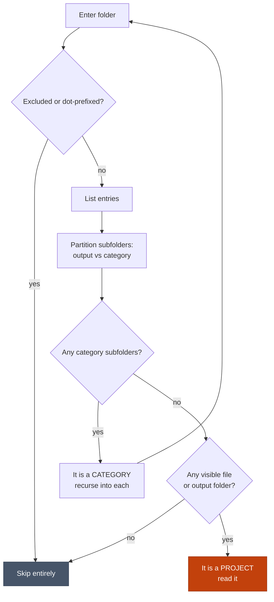
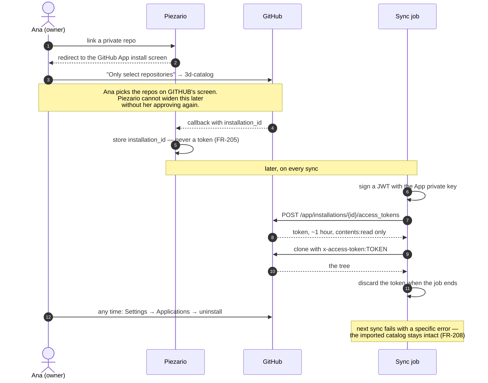
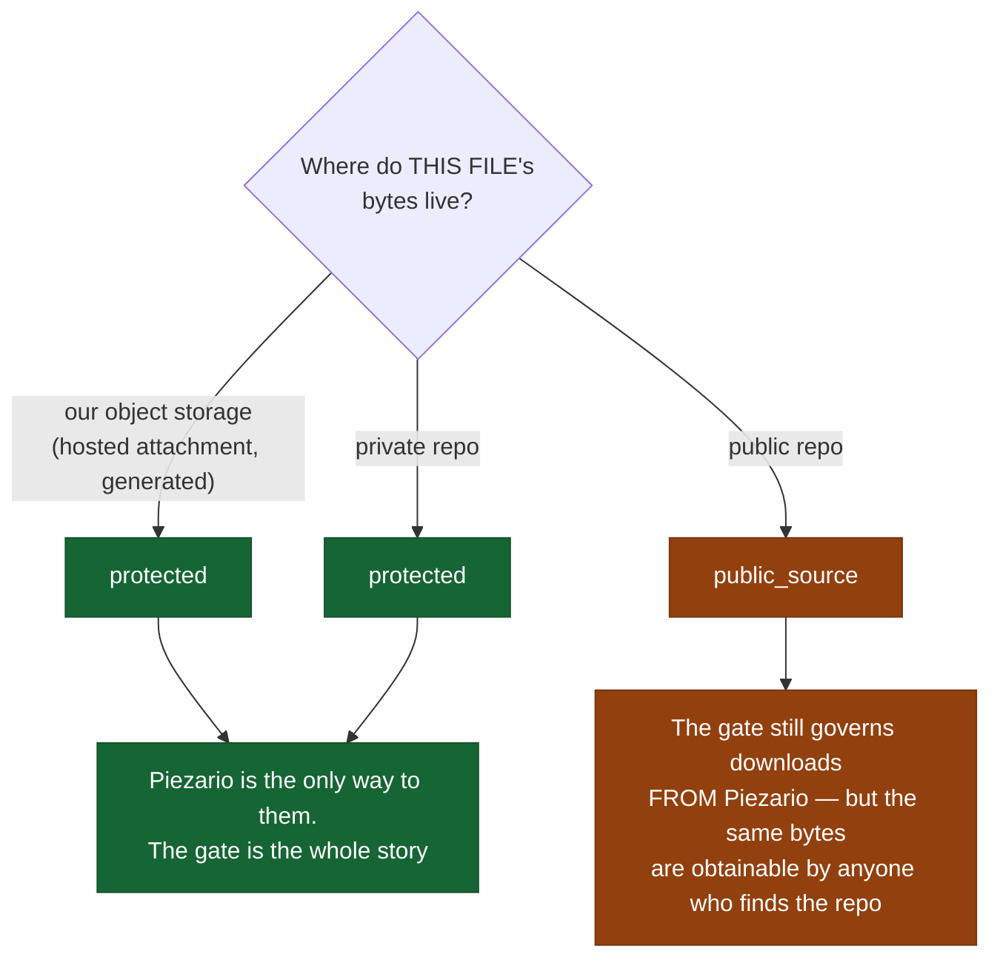
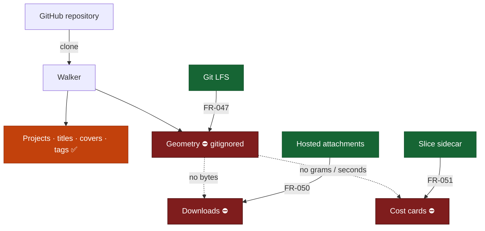
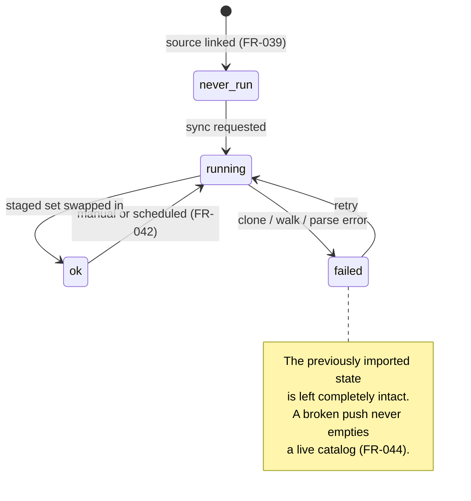
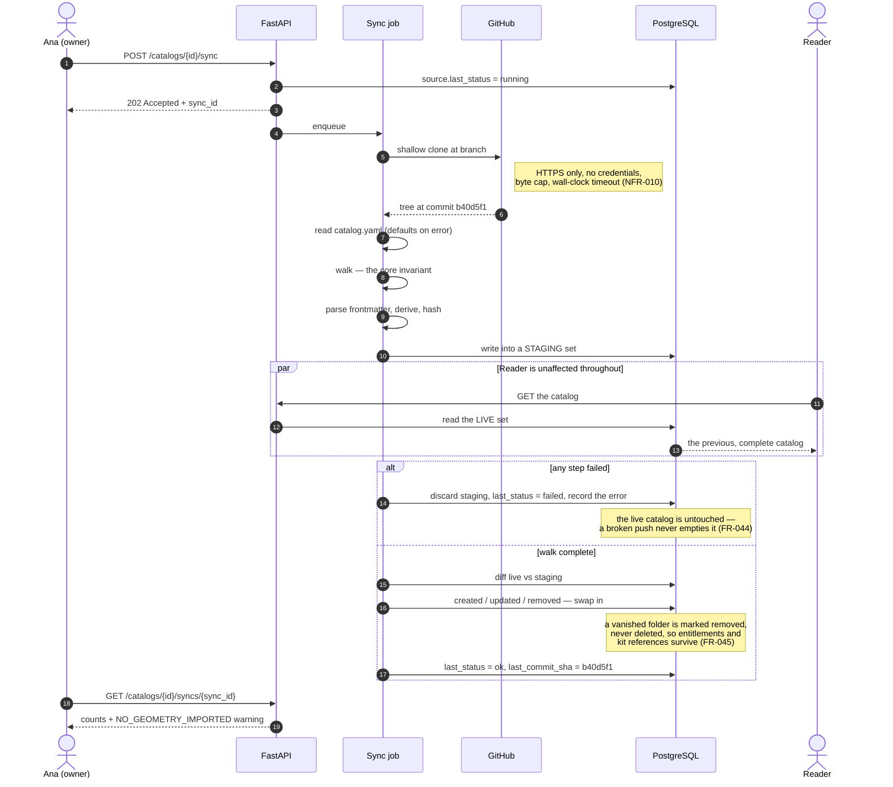
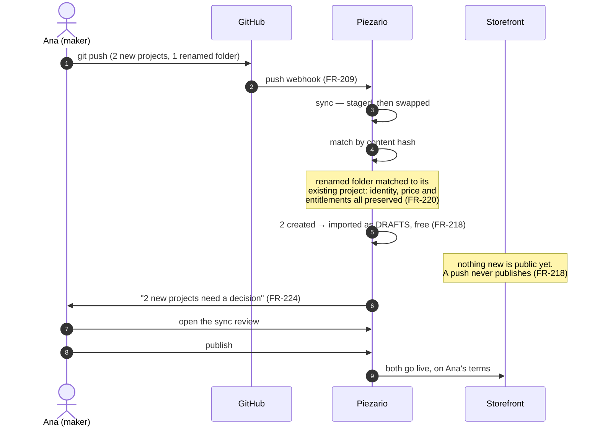
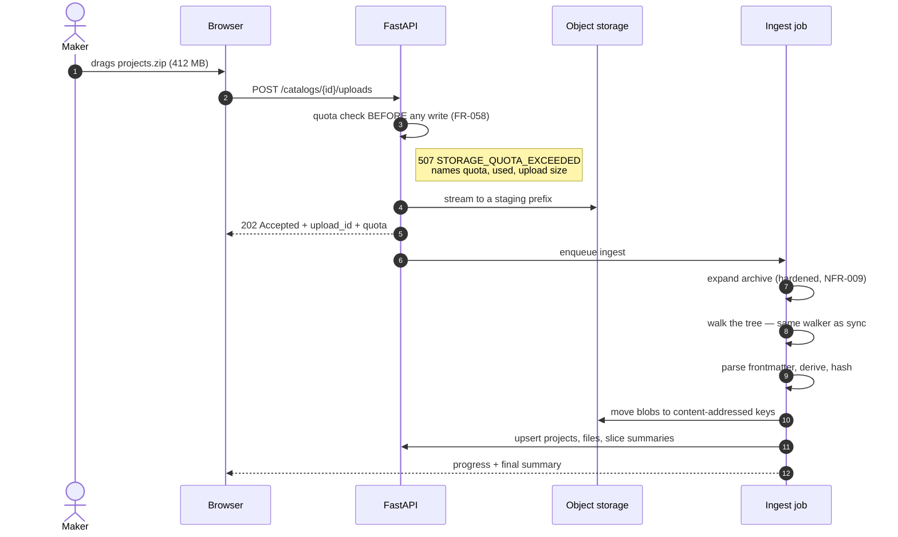

# Catalog Sources & Import

How a folder of STLs becomes a browsable catalog — whether it arrives
from a GitHub repository or from someone dragging a zip into a browser
— and why the two paths must never produce different results.

This page is written for **catalog owners and the people implementing
the importer**. It explains the mental model, the mechanics, and the one
awkward truth about 3D-model repositories that shapes most of the
design.

---

## The two source types

A catalog declares exactly one source type when it is created, and it
cannot change afterwards without being re-imported (FR-023).

| | `github` | `hosted` |
|---|---|---|
| Where the bytes live | The maker's repository | Our object storage |
| Access | Public: anonymous clone. Private: a GitHub App installation | Ours already |
| Can hold paid projects | Yes. Files in a **public** repo are sold without exclusivity, and the owner is told so (FR-214, FR-215) | Yes |
| Who edits content | The maker, via git | The maker, in the browser |
| Counts against quota | Only derived artifacts (FR-049) | Everything (FR-056) |
| Effective size limit | Whatever GitHub allows | 1 GB by default (FR-057) |
| Metadata edits in the UI | Rejected — `CATALOG_IS_READ_ONLY` | Allowed |
| Typical user | Already uses git | Refuses to learn git |

The incentive is deliberate and should stay visible in the UI: hosting
your own repository costs you nothing and has no ceiling. That is the
whole reason the GitHub path exists.

**What must be identical:** the projects, the categories, the derived
titles and covers, the capability badges, the cost cards, the access
rules, the download gate. A reader must not be able to tell which kind
of catalog they are looking at. If a feature works for one and not the
other, that is a bug (see the roadmap's Guiding Constraints).

---

## The core invariant

Both paths run the same walker over the same tree. It implements one
rule, inherited unchanged from the desktop app:

> **A folder with no non-output subfolders is a project. Its ancestor
> folders are its categories.**

with three qualifications that are all load-bearing:

- A folder is only a project if it holds **at least one visible file or
  one output folder**. An empty folder is nothing.
- Folders matching `output_dirs` belong to their **parent** and do not
  make it a category.
- Folders matching `exclude`, and any folder whose name starts with
  `.`, are neither projects nor categories, and their contents are never
  listed.



The `output_dirs` rule looks fussy and is not. In the reference catalog,
a generator script that drops meshes into `out/` would otherwise demote
the folder holding the script and the README into a mere category — and
its README, its cost card and its whole page would vanish, replaced by a
project called "Out". Every entry in that list was added after exactly
that happened.

### Pattern matching

Shared by `exclude` and `output_dirs`, case-insensitively:

- a plain name (`venv`) matches a folder of that name **at any depth**
- a `*` glob (`*.bak`) matches within **one path segment** — `*` never
  crosses a `/`
- a path (`pets/scratch`) matches that **one folder**, relative to the
  tree root

### One implementation, forever

In the desktop app this rule lived in two places — `walk()` in
TypeScript and `is_model_dir()` in the thumbnail script — which had to
be kept in sync by hand. Here it lives once, in
`app/imports/walker.py`, and the thumbnail job calls it. Any second
implementation is a defect, including a "quick" one in the frontend.

---

## What the importer reads

### `catalog.yaml`

Read from the tree root, and applied over the catalog's stored settings
(FR-048). Only these keys are read:

| Key | Effect |
|---|---|
| `models_dir` / `fonts_dir` / `icons_dir` | Where each tree starts, relative to the file |
| `supply_images_dir` | Where supply photos live |
| `exclude` | Noise folders |
| `output_dirs` | Folders belonging to the parent project |

A malformed `catalog.yaml` **falls back to defaults rather than failing
the sync**. Taking a catalog down because someone fat-fingered a colon
is the wrong trade.

### Frontmatter

Twenty-four fields, plus legacy spellings, plus everything else. The
full list is FR-067; the rules that are easy to get wrong:

- `tags` are lower-cased, de-duplicated and **sorted**. `materials` and
  `printers` keep their case and order but de-duplicate
  case-insensitively (FR-068).
- `material`, `printer` and `profile` are accepted as singular aliases;
  `packaging_cost` is an alias for `shipping_cost` (FR-069).
- `failure_risk` accepts only `low`/`medium`/`high`; anything else is
  treated as unset, not as an error (FR-070).
- `yield` defaults to 1 and must be ≥ 1 (FR-072).
- An unquoted `date: 2026-07-08` parses as a **date object**, not a
  string, in every YAML library. Normalize it to `YYYY-MM-DD` on the way
  in — this bit the desktop app twice.
- **Every unrecognized key is preserved verbatim** into
  `extra_frontmatter` (FR-074). One real project carries a whole nested
  `revisions:` table that only its own Python script reads. Dropping it
  on import and writing it back out empty would destroy the maker's
  work.

### Derivation

Nothing below is ever declared; it is computed on import and stored.

| Derived | From |
|---|---|
| Categories | Ancestor folder names |
| Title | `title:` → folder name, `-`/`_` → spaces, first letter capitalized only |
| Description | `description:` → first README paragraph that is not a heading or an image, markdown stripped, 240 chars |
| Cover | `cover:` filename → first `cover.*` / `*preview*` / `*_render*` → first image → none |
| File kind | Last extension, per the FR-081 table |
| Capabilities | `printable` from print/mesh, `parametric` from script, `editable` from cad, `electronics`/`firmware` from those kinds, `assembly` from having non-printed parts, `kit` from having components |

---

## Repository access: how we get to read it

A public repository needs nothing — an anonymous `git clone` over
HTTPS, no credential, no setup (FR-213). Linking a showcase must stay
frictionless.

A **private** repository is the interesting case. It is one of the two
ways a file becomes exclusively ours to serve — see "What the gate can
and cannot protect" below.

### The mechanism: a GitHub App

The owner installs Piezario's **GitHub App** on the repositories they
choose, from GitHub's own installation screen. We store the resulting
installation id and nothing else.



Why this is the right mechanism, concretely:

- **The owner chooses the scope, on GitHub's UI, not ours.** That is
  exactly the "let the maker decide who sees their data" property, and
  we cannot widen it later without them approving again.
- **We store no credential.** The database holds an installation id; the
  App's private key lives in the secret manager. A full PostgreSQL dump
  gives an attacker access to nobody's repository.
- **Permissions are declared and enforced by GitHub** — contents:read,
  metadata:read (FR-206). Even a leaked one-hour token cannot push, open
  issues, or reach a repository outside the installation.
- **Revocation is theirs**, self-service, effective immediately.
- **It survives people leaving** — an org installation is not tied to
  the employee who set it up.
- **Push webhooks come free**, which fixes the most common complaint:
  "I pushed and nothing changed" (FR-209).

### What we rejected, and why

Three of these are what people reach for first, so the reasoning
matters more than the verdict.

| Option | Verdict |
|---|---|
| **GitHub App** (chosen) | Per-repo scope chosen by the owner, no stored credential, short-lived least-privilege tokens, self-service revocation, webhooks. What Vercel, Netlify, Render, Dependabot and Codecov all use. |
| **Fine-grained PAT**, pasted by the owner | Workable, and genuinely better than a classic PAT — per-repo and expiring. But *we* end up storing a bearer credential, inheriting its encryption and rotation, and sync dies silently on expiry. All of the cost, none of the benefit. |
| **Classic PAT** | Rejected. Scope is all-or-nothing across every repository the user can reach, including their employer's. It asks a maker to hand us keys to work we have nothing to do with. |
| **OAuth App with the `repo` scope** | Rejected firmly. `repo` grants read **and write** to every private repository the user can access. For a read-only mirror that is indefensible. |
| **A shared machine account added as a collaborator** | Rejected. One account whose compromise exposes every customer's repository; collaborator access is normally write-capable; it consumes a paid seat on org plans; and GitHub's terms discourage machine accounts. |
| **Per-repo deploy key** | Good properties — per-repo, read-only, no expiry — and the right answer for GitLab or a self-hosted host later. Rejected for v1 GitHub: manual setup per repository, requires admin on the repo, and no webhooks. |

The industry pattern is consistent. Anything that clones many customers'
repositories uses a GitHub App; personal tokens are what single-user
scripts use; a bot collaborator account is what teams regret.

### What the gate can and cannot protect

Selling from a public-repo catalog is **allowed** (FR-210). The question
is never "is the repo public" — it is **"where do the bytes a buyer is
paying for actually live?"** That is a per-file question, and the
platform answers it per file (FR-214).



Note what the right-hand branch does **not** say. A `public_source` file
is not unprotected on Piezario — the entitlement check, the signed URL
and the rate limit all still apply to *our* copy. What is missing is
**exclusivity**, not enforcement.

#### The generator-only case

This is the common one, and it is fully protected (FR-216).

A large share of real projects keep only a **generator** in git — a Python
script, a README, a `catalog.yaml` — because the reference catalog
gitignores every `*.stl` and `*.3mf` as too big. The deliverable is a
hosted attachment or generated output. Someone who finds that public
repository gets a script that needs FreeCAD or build123d, a virtualenv
and the parameters, and still does not have the printable file.

**The repository holds the recipe; the platform holds the dish.** Those
projects classify as fully `protected` and produce **no warning**. This is
not a loophole being tolerated — it is the normal shape of a 3D-model
repository, and treating it as a problem would have been the bug.

#### Where obscurity does and does not count

Piezario does not link a catalog's repository on public pages unless the
owner opts in, and defaults to hiding it for catalogs with paid projects
(FR-217). That genuinely reduces how many people stumble onto the
source.

It is a **deterrent, not a control**, and the documentation and the UI
must both say so in those words. A public repository is indexed by
GitHub's own search and by Google, appears on the owner's profile, is
carried in public GitHub datasets, and is frequently linked from the
very README the project page renders. Anyone motivated will find it. What
obscurity buys is that a casual buyer will not idly bump into it — which
is worth something for a low-value project, and worth nothing against
someone deliberately avoiding payment.

So the platform states the classification and lets the owner decide
(FR-215). Before a project is first marked paid it says, plainly: *of the
6 files a buyer gets, 6 are protected* — or *4 are protected and 2 are
already public in your repository*. What it must never do is show a lock
icon over a file that anyone can `git clone`.

Visibility is re-checked on **every** sync and classification re-derived
(FR-211). If a repository holding paid projects turns public, the owner is
told promptly and the affected files are named — but nothing is blocked
and no entitlement is revoked. The change may well have been deliberate,
and revoking would not un-publish anything.

---

## The geometry gap

This is the part worth understanding properly, because it is the single
biggest difference between what a maker expects and what actually
arrives.

**Almost every real 3D-model repository gitignores its geometry.** The
reference catalog's `.gitignore` says so in as many words:

```gitignore
# The catalog reads these off disk at runtime, so they work fine locally,
# but they are far too big for git.
*.stl
*.3mf
*.obj
*.step
*.gcode
```

That repository is 3.1 GB on disk and 848 MB of real content. A fresh
clone gets the READMEs, the scripts and the small cover PNGs — and not
one printable file.

Two consequences follow, and they compound:

1. **Nothing is downloadable.** A GitHub-backed catalog is a showcase.
2. **Nothing is priceable.** Grams and seconds come from inside sliced
   `.3mf` files. No `.3mf`, no cost card — every row blank, for every
   viewer.



The platform must **say this out loud** rather than rendering an empty
catalog and letting the owner guess. A sync that imports projects but no
printable files emits `NO_GEOMETRY_IMPORTED` with the count (FR-046),
and the UI turns it into the three ways forward:

- **Git LFS** (FR-047) — the geometry stays in the repository, properly
  versioned. Best if the maker is willing.
- **Hosted attachments** (FR-050) — attach files to a project in an
  otherwise GitHub-backed catalog. The repo carries the text, we carry
  the bytes, and those bytes count against quota. This is what most
  sellers will use, because it is also how a paid file gets somewhere
  the download gate can protect it.
- **A slice sidecar** (FR-051) — publish the *numbers* without the
  files.

### The slice sidecar

The cheapest fix, and the one worth explaining. A committed file
declares what each plate would have weighed and taken:

```yaml
# .piezario/slices.yaml
version: 1
summaries:
  - rel_path: out/estimate/plate.gcode.3mf
    grams: 24.8
    seconds: 5340
    printer: Snapmaker U1
    nozzle: "0.4"
    filaments:
      - { type: PLA, grams: 20.1, color: "#f5c542" }
      - { type: TPU, grams: 4.7,  color: "#1a1a1a" }
```

It is a few hundred bytes, it belongs in git, and it makes every cost
card work for every viewer without a single megabyte of geometry
leaving the maker's laptop. The desktop client generates it (FR-192),
and the same payload is accepted over the API
(`POST /projects/{id}/slice-summaries`).

**A real parsed file always outranks a sidecar entry for the same
path** (FR-088). Precedence is resolved on write: the importer refuses
to overwrite a `parsed` row with a `sidecar` one, so no reader ever has
to sort by origin.

---

## Sync: the lifecycle



A sync is **staged, then swapped**. It walks into a staging set, and
only when the whole walk succeeds does it diff against the live set and
apply. There is no window in which a reader sees a half-imported
catalog (NFR-017).



The diff produces five outcomes per project:

- **created** — a path that matches nothing existing. Imports as a
  **draft**, `free`, awaiting the owner (FR-218, FR-219)
- **updated** — same project, changed content or frontmatter. Never
  changes access level, draft state or visibility (FR-222)
- **moved** — the folder was renamed or relocated. Same project, new
  path (FR-220)
- **suspected move** — an ambiguous match, held for the owner to
  confirm; both rows survive meanwhile (FR-221)
- **removed** — the folder is genuinely gone. The row is marked
  removed, **not deleted** (FR-045), and entitlement holders keep their
  downloads (FR-225)

### Staying up to date

Three triggers, in descending order of how much work they do:

| Trigger | When | Why it exists |
|---|---|---|
| **`push` webhook** | Seconds after a push (FR-209) | The primary path. The maker pushes and the catalog updates |
| **Scheduled poll** | Periodically (FR-042) | Webhooks get missed — deliveries fail, the App is reinstalled, the endpoint was down. The poll is the safety net that makes the system self-healing |
| **Manual "Sync now"** | The owner clicks (FR-042) | For impatience, and for retrying after a failure |



**The point of the draft default.** A webhook fires on every push,
including the one where you committed a half-finished design at
midnight. If a push could publish, the storefront would be whatever the
repository happened to contain at that moment. So a sync moves *content*
and never *status*: it can add a project, change its files, move it, or
withdraw it, but publishing and pricing stay the owner's explicit acts
(FR-218, FR-219, FR-222).

An owner running a pure free showcase can opt the whole catalog into
`publish_free` and skip the review entirely — the friction should exist
only where it earns its keep.

### Why move detection matters more than it sounds

Without it, renaming `keychains/mexico-jersey` to
`keychains/mexico-2026` is a removal plus an unrelated creation. The new
row would arrive as a draft with **no price**, and the old row — the one
every entitlement, download record and kit line points at — would be
marked removed. Every buyer of that project would lose the thing they paid
for, because a maker tidied up a folder name.

So a sync matches disappeared folders against newly appeared ones by
their **file content hashes**, using path similarity only to break ties.
A confident match is a move and carries everything forward (FR-220). An
ambiguous one is held as a *suspected move* with both rows intact until
the owner says which it is (FR-221) — guessing wrong here is expensive
in both directions, so the design refuses to guess.

### Safety

Cloning executes someone else's repository name against our network, so
it is treated as hostile input (NFR-010): HTTPS only, a byte ceiling
(`GIT_CLONE_MAX_BYTES`), a wall-clock timeout
(`GIT_CLONE_TIMEOUT_SECONDS`), and a shallow clone at one ref. Scripts
in the tree are stored as text and **never executed** during import.

Credentials get their own rules. A clone uses **only** the installation
token minted for that one repository, passed for that one command; the
job inherits no ambient credential, and the token is never written to
disk, to the job record, or to a log line — including the sanitized
`git` command echoed on failure, where an embedded token in the remote
URL is the classic leak.

---

## Hosted upload: the pipeline



### Archive hardening

Expanding an uploaded zip is the most dangerous thing this platform
does. Every entry is rejected unless it passes all of:

- no absolute path, no `..` segment, no drive letter
- not a symlink or a hardlink
- resolved destination still inside the target prefix, checked **after**
  resolution, not before
- per-entry and total uncompressed size under the cap
- compression ratio under the bomb threshold
- extension on the allowlist (FR-060)

A rejected archive fails whole with `ARCHIVE_UNSAFE`. Partial
extraction of a hostile archive is not a safe state to be in.

### Quota accounting

The check runs **before any bytes are committed** and rejects the
upload whole (FR-058). There is no partial acceptance, because a maker
who uploads 40 projects and gets 31 has a worse problem than one who gets
a clear error.

`users.storage_used_bytes` is maintained incrementally and reconciled
nightly against the actual sum. That reconciliation exists because an
incremental counter that drifts upward silently locks a maker out of
their own account, and no error message would explain why.

Deletes and de-duplication both give bytes back: two projects shipping the
same 19 MB STL share one object and are billed once (FR-084).

---

## Where do I do what?

| I want to… | Go to | Look for |
|---|---|---|
| Publish a repo I already have | New catalog → **GitHub** | Paste the repo URL, pick the branch |
| Publish a **private** repo | New catalog → **GitHub** | **Install the GitHub App**, select just that repo |
| Sell from a GitHub catalog | Project → **Access** | Piezario shows which files are protected before you set a price (FR-215) |
| Sell without making the repo private | Project → **Attach hosted file** | The repo keeps the script, we hold the printable file (FR-216) |
| Stop Piezario reading my repo | GitHub → Settings → Applications | Uninstall. No need to tell us |
| Publish without git | New catalog → **Hosted** | **Upload files** or drop a `.zip` |
| Fix "my catalog has no files" | Catalog → **Sync status** | The `NO_GEOMETRY_IMPORTED` warning and its three buttons |
| Sell a file from a GitHub catalog | Project → **Attach hosted file** | It counts against quota, and can be marked paid |
| Show costs without uploading STLs | Desktop app → **Publish slice data** | Or commit `.piezario/slices.yaml` |
| See where my gigabyte went | Settings → **Storage** | Per-catalog breakdown, largest files first |
| Get more space | Settings → **Storage** | **Request more** — a maintainer adjusts it (FR-057) |
| Rename a project without breaking kits | Project → **Move** | The old path keeps redirecting (FR-062) |

### Everyday problems

**"I pushed to GitHub and nothing changed."** Syncs are scheduled, not
instantaneous. Hit **Sync now**; the commit SHA on the status panel
tells you what was actually imported.

**"My project turned into a category."** It has a subfolder the importer
does not know is output. Add that folder's name to `output_dirs`.

**"Everything says 0 g and the price is blank."** No sliced `.3mf` in
an output folder. Either the geometry is gitignored, or the `.3mf` sits
at the project root — a `.3mf` outside an output folder is a *source*
file and prices at nothing (FR-089).

**"I renamed a folder and my kit broke."** It did not: kits reference
project IDs, not paths (FR-098). If the sync saw it as a delete plus a
create, re-point the component line and the old URL still redirects.

---

## Failure modes

| Situation | What the platform does |
|---|---|
| Repository unreachable | `REPO_UNREACHABLE`, live catalog untouched |
| Private repo, no installation | `INSTALLATION_REQUIRED` with a link to the install screen |
| App uninstalled, or repo deselected | `INSTALLATION_REVOKED`; imported catalog stays readable (FR-208) |
| Org install awaiting admin approval | Shown as **pending**, not as a failure (FR-212) |
| Marking a project paid in a public repo | Allowed; the owner is shown which files are `public_source` first (FR-215) |
| A repo holding paid projects turns public | Owner told promptly, affected files named; nothing blocked, nothing revoked (FR-211) |
| Clone exceeds size or time cap | Sync fails, cap named in the error, live catalog untouched |
| Malformed `catalog.yaml` | Defaults used, warning on the sync record |
| Malformed frontmatter in one project | That project imports with derived values, warning listed; the sync still succeeds |
| Project folder disappeared | Marked removed, row retained (FR-045) |
| Upload would exceed quota | `507` before any write, with the real numbers |
| Zip contains a traversal entry | `ARCHIVE_UNSAFE`, nothing extracted |
| Two files with identical content | Stored once, referenced twice, billed once |
| `.3mf` present but unparseable | File imports, slice summary absent, cost row hidden |

## Related requirements

Source types and sync: §3.4 (FR-039 – FR-060). Projects and derivation:
§3.5 (FR-061 – FR-080). Files, slice summaries and the sidecar: §3.6
(FR-081 – FR-094). The storage and archive hardening rules are NFR-008
through NFR-010. The schema all of this writes into is in
[`database-schema.md`](database-schema.md); the endpoints are in
[`api-specification.md`](api-specification.md).
