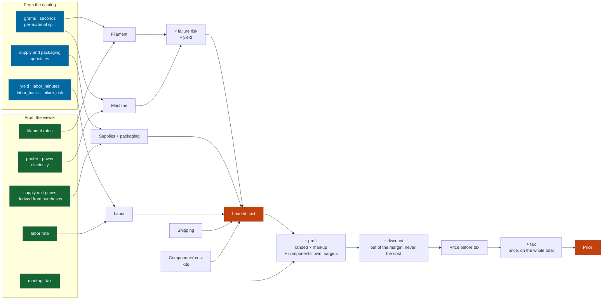
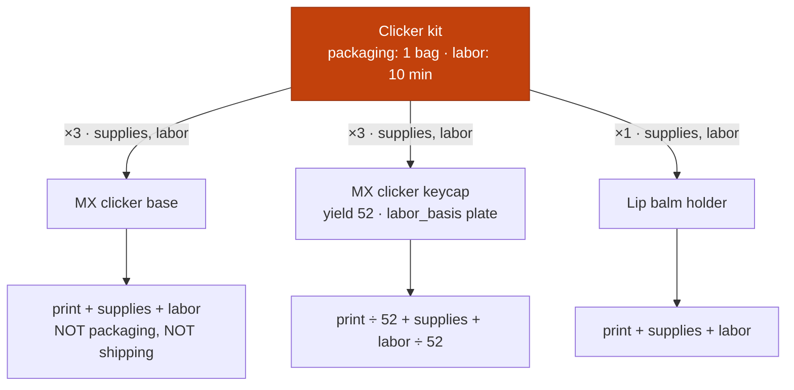
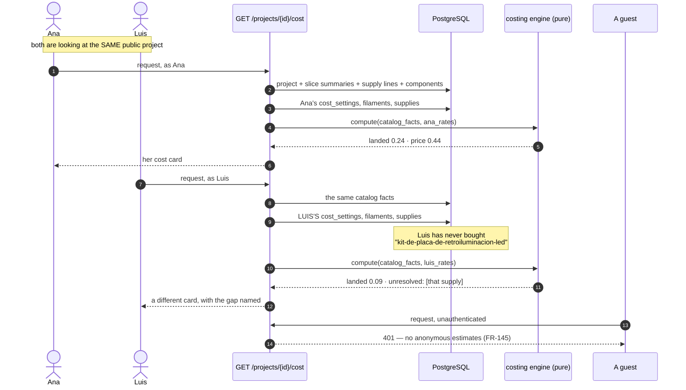

# Cost Model

What a print costs, what it should sell for, and why the same public
project shows a different number to every maker who looks at it.

The project here is the desktop app's, carried over whole — it works and
it is in daily use. What changes is *where the inputs live*, and that
change is the whole design problem.

---

## The split that defines everything

Costing needs two kinds of input, and they belong to two different
people.

| The **catalog** knows | The **viewer** knows |
|---|---|
| Grams and seconds per plate | What a kilogram of PLA costs them |
| Which materials, in what proportion | What their printer cost and how long it lasts |
| How many pieces per plate (`yield`) | What their electricity costs |
| Which supplies, in what quantity | What they paid for a bag of 100 rings |
| How many minutes of labor | What an hour of their time is worth |
| Failure risk, labor basis | Their markup and their local tax |

The catalog's half is a **fact about the design**. The viewer's half is
a **fact about their business**. Storing the second on the project — as
the desktop app effectively did, because there was only ever one user —
would publish a maker's spool prices and machine costs to everyone who
can see the project.

So: `projects` carries grams, seconds, quantities and percentages.
`cost_settings`, `filaments` and `supplies` are keyed to a **user**.
A cost card is computed per request, for the caller, and a guest gets
`401` rather than an anonymous estimate (FR-145).

This is also why supply lines reference a **string key**, not a foreign
key (FR-128). Two makers looking at the same public project each price
`bolsa-de-carton` from their own purchase history; a maker who has never
bought one sees that line as explicitly unresolved and contributing
nothing.

---

## The formula

```text
landed = (filament + machine) / yield
       + supplies + packaging + shipping
       + labor / (yield if labor_basis = plate else 1)
       + what its components cost              # kits only

profit = landed_own × markup_percent
       + the components' own profits           # FR-138

discount = (landed + profit) × discount_percent
total    = landed + profit − discount          # price before tax
tax      = total × tax_percent
price    = total + tax
```



**Order matters, and only this order is correct.** Markup is a margin
on cost — revenue you keep. Tax is collected on the price you charge.
The final number is the same either way, since two flat percentages
commute, but the split into *profit* and *tax* is only right when markup
comes first. A maker reading "profit: $0.17" needs that to be their
money.

Two smaller rules follow the same logic:

- **A discount comes out of the margin, never out of the cost**
  (FR-139). A discount deeper than the markup shows as a *negative
  profit* — sold below cost — rather than quietly making the part look
  cheaper to produce than it is.
- **Tax is charged exactly once, on the whole pre-tax total** (FR-140).
  Adding up component *prices* by hand charges it twice.

---

## Materials and machine

### Filament

The rate for a given material resolves in three steps:

1. the pinned filament's own `price_per_kg`, if one is set
2. `filament_per_kg_by_type[MATERIAL]`, matched uppercase
3. `filament_per_kg`, the default

**Per-material pricing is not optional.** When the slice summary breaks
weight down by filament — which every modern slicer records — each
material is priced at its own rate (FR-132). A two-colour print of 20 g
PLA and 5 g TPU is not 25 g at a blended rate; at $12.99 and $39.99 that
error is 40%.

Only when there is no breakdown does it fall back to the plate total at
the default rate.

### Machine

```text
depreciation = (printer_price + maintenance_cost) / lifespan_hours
electricity  = (power_watts / 1000) × electricity_per_kwh
rate/hour    = (depreciation + electricity) × risk_factor
```

With realistic numbers — a $1000 printer, $250 of maintenance, 5000
hours, 150 W, $0.11/kWh — that is $0.25/h of depreciation and $0.0165/h
of power: **$0.2665/h**, or $0.346/h at medium risk. The rate is null
when neither half is configured, and the row simply does not appear.

### The failure-risk buffer

`low` 1.1, `medium` 1.3, `high` 1.7 by default, and it scales **both**
filament and machine time (FR-134) — because a failed print wastes the
plastic and the hours in the same proportion. Applying it to filament
alone, which is the intuitive mistake, understates a long print badly.

A project with no declared `failure_risk` is costed at the `medium`
factor.

### Yield

`yield: 52` means one plate produces 52 keycaps. Filament and machine
cost divide by it. Supplies, packaging and shipping never do — they are
per finished piece by their nature.

Labor is the one that could genuinely be either, so it is **declared,
not guessed**: `labor_basis: plate` divides labor by yield, `part`
(the default) does not. Only the author knows whether those five
minutes were spent on the plate or on each piece.

---

## Supplies

A supply's unit price is **derived from its purchase history and never
stored** (FR-118):

```text
unit_price = Σ package_price / Σ package_quantity
```

over purchases flagged as counting toward the price.

It is **quantity-weighted, not an average of rates**. Buying 100 rings
for $20 and later 10 for $5 gives $25 / 110 = **22.7¢**, not the 35¢ an
average of the two rates would produce. This distinction has a pinned
test in the desktop app and should keep one here.

A supply with no qualifying purchase has a null unit price, contributes
zero, and is listed by name under `unresolved_supplies` on the cost card
(FR-119). The row is not silently dropped — a maker needs to know *why*
their kit looks cheap.

Legacy flat supplies — a bare `price:` with no purchase history — import
as a single undated purchase (FR-121).

---

## Batches: Estimate vs. real runs

Not every sliced file is the same kind of thing.

```text
out/plate.gcode.3mf              → the "Estimate" group — the reference print
out/juanito1/order.gcode.3mf     → batch "juanito1" — one real customer order
out/juanito2/order.gcode.3mf     → batch "juanito2"
```

Files directly inside an output directory form the **Estimate** group;
each named subdirectory beneath it forms its own group, summed
independently (FR-136). Estimate sorts first, then batches by name.

Two rules about which files count at all:

- **Only files inside an output directory are priced.** A `.3mf` at the
  project root is a *source* file — the editable project — and prices at
  nothing (FR-089).
- **Geometry is never opened to render a page** (NFR-004). Every gram
  and second comes from a `slice_summaries` row extracted once at
  import. This is what makes a 100-project catalog page fast, and it is
  what makes the sidecar mechanism possible at all (see
  [`catalog-sources.md`](catalog-sources.md#the-slice-sidecar)).

---

## Kits

A kit is a project whose components list is non-empty. It usually prints
nothing itself: it is a bag holding three clickers, three keycaps and a
lip balm holder.



Three rules govern it, and each exists because the naive version is
wrong:

**A component brings its own margin.** Its cost joins the kit's landed
cost and its markup joins the kit's profit (FR-138). A price you
back-solved on a keychain survives being sold inside a kit — it does not
get re-marked-up at the kit's rate, and it does not lose its margin
either.

**A component brings only what its `include` set allows.** The print
always; `supplies` and `labor` by default; `packaging` and `shipping`
only when explicitly asked. A kit is bagged once and posted once — three
clickers inside it do not each bring their own bag. An **explicitly
empty** include set means print-only and must not be replaced by the
default (FR-096).

**A component is re-costed from scratch, with its own settings.** Its
own failure risk, its own preferred filament, its own yield and labor
basis, its own markup and discount, and its own nested components. Not
the kit's.

### Resolution limits

Component resolution walks a graph, so it is bounded on three axes, each
producing a distinct, human-readable note on the offending line
(FR-100):

| Limit | Note shown |
|---|---|
| Cycle detected | "Skipped: this would make the kit contain itself." |
| Nesting past the depth cap | "Skipped: nested more than 5 kits deep." |
| More components than the count cap | "Skipped: more than 32 components on one page." |
| Unresolvable reference | "No project with this id — it may have been removed." |
| No sliced output | "No sliced file in an output folder, so the print costs nothing." |
| Discount deeper than margin | "Its discount is deeper than its margin — sold below cost." |

The cycle check must run **before** the memoization lookup, or a cycle
memoizes itself into an infinite loop.

Components resolve by **project ID**, not by path (FR-098). In the desktop
app they resolved by slug, so renaming a folder silently broke every kit
referencing it, and a "missing" chip was the only symptom. That single
failure is the reason project identity is a surrogate key here.

---

## Back-solving a price

Makers do not think in markup percentages. They think "this sells for
$8." So the price field is editable: type a target and the markup is
back-solved and saved (FR-142).

```text
markup_percent = (target_pre_tax − landed) / landed × 100
```

For a kit, the same field back-solves the **discount** instead, because
a kit's price is normally set below the sum of its parts and the
components' own margins are not the kit author's to rewrite.

Values are rounded to two decimals, which is why real catalog
frontmatter contains lines like `markup_percent: 143.61` — the artefact
of someone typing a round price.

---

## Rendering the card

Row order, each shown only when it has a value:

```text
Components
Filament
Machine
Supplies
Packaging
Shipping
Labor
─────────────────
Landed cost            ← bold
Profit (70%)           ← "(70% blended)" for a kit
Kit discount (15%)     ← shown as −$0.06
Price before tax
Tax (8%)
─────────────────
Price                  ← bold, and editable (FR-142)
```

Every row expands to the arithmetic that produced it (FR-143): filament
to the per-file grams and rate, supplies to each line's quantity × unit
price, components to each line's unit cost and quantity.

**A missing input hides its row; it never fails the page** (FR-144). No
rate, no slice data and no priced supplies means no cost card at all —
and the endpoint returns `204`, not an error.

The group header carries the batch name and, when `yield > 1`, the label
`per unit · 52 per plate`, because a card showing $0.014 with no context
looks like a bug.

---

## Implementation notes

The pricing engine lives in `app/costing/` and is **pure**: it takes a
resolved input structure and returns numbers. It performs no queries, no
I/O and no permission checks. That makes the whole formula — including
every kit rule above — unit-testable from fixtures, which is the only
practical way to keep it correct.

The service layer around it does the querying: load the project, its slice
summaries, its supply lines, its component graph; load the caller's cost
settings, filaments and supplies; hand the lot to the engine.



The engine is called twice with identical catalog facts and different
viewer facts, and that is the entire point. Nothing about a price is
ever stored on the project.

Money is `Numeric` in the database and `Decimal` in Python, never
`float`. The currency is a bare prefix string (`"$"`), not an ISO code —
carried over from the desktop app, and adequate as long as one user has
one currency. Rounding happens at the presentation edge only; every
intermediate stays full-precision, or a kit of 52 keycaps accumulates
visible error.

---

## Failure modes

| Situation | What the cost card does |
|---|---|
| No `cost_settings` for the viewer | Card absent; the UI prompts them to configure rates |
| Guest viewer | `401` — no anonymous estimates (FR-145) |
| No sliced `.3mf` in an output folder | Filament and machine rows hidden; supplies and labor still price |
| `.3mf` present but at the project root | Treated as source, prices at nothing (FR-089) |
| Slice summary from a sidecar | Prices normally; a real parsed file would outrank it (FR-088) |
| Supply key not in the viewer's inventory | Line contributes 0, listed in `unresolved_supplies` |
| Filament material not in the rate table | Falls back to the default rate |
| Neither printer price nor power configured | Machine row hidden entirely |
| `labor_per_hour` unset | Falls back to 20/hour (FR-131) |
| Kit component removed | Line shown with a note; the rest of the kit still prices |
| Discount deeper than markup | Profit renders negative — sold below cost, said out loud |

## Related requirements

The cost model: §3.10 (FR-129 – FR-146). Kits and components: §3.7
(FR-095 – FR-102). Inventory: §3.9 (FR-113 – FR-128). Slice summaries:
FR-087 – FR-089. The tables are in
[`database-schema.md`](database-schema.md#cost-settings); the endpoints
are in
[`api-specification.md`](api-specification.md#8-inventory-cost).
