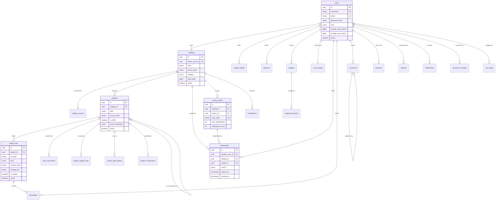
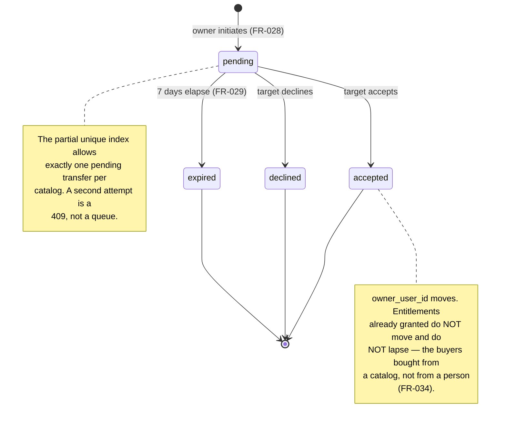

# Database Schema

## Database Choice: PostgreSQL

PostgreSQL 16. Three features earn it here: `JSONB` for the frontmatter
keys we deliberately do not model (`extra_frontmatter`, `customize`,
`filaments` breakdowns), array columns for tags and materials so a
filter is an index lookup rather than a join table nobody wanted, and
**partial unique indexes**, which are what let this schema soft-delete
everything without giving up uniqueness on live rows.

## Schema Overview



## Global Types

```sql
-- ======================================================================
-- Identity and access
-- ======================================================================
CREATE TYPE user_role AS ENUM ('user', 'maintainer', 'admin');           -- FR-013
CREATE TYPE catalog_visibility AS ENUM ('public', 'unlisted', 'private');-- FR-024
CREATE TYPE catalog_source_type AS ENUM ('github', 'hosted');            -- FR-023
CREATE TYPE catalog_editor_role AS ENUM ('editor');                      -- FR-027
CREATE TYPE access_level AS ENUM ('free', 'paid');                       -- FR-147
CREATE TYPE entitlement_source AS ENUM ('manual', 'access_code', 'transfer');

-- ======================================================================
-- Catalog content
-- ======================================================================
CREATE TYPE file_kind AS ENUM (
    'print', 'mesh', 'cad', 'script', 'electronics', 'firmware',
    'image', 'doc', 'other');                                            -- FR-081
CREATE TYPE file_origin AS ENUM ('upload', 'github', 'generated');
CREATE TYPE slice_origin AS ENUM ('parsed', 'sidecar', 'desktop');       -- FR-088
CREATE TYPE failure_risk AS ENUM ('low', 'medium', 'high');              -- FR-070
CREATE TYPE labor_basis AS ENUM ('part', 'plate');                       -- FR-071
CREATE TYPE supply_line_kind AS ENUM ('supply', 'packaging');

-- ======================================================================
-- Operations
-- ======================================================================
CREATE TYPE sync_status AS ENUM ('never_run', 'running', 'ok', 'failed');-- FR-041
CREATE TYPE repo_visibility AS ENUM ('public', 'private', 'unknown');    -- FR-211
CREATE TYPE github_account_type AS ENUM ('user', 'organization');        -- FR-212
CREATE TYPE new_project_policy AS ENUM ('draft', 'publish_free');        -- FR-218
CREATE TYPE sync_change_kind AS ENUM (
    'created', 'updated', 'moved', 'suspected_move', 'removed');         -- FR-220
CREATE TYPE moderation_status AS ENUM ('pending', 'accepted', 'rejected');
CREATE TYPE transfer_status AS ENUM (
    'pending', 'accepted', 'declined', 'expired');                       -- FR-028
```

### ENUM Reference

| Type | Values | Reference |
|------|--------|-----------|
| `user_role` | `user`, `maintainer`, `admin` | FR-013 |
| `catalog_visibility` | `public`, `unlisted`, `private` | FR-024 |
| `catalog_source_type` | `github`, `hosted` | FR-023 |
| `access_level` | `free`, `paid` | FR-147 |
| `entitlement_source` | `manual`, `access_code`, `transfer` | FR-150 |
| `file_kind` | `print`, `mesh`, `cad`, `script`, `electronics`, `firmware`, `image`, `doc`, `other` | FR-081 |
| `slice_origin` | `parsed`, `sidecar`, `desktop` | FR-088 |
| `failure_risk` | `low`, `medium`, `high` | FR-070 |
| `labor_basis` | `part`, `plate` | FR-071 |
| `sync_status` | `never_run`, `running`, `ok`, `failed` | FR-041 |
| `repo_visibility` | `public`, `private`, `unknown` | FR-211 |
| `github_account_type` | `user`, `organization` | FR-212 |
| `new_project_policy` | `draft`, `publish_free` | FR-218 |
| `sync_change_kind` | `created`, `updated`, `moved`, `suspected_move`, `removed` | FR-220 |

Two things are deliberately **not** enums. A project's `status` (`idea`,
`wip`, `printed`) is free text, because it is the maker's own workflow
vocabulary and the desktop app never validated it either. A supply's
`unit` is free text for the same reason — "piece", "metros", "cajas"
are all legitimate and the list is not ours to close.

## Table Definitions

### Users

```sql
CREATE TABLE users (
    id UUID PRIMARY KEY DEFAULT gen_random_uuid(),
    username VARCHAR(64) NOT NULL,
    email VARCHAR(255) NOT NULL,
    password_hash VARCHAR(255) NOT NULL,
    display_name VARCHAR(120),
    full_name VARCHAR(255),
    avatar_url VARCHAR(500),
    -- The square region of avatar_url shown in the circular avatar, as
    -- PERCENTAGES of the source image: position (x/y) and size (w/h).
    -- A crop rectangle rather than a focal point so the user can pan AND
    -- zoom; percentages keep it container-independent, so the same four
    -- numbers render an identical crop at every avatar size.
    -- 0/0/100/100 means "no crop chosen" and renders as a centred cover
    -- fit (FR-231).
    avatar_crop_x NUMERIC(6, 3) NOT NULL DEFAULT 0,
    avatar_crop_y NUMERIC(6, 3) NOT NULL DEFAULT 0,
    avatar_crop_w NUMERIC(6, 3) NOT NULL DEFAULT 100,
    avatar_crop_h NUMERIC(6, 3) NOT NULL DEFAULT 100,
    -- Short self-authored public blurb. Capped so it stays a one-liner.
    bio VARCHAR(280),
    -- Google account subject for users who sign in with Google (IR-002).
    google_sub VARCHAR(255),
    -- FALSE only for accounts still carrying an auto-generated username
    -- that must pick their own before using the app.
    username_chosen BOOLEAN NOT NULL DEFAULT TRUE,
    role user_role NOT NULL DEFAULT 'user',
    -- Quota is per user and spans every hosted catalog they own
    -- (FR-056/FR-057). GitHub-backed bytes never count (FR-049).
    storage_quota_bytes BIGINT NOT NULL DEFAULT 1073741824,
    storage_used_bytes BIGINT NOT NULL DEFAULT 0,
    preferred_locale VARCHAR(8) NOT NULL DEFAULT 'en',
    active BOOLEAN NOT NULL DEFAULT TRUE,
    created_at TIMESTAMP WITH TIME ZONE NOT NULL DEFAULT NOW(),
    updated_at TIMESTAMP WITH TIME ZONE NOT NULL DEFAULT NOW(),

    CONSTRAINT user_quota_non_negative CHECK (storage_used_bytes >= 0)
);

CREATE UNIQUE INDEX users_username_lower ON users (LOWER(username));
CREATE UNIQUE INDEX users_email_lower ON users (LOWER(email));
CREATE INDEX idx_users_role ON users(role);
CREATE UNIQUE INDEX users_google_sub ON users(google_sub) WHERE google_sub IS NOT NULL;
```

> **No `ON DELETE CASCADE` from `users`, anywhere.** Deactivating a
> seller must not destroy the entitlements they granted (FR-011), and
> deactivating a buyer must not erase the download history a seller
> relies on. Every FK to `users` is a plain reference and every removal
> is a soft delete.

### Catalogs

The tenant boundary. Everything with content hangs off exactly one row
here, and `can_view_catalog` (see
[`backend.md`](backend.md#apppermissionspy-the-three-gates)) is the
gate every read path passes through.

```sql
CREATE TABLE catalogs (
    id UUID PRIMARY KEY DEFAULT gen_random_uuid(),
    owner_user_id UUID NOT NULL REFERENCES users(id),
    slug VARCHAR(80) NOT NULL,
    name VARCHAR(200) NOT NULL,
    description TEXT,
    cover_url VARCHAR(500),
    source_type catalog_source_type NOT NULL,
    visibility catalog_visibility NOT NULL DEFAULT 'private',
    default_license VARCHAR(120),
    comments_enabled BOOLEAN NOT NULL DEFAULT TRUE,
    -- What a sync does with a project it has never seen before (FR-218).
    -- 'draft' is the default: a git push must never publish. A pure
    -- showcase catalog may opt into 'publish_free'.
    new_project_policy new_project_policy NOT NULL DEFAULT 'draft',
    -- Import controls, mirroring catalog.yaml (FR-032/FR-048).
    exclude TEXT[] NOT NULL DEFAULT
        ARRAY['node_modules','__pycache__','venv','build','dist'],
    output_dirs TEXT[] NOT NULL DEFAULT ARRAY['out','output'],
    -- Denormalized counters, maintained incrementally (FR-035).
    project_count INTEGER NOT NULL DEFAULT 0,
    file_count INTEGER NOT NULL DEFAULT 0,
    total_bytes BIGINT NOT NULL DEFAULT 0,
    active BOOLEAN NOT NULL DEFAULT TRUE,
    created_at TIMESTAMP WITH TIME ZONE NOT NULL DEFAULT NOW(),
    updated_at TIMESTAMP WITH TIME ZONE NOT NULL DEFAULT NOW()
);

-- FR-022: a catalog's public address is /{username}/{slug}, so the slug
-- is unique per owner among live rows only — a deleted catalog must not
-- reserve its name forever.
CREATE UNIQUE INDEX catalog_owner_slug_active
    ON catalogs(owner_user_id, slug) WHERE active;

CREATE INDEX idx_catalogs_visibility ON catalogs(visibility) WHERE active;
CREATE INDEX idx_catalogs_owner ON catalogs(owner_user_id);
```

### Catalog Editors

```sql
CREATE TABLE catalog_editors (
    id UUID PRIMARY KEY DEFAULT gen_random_uuid(),
    catalog_id UUID NOT NULL REFERENCES catalogs(id),
    user_id UUID NOT NULL REFERENCES users(id),
    role catalog_editor_role NOT NULL DEFAULT 'editor',
    invited_by_id UUID NOT NULL REFERENCES users(id),
    accepted_at TIMESTAMP WITH TIME ZONE,
    active BOOLEAN NOT NULL DEFAULT TRUE,
    created_at TIMESTAMP WITH TIME ZONE NOT NULL DEFAULT NOW(),
    updated_at TIMESTAMP WITH TIME ZONE NOT NULL DEFAULT NOW()
);

CREATE UNIQUE INDEX catalog_editor_unique_active
    ON catalog_editors(catalog_id, user_id) WHERE active;
```

> **The owner is on the catalog row, not in this table** (FR-028). This
> table holds only invited editors. "Who may edit" is therefore
> `owner_user_id` ∪ accepted editors ∪ maintainers, resolved by
> `can_edit_catalog` and never by a query written inline.

### Catalog Sources

```sql
```sql
CREATE TABLE catalog_sources (
    id UUID PRIMARY KEY DEFAULT gen_random_uuid(),
    catalog_id UUID NOT NULL REFERENCES catalogs(id),
    repo_url VARCHAR(500) NOT NULL,
    repo_full_name VARCHAR(300) NOT NULL,    -- "jcarranz97/3d-catalog"
    branch VARCHAR(200) NOT NULL DEFAULT 'main',
    subdirectory VARCHAR(500),
    lfs_enabled BOOLEAN NOT NULL DEFAULT FALSE,
    -- NULL for a public repository, which is cloned anonymously with no
    -- credential at all (FR-213). Set for a private one.
    github_installation_id UUID REFERENCES github_installations(id),
    -- Recorded on every sync. Drives the paid/public guard (FR-210/211).
    repo_visibility repo_visibility NOT NULL DEFAULT 'unknown',
    visibility_checked_at TIMESTAMP WITH TIME ZONE,
    last_commit_sha VARCHAR(64),
    last_synced_at TIMESTAMP WITH TIME ZONE,
    last_status sync_status NOT NULL DEFAULT 'never_run',
    last_error TEXT,
    active BOOLEAN NOT NULL DEFAULT TRUE,
    created_at TIMESTAMP WITH TIME ZONE NOT NULL DEFAULT NOW(),
    updated_at TIMESTAMP WITH TIME ZONE NOT NULL DEFAULT NOW()
);

CREATE UNIQUE INDEX catalog_source_one_active
    ON catalog_sources(catalog_id) WHERE active;
CREATE INDEX idx_catalog_sources_installation
    ON catalog_sources(github_installation_id);
```

### Sync Runs and Sync Changes

`catalog_sources` carries only the *latest* outcome. The per-run history
and the per-project diff live here, because they are what the owner's
review screen reads (FR-041, FR-223).

```sql
CREATE TABLE sync_runs (
    id UUID PRIMARY KEY DEFAULT gen_random_uuid(),
    catalog_id UUID NOT NULL REFERENCES catalogs(id),
    trigger VARCHAR(16) NOT NULL,       -- 'webhook' | 'schedule' | 'manual'
    commit_sha VARCHAR(64),
    status sync_status NOT NULL DEFAULT 'running',
    error TEXT,
    warnings JSONB NOT NULL DEFAULT '[]'::jsonb,
    started_at TIMESTAMP WITH TIME ZONE NOT NULL DEFAULT NOW(),
    finished_at TIMESTAMP WITH TIME ZONE
);

CREATE INDEX idx_sync_runs_catalog_time
    ON sync_runs(catalog_id, started_at DESC);

CREATE TABLE sync_changes (
    id UUID PRIMARY KEY DEFAULT gen_random_uuid(),
    sync_run_id UUID NOT NULL REFERENCES sync_runs(id),
    catalog_id UUID NOT NULL REFERENCES catalogs(id),
    kind sync_change_kind NOT NULL,
    project_id UUID REFERENCES projects(id),
    -- For a move: where it came from. For a removal: where it was.
    previous_path VARCHAR(500),
    new_path VARCHAR(500),
    -- Set for 'suspected_move' (FR-221): the row we think it came from,
    -- kept alive until the owner confirms or rejects.
    candidate_project_id UUID REFERENCES projects(id),
    match_confidence NUMERIC(5, 4),
    -- NULL until the owner acts on it in the sync review (FR-223).
    resolved_at TIMESTAMP WITH TIME ZONE,
    resolved_by_user_id UUID REFERENCES users(id),
    created_at TIMESTAMP WITH TIME ZONE NOT NULL DEFAULT NOW()
);

CREATE INDEX idx_sync_changes_run ON sync_changes(sync_run_id);
-- The review queue: everything still awaiting a decision.
CREATE INDEX idx_sync_changes_unresolved
    ON sync_changes(catalog_id) WHERE resolved_at IS NULL;
```

> **A `suspected_move` is the only diff outcome that blocks.** Every
> other kind is applied immediately and merely *reported*; a suspected
> move leaves both rows intact and waits, because guessing wrong either
> way is expensive — a false move silently reprices a new project, and a
> false removal takes a paid project away from the people who bought it
> (FR-220, FR-221).

### GitHub Installations

What the platform stores in order to read a private repository. Note
what is **absent**: there is no token column, and there never will be
one. An installation access token is minted on demand from the App's
private key, lives about an hour, and is held only in the memory of the
job using it (FR-205).

```sql
CREATE TABLE github_installations (
    id UUID PRIMARY KEY DEFAULT gen_random_uuid(),
    -- GitHub's own installation id. This is the whole credential: it
    -- names an installation, and only the holder of the App's private
    -- key can turn it into a usable token.
    installation_id BIGINT NOT NULL,
    account_login VARCHAR(120) NOT NULL,       -- user or org that installed
    account_type github_account_type NOT NULL, -- 'user' | 'organization'
    -- Who linked it here. Not the same as who owns the GitHub account.
    installed_by_user_id UUID NOT NULL REFERENCES users(id),
    -- 'all' when the installer granted every repo; 'selected' otherwise.
    repository_selection VARCHAR(16) NOT NULL DEFAULT 'selected',
    suspended_at TIMESTAMP WITH TIME ZONE,
    revoked_at TIMESTAMP WITH TIME ZONE,
    active BOOLEAN NOT NULL DEFAULT TRUE,
    created_at TIMESTAMP WITH TIME ZONE NOT NULL DEFAULT NOW(),
    updated_at TIMESTAMP WITH TIME ZONE NOT NULL DEFAULT NOW()
);

CREATE UNIQUE INDEX github_installation_unique_active
    ON github_installations(installation_id) WHERE active;
CREATE INDEX idx_github_installations_user
    ON github_installations(installed_by_user_id);
```

> **The App's private key is not in this database.** It lives in the
> environment / secret manager as `GITHUB_APP_PRIVATE_KEY`, alongside
> `GITHUB_APP_ID`. A dump of PostgreSQL therefore grants an attacker
> exactly nothing against anyone's repository — which is the entire
> reason for preferring an App over a stored personal access token.

### Projects

```sql
CREATE TABLE projects (
    id UUID PRIMARY KEY DEFAULT gen_random_uuid(),
    catalog_id UUID NOT NULL REFERENCES catalogs(id),
    path VARCHAR(500) NOT NULL,          -- "keychains/ysisi-nametag"
    title VARCHAR(300) NOT NULL,
    description TEXT,
    body TEXT NOT NULL DEFAULT '',       -- README, frontmatter stripped
    tags TEXT[] NOT NULL DEFAULT '{}',   -- lowercased + sorted (FR-068)
    status VARCHAR(60),                  -- free text, deliberately
    declared_date DATE,                  -- frontmatter `date:`
    materials TEXT[] NOT NULL DEFAULT '{}',
    printers TEXT[] NOT NULL DEFAULT '{}',
    profiles TEXT[] NOT NULL DEFAULT '{}',
    source_url VARCHAR(500),
    license VARCHAR(120),
    cover_file_id UUID,                  -- FK added after project_files exists
    access_level access_level NOT NULL DEFAULT 'free',
    -- A sync imports a newly discovered project as a draft unless the
    -- catalog opted into 'publish_free' (FR-218). A git push must never
    -- publish, and must never price (FR-219).
    is_draft BOOLEAN NOT NULL DEFAULT TRUE,

    -- Cost inputs that belong to the PROJECT. Rates and prices belong to
    -- the viewer and live in cost_settings (FR-145).
    failure_risk failure_risk,
    labor_minutes NUMERIC(10, 2),
    labor_basis labor_basis NOT NULL DEFAULT 'part',
    shipping_cost NUMERIC(12, 4),
    markup_percent NUMERIC(9, 4),
    discount_percent NUMERIC(9, 4),
    yield_units INTEGER NOT NULL DEFAULT 1,
    preferred_filament_key VARCHAR(120),

    customize JSONB,                     -- the parametric spec (FR-202)
    extra_frontmatter JSONB NOT NULL DEFAULT '{}'::jsonb,  -- FR-074
    contributor_user_id UUID REFERENCES users(id),         -- FR-181

    content_updated_at TIMESTAMP WITH TIME ZONE NOT NULL DEFAULT NOW(),
    active BOOLEAN NOT NULL DEFAULT TRUE,
    created_at TIMESTAMP WITH TIME ZONE NOT NULL DEFAULT NOW(),
    updated_at TIMESTAMP WITH TIME ZONE NOT NULL DEFAULT NOW(),

    CONSTRAINT model_yield_positive CHECK (yield_units >= 1),   -- FR-072
    CONSTRAINT model_percentages_non_negative CHECK (
        (markup_percent IS NULL OR markup_percent >= 0) AND
        (discount_percent IS NULL OR discount_percent >= 0)
    )
);

CREATE UNIQUE INDEX model_catalog_path_active
    ON projects(catalog_id, path) WHERE active;
CREATE INDEX idx_models_catalog ON projects(catalog_id) WHERE active;
CREATE INDEX idx_models_access ON projects(access_level);
CREATE INDEX idx_models_tags ON projects USING GIN (tags);
CREATE INDEX idx_models_materials ON projects USING GIN (materials);
-- Default catalog ordering (FR-075).
CREATE INDEX idx_models_ordering
    ON projects(catalog_id, declared_date DESC NULLS LAST, content_updated_at DESC);
```

> **Identity is the id, not the path.** In the desktop app the folder
> path *was* the identity, so renaming `clickers/mx-clicker-base` broke
> every kit referencing it, silently, with a "missing" chip as the only
> symptom. Here `path` is a mutable unique field, kits reference
> `projects.id`, and superseded paths live in `project_path_history` so old
> URLs redirect (FR-062). This is the single most important departure
> from the filesystem schema.

### Project Path History

```sql
CREATE TABLE project_path_history (
    id UUID PRIMARY KEY DEFAULT gen_random_uuid(),
    project_id UUID NOT NULL REFERENCES projects(id),
    catalog_id UUID NOT NULL REFERENCES catalogs(id),
    path VARCHAR(500) NOT NULL,
    created_at TIMESTAMP WITH TIME ZONE NOT NULL DEFAULT NOW()
);

CREATE INDEX idx_project_path_history_lookup ON project_path_history(catalog_id, path);
```

### Project Files

```sql
CREATE TABLE project_files (
    id UUID PRIMARY KEY DEFAULT gen_random_uuid(),
    project_id UUID NOT NULL REFERENCES projects(id),
    rel_path VARCHAR(700) NOT NULL,     -- "out/juanito1/order.gcode.3mf"
    kind file_kind NOT NULL,
    is_output BOOLEAN NOT NULL DEFAULT FALSE,   -- FR-082
    is_derived BOOLEAN NOT NULL DEFAULT FALSE,  -- thumbnails etc (FR-091)
    size_bytes BIGINT NOT NULL,
    content_hash CHAR(64) NOT NULL,             -- sha256 hex
    -- NULL when the bytes live in the linked repository rather than in
    -- our object store — the normal case for a GitHub catalog (FR-049).
    storage_key VARCHAR(500),
    origin file_origin NOT NULL,
    active BOOLEAN NOT NULL DEFAULT TRUE,
    created_at TIMESTAMP WITH TIME ZONE NOT NULL DEFAULT NOW(),
    updated_at TIMESTAMP WITH TIME ZONE NOT NULL DEFAULT NOW(),

    CONSTRAINT model_file_size_non_negative CHECK (size_bytes >= 0)
);

CREATE UNIQUE INDEX model_file_path_active
    ON project_files(project_id, rel_path) WHERE active;
CREATE INDEX idx_project_files_model ON project_files(project_id) WHERE active;
-- Content-addressed dedupe: many rows, one object (FR-084).
CREATE INDEX idx_project_files_hash ON project_files(content_hash);

ALTER TABLE projects ADD CONSTRAINT models_cover_file_fk
    FOREIGN KEY (cover_file_id) REFERENCES project_files(id);
```

### Slice Summaries

The table that lets a catalog price a print it does not store. Every
number the cost engine needs about geometry — grams, seconds, the
per-material breakdown — is extracted once and lives here; the `.3mf`
itself is never re-opened to render a page (NFR-004).

```sql
CREATE TABLE slice_summaries (
    id UUID PRIMARY KEY DEFAULT gen_random_uuid(),
    project_id UUID NOT NULL REFERENCES projects(id),
    -- The file it describes, which may not exist as a row at all: a
    -- sidecar entry describes geometry that was never uploaded (FR-088).
    project_file_id UUID REFERENCES project_files(id),
    rel_path VARCHAR(700) NOT NULL,
    grams NUMERIC(12, 4),
    seconds INTEGER,
    -- [{ "type": "PLA", "grams": 12.4, "color": "#f5c542" }, ...]
    filaments JSONB NOT NULL DEFAULT '[]'::jsonb,
    printer VARCHAR(200),
    nozzle VARCHAR(60),
    origin slice_origin NOT NULL,
    active BOOLEAN NOT NULL DEFAULT TRUE,
    created_at TIMESTAMP WITH TIME ZONE NOT NULL DEFAULT NOW(),
    updated_at TIMESTAMP WITH TIME ZONE NOT NULL DEFAULT NOW(),

    CONSTRAINT slice_seconds_non_negative CHECK (seconds IS NULL OR seconds >= 0)
);

CREATE UNIQUE INDEX slice_summary_path_active
    ON slice_summaries(project_id, rel_path) WHERE active;
```

> **`origin = 'parsed'` outranks `'sidecar'` for the same path**
> (FR-088). The precedence is resolved on write, not on read: the
> importer refuses to overwrite a parsed row with a sidecar one, so the
> partial unique index above is sufficient and no reader ever has to
> sort by origin.

### Project Components

```sql
CREATE TABLE project_components (
    id UUID PRIMARY KEY DEFAULT gen_random_uuid(),
    parent_project_id UUID NOT NULL REFERENCES projects(id),
    component_project_id UUID NOT NULL REFERENCES projects(id),
    quantity INTEGER NOT NULL,
    -- Subset of supplies/labor/packaging/shipping. Empty means
    -- print-only and must NOT be replaced by the default (FR-096).
    include_parts TEXT[] NOT NULL DEFAULT ARRAY['supplies','labor'],
    active BOOLEAN NOT NULL DEFAULT TRUE,
    created_at TIMESTAMP WITH TIME ZONE NOT NULL DEFAULT NOW(),
    updated_at TIMESTAMP WITH TIME ZONE NOT NULL DEFAULT NOW(),

    CONSTRAINT component_quantity_positive CHECK (quantity >= 1),
    CONSTRAINT component_not_self CHECK (parent_project_id <> component_project_id)
);

CREATE UNIQUE INDEX model_component_unique_active
    ON project_components(parent_project_id, component_project_id) WHERE active;
```

The `CHECK` catches only the trivial one-step cycle. Longer cycles
(A → B → A) cannot be expressed as a row constraint and are detected
during resolution, before the memo lookup, with a per-line note
(FR-100).

### Project Supply Lines

```sql
CREATE TABLE project_supply_lines (
    id UUID PRIMARY KEY DEFAULT gen_random_uuid(),
    project_id UUID NOT NULL REFERENCES projects(id),
    -- NOT a foreign key. This is a catalog-side identifier that resolves
    -- against the VIEWING user's private inventory (FR-128). Two makers
    -- looking at the same public project each price "bolsa-de-carton"
    -- from their own purchase history.
    supply_key VARCHAR(120) NOT NULL,
    quantity NUMERIC(12, 4) NOT NULL,
    line_kind supply_line_kind NOT NULL,
    active BOOLEAN NOT NULL DEFAULT TRUE,
    created_at TIMESTAMP WITH TIME ZONE NOT NULL DEFAULT NOW(),
    updated_at TIMESTAMP WITH TIME ZONE NOT NULL DEFAULT NOW(),

    CONSTRAINT supply_line_quantity_positive CHECK (quantity > 0)
);

CREATE UNIQUE INDEX supply_line_unique_active
    ON project_supply_lines(project_id, supply_key, line_kind) WHERE active;
```

### Cost Settings

```sql
CREATE TABLE cost_settings (
    id UUID PRIMARY KEY DEFAULT gen_random_uuid(),
    user_id UUID NOT NULL REFERENCES users(id),
    currency VARCHAR(8) NOT NULL DEFAULT '$',
    filament_per_kg NUMERIC(12, 4),
    -- { "PETG": 27.99, "TPU": 39.99 } — keys uppercased on write.
    filament_per_kg_by_type JSONB NOT NULL DEFAULT '{}'::jsonb,
    failure_risk_low NUMERIC(6, 3) NOT NULL DEFAULT 1.1,
    failure_risk_medium NUMERIC(6, 3) NOT NULL DEFAULT 1.3,
    failure_risk_high NUMERIC(6, 3) NOT NULL DEFAULT 1.7,
    printer_price NUMERIC(12, 4),
    maintenance_cost NUMERIC(12, 4),
    lifespan_hours NUMERIC(12, 2),
    power_watts NUMERIC(10, 2),
    electricity_per_kwh NUMERIC(10, 4),
    labor_per_hour NUMERIC(10, 2),      -- falls back to 20 at use (FR-131)
    shipping_cost NUMERIC(12, 4),
    markup_percent NUMERIC(9, 4),
    tax_percent NUMERIC(9, 4),
    active BOOLEAN NOT NULL DEFAULT TRUE,
    created_at TIMESTAMP WITH TIME ZONE NOT NULL DEFAULT NOW(),
    updated_at TIMESTAMP WITH TIME ZONE NOT NULL DEFAULT NOW()
);

CREATE UNIQUE INDEX cost_settings_one_per_user ON cost_settings(user_id) WHERE active;
```

### Filaments and Supplies

```sql
CREATE TABLE filaments (
    id UUID PRIMARY KEY DEFAULT gen_random_uuid(),
    user_id UUID NOT NULL REFERENCES users(id),
    key VARCHAR(120) NOT NULL,          -- lower-kebab (FR-127)
    name VARCHAR(200) NOT NULL,
    material VARCHAR(60),
    brand VARCHAR(120),
    price_per_kg NUMERIC(12, 4),
    notes TEXT,
    -- [{ "name": "Jade White", "hex": "#ffffff" }, ...]
    colors JSONB NOT NULL DEFAULT '[]'::jsonb,
    active BOOLEAN NOT NULL DEFAULT TRUE,
    created_at TIMESTAMP WITH TIME ZONE NOT NULL DEFAULT NOW(),
    updated_at TIMESTAMP WITH TIME ZONE NOT NULL DEFAULT NOW()
);

CREATE UNIQUE INDEX filament_user_key_active ON filaments(user_id, key) WHERE active;

CREATE TABLE supplies (
    id UUID PRIMARY KEY DEFAULT gen_random_uuid(),
    user_id UUID NOT NULL REFERENCES users(id),
    key VARCHAR(120) NOT NULL,
    name VARCHAR(200) NOT NULL,
    unit VARCHAR(60) NOT NULL DEFAULT 'piece',
    category VARCHAR(120),
    description TEXT,
    image_url VARCHAR(500),
    active BOOLEAN NOT NULL DEFAULT TRUE,
    created_at TIMESTAMP WITH TIME ZONE NOT NULL DEFAULT NOW(),
    updated_at TIMESTAMP WITH TIME ZONE NOT NULL DEFAULT NOW()
);

CREATE UNIQUE INDEX supply_user_key_active ON supplies(user_id, key) WHERE active;

CREATE TABLE supply_purchases (
    id UUID PRIMARY KEY DEFAULT gen_random_uuid(),
    supply_id UUID NOT NULL REFERENCES supplies(id),
    purchased_on DATE,
    url VARCHAR(700),                   -- http/https only, checked in service
    notes TEXT,
    package_price NUMERIC(12, 4),
    package_quantity NUMERIC(12, 4),
    counts_toward_price BOOLEAN NOT NULL DEFAULT TRUE,
    active BOOLEAN NOT NULL DEFAULT TRUE,
    created_at TIMESTAMP WITH TIME ZONE NOT NULL DEFAULT NOW(),
    updated_at TIMESTAMP WITH TIME ZONE NOT NULL DEFAULT NOW(),

    CONSTRAINT purchase_quantity_positive CHECK (
        package_quantity IS NULL OR package_quantity > 0)
);

CREATE INDEX idx_supply_purchases_supply ON supply_purchases(supply_id) WHERE active;
```

> **There is no `price` column on `supplies`, and there must never be
> one** (FR-118). The unit price is `SUM(package_price) /
> SUM(package_quantity)` over qualifying purchases — quantity-weighted,
> so $20/100 plus $5/10 is 22.7¢, not the 35¢ an average of rates would
> give. Storing it would create a second source of truth that drifts the
> moment a purchase is edited.

### Entitlements

```sql
CREATE TABLE entitlements (
    id UUID PRIMARY KEY DEFAULT gen_random_uuid(),
    grantee_user_id UUID NOT NULL REFERENCES users(id),
    catalog_id UUID NOT NULL REFERENCES catalogs(id),
    -- NULL means the whole catalog; set means one project (FR-149).
    project_id UUID REFERENCES projects(id),
    granted_by_user_id UUID NOT NULL REFERENCES users(id),
    source entitlement_source NOT NULL DEFAULT 'manual',
    access_code_id UUID,                -- FK added after access_codes
    -- Reserved for a future payment gateway so adding one needs no
    -- migration here (FR-166, IR-003).
    external_order_ref VARCHAR(200),
    note TEXT,                          -- seller-private (FR-150)
    expires_at TIMESTAMP WITH TIME ZONE,
    revoked_at TIMESTAMP WITH TIME ZONE,
    created_at TIMESTAMP WITH TIME ZONE NOT NULL DEFAULT NOW(),
    updated_at TIMESTAMP WITH TIME ZONE NOT NULL DEFAULT NOW()
);

-- One live grant per (buyer, catalog, project). NULLS NOT DISTINCT makes
-- the whole-catalog grant (project_id IS NULL) collide with itself, which
-- is what we want — otherwise a buyer could accumulate duplicates.
CREATE UNIQUE INDEX entitlement_unique_live
    ON entitlements(grantee_user_id, catalog_id, project_id)
    NULLS NOT DISTINCT
    WHERE revoked_at IS NULL;

CREATE INDEX idx_entitlements_grantee ON entitlements(grantee_user_id);
CREATE INDEX idx_entitlements_catalog ON entitlements(catalog_id);
```

> **Entitlements have no `active` column.** They are not soft-deleted;
> they are *revoked*, which is a different and visible act with a
> timestamp attached (FR-151, FR-152). Nothing in the system ever
> removes an entitlement row, including deactivating the seller
> (FR-011), hiding the catalog (FR-034) or deleting the project.

### Access Codes

```sql
CREATE TABLE access_codes (
    id UUID PRIMARY KEY DEFAULT gen_random_uuid(),
    catalog_id UUID NOT NULL REFERENCES catalogs(id),
    project_id UUID REFERENCES projects(id),
    created_by_user_id UUID NOT NULL REFERENCES users(id),
    -- The code itself is NEVER stored. Shown once at creation (FR-157).
    code_hash CHAR(64) NOT NULL,
    code_prefix VARCHAR(8) NOT NULL,    -- for the issuer's own reference
    max_redemptions INTEGER,            -- NULL means unlimited
    redemption_count INTEGER NOT NULL DEFAULT 0,
    expires_at TIMESTAMP WITH TIME ZONE,
    note TEXT,
    revoked_at TIMESTAMP WITH TIME ZONE,
    created_at TIMESTAMP WITH TIME ZONE NOT NULL DEFAULT NOW(),
    updated_at TIMESTAMP WITH TIME ZONE NOT NULL DEFAULT NOW(),

    CONSTRAINT access_code_redemptions_within_cap CHECK (
        max_redemptions IS NULL OR redemption_count <= max_redemptions),
    CONSTRAINT access_code_redemptions_non_negative CHECK (redemption_count >= 0)
);

CREATE UNIQUE INDEX access_code_hash_unique ON access_codes(code_hash);
CREATE INDEX idx_access_codes_catalog ON access_codes(catalog_id);

ALTER TABLE entitlements ADD CONSTRAINT entitlement_access_code_fk
    FOREIGN KEY (access_code_id) REFERENCES access_codes(id);
```

### Downloads

```sql
CREATE TABLE downloads (
    id UUID PRIMARY KEY DEFAULT gen_random_uuid(),
    project_file_id UUID NOT NULL REFERENCES project_files(id),
    project_id UUID NOT NULL REFERENCES projects(id),
    catalog_id UUID NOT NULL REFERENCES catalogs(id),
    user_id UUID REFERENCES users(id),          -- NULL when anonymous
    entitlement_id UUID REFERENCES entitlements(id),
    bytes_served BIGINT NOT NULL DEFAULT 0,
    created_at TIMESTAMP WITH TIME ZONE NOT NULL DEFAULT NOW()
);

CREATE INDEX idx_downloads_catalog_time ON downloads(catalog_id, created_at DESC);
CREATE INDEX idx_downloads_model ON downloads(project_id);
CREATE INDEX idx_downloads_user ON downloads(user_id);
```

Append-only, like the audit log. `catalog_id` is denormalized onto the
row so the owner's ledger (FR-165) is a single-table aggregate rather
than a three-way join on every page load.

### Catalog Ownership Transfers

```sql
CREATE TABLE catalog_transfers (
    id UUID PRIMARY KEY DEFAULT gen_random_uuid(),
    catalog_id UUID NOT NULL REFERENCES catalogs(id),
    from_user_id UUID NOT NULL REFERENCES users(id),
    to_user_id UUID NOT NULL REFERENCES users(id),
    status transfer_status NOT NULL DEFAULT 'pending',
    expires_at TIMESTAMP WITH TIME ZONE NOT NULL,   -- 7 days (FR-029)
    resolved_at TIMESTAMP WITH TIME ZONE,
    created_at TIMESTAMP WITH TIME ZONE NOT NULL DEFAULT NOW(),
    updated_at TIMESTAMP WITH TIME ZONE NOT NULL DEFAULT NOW(),

    CONSTRAINT transfer_not_self CHECK (from_user_id <> to_user_id)
);

CREATE UNIQUE INDEX catalog_transfer_one_pending
    ON catalog_transfers(catalog_id) WHERE status = 'pending';
```



### Social: Comments, Reactions, Watches

One polymorphic mechanism per concern, reused across every surface —
projects, catalogs, and the private contribution review thread. The
`(entity_type, entity_id)` pair carries no foreign key on purpose: a
table per commentable entity would triple the schema and force every new
surface to ship a migration.

```sql
CREATE TABLE comments (
    id UUID PRIMARY KEY DEFAULT gen_random_uuid(),
    entity_type VARCHAR(40) NOT NULL,   -- project | catalog | contribution_review
    entity_id UUID NOT NULL,
    author_user_id UUID NOT NULL REFERENCES users(id),
    -- NULL for a top-level comment; the TOP-LEVEL comment's id for a
    -- reply. Replying to a reply attaches to the same parent, so threads
    -- are exactly one level deep (FR-243).
    parent_comment_id UUID REFERENCES comments(id),
    body TEXT NOT NULL,
    edited_at TIMESTAMP WITH TIME ZONE,
    active BOOLEAN NOT NULL DEFAULT TRUE,
    created_at TIMESTAMP WITH TIME ZONE NOT NULL DEFAULT NOW(),
    updated_at TIMESTAMP WITH TIME ZONE NOT NULL DEFAULT NOW()
);

CREATE INDEX ix_comments_entity
    ON comments(entity_type, entity_id, created_at DESC) WHERE active;
CREATE INDEX ix_comments_parent ON comments(parent_comment_id) WHERE active;

CREATE TABLE reactions (
    id UUID PRIMARY KEY DEFAULT gen_random_uuid(),
    user_id UUID NOT NULL REFERENCES users(id),
    entity_type VARCHAR(40) NOT NULL,   -- project | catalog | comment
    entity_id UUID NOT NULL,
    -- v1 is always 'like'. A column rather than a boolean so multi-emoji
    -- reactions later need no migration (FR-248).
    reaction_type VARCHAR(20) NOT NULL DEFAULT 'like',
    active BOOLEAN NOT NULL DEFAULT TRUE,
    created_at TIMESTAMP WITH TIME ZONE NOT NULL DEFAULT NOW(),
    updated_at TIMESTAMP WITH TIME ZONE NOT NULL DEFAULT NOW()
);

-- Liking twice is idempotent, not a duplicate row (FR-249).
CREATE UNIQUE INDEX uq_reactions_active
    ON reactions(user_id, entity_type, entity_id, reaction_type) WHERE active;
CREATE INDEX ix_reactions_entity ON reactions(entity_type, entity_id) WHERE active;

CREATE TABLE watches (
    id UUID PRIMARY KEY DEFAULT gen_random_uuid(),
    user_id UUID NOT NULL REFERENCES users(id),
    entity_type VARCHAR(40) NOT NULL,   -- project | catalog
    entity_id UUID NOT NULL,
    active BOOLEAN NOT NULL DEFAULT TRUE,
    created_at TIMESTAMP WITH TIME ZONE NOT NULL DEFAULT NOW(),
    updated_at TIMESTAMP WITH TIME ZONE NOT NULL DEFAULT NOW()
);

CREATE UNIQUE INDEX uq_watches_active
    ON watches(user_id, entity_type, entity_id) WHERE active;
CREATE INDEX ix_watches_entity ON watches(entity_type, entity_id) WHERE active;
```

### Notifications

```sql
CREATE TABLE notifications (
    id UUID PRIMARY KEY DEFAULT gen_random_uuid(),
    recipient_user_id UUID NOT NULL REFERENCES users(id),
    actor_user_id UUID NOT NULL REFERENCES users(id),
    entity_type VARCHAR(40) NOT NULL,
    entity_id UUID NOT NULL,
    reason VARCHAR(20) NOT NULL,        -- mention | watch | moderation
    event VARCHAR(40) NOT NULL,
    comment_id UUID,
    payload JSONB NOT NULL DEFAULT '{}'::jsonb,
    read_at TIMESTAMP WITH TIME ZONE,
    active BOOLEAN NOT NULL DEFAULT TRUE,
    created_at TIMESTAMP WITH TIME ZONE NOT NULL DEFAULT NOW(),
    updated_at TIMESTAMP WITH TIME ZONE NOT NULL DEFAULT NOW(),

    -- Nobody is notified about their own action (FR-268).
    CONSTRAINT notification_not_self CHECK (recipient_user_id <> actor_user_id)
);

-- The header badge polls the unread count; keep it a single index hit.
CREATE INDEX ix_notifications_unread
    ON notifications(recipient_user_id, created_at DESC)
    WHERE active AND read_at IS NULL;

CREATE TABLE notification_preferences (
    id UUID PRIMARY KEY DEFAULT gen_random_uuid(),
    user_id UUID NOT NULL REFERENCES users(id),
    category VARCHAR(30) NOT NULL,
    in_app_enabled BOOLEAN NOT NULL DEFAULT TRUE,
    email_enabled BOOLEAN NOT NULL DEFAULT TRUE,
    active BOOLEAN NOT NULL DEFAULT TRUE,
    created_at TIMESTAMP WITH TIME ZONE NOT NULL DEFAULT NOW(),
    updated_at TIMESTAMP WITH TIME ZONE NOT NULL DEFAULT NOW()
);

CREATE UNIQUE INDEX uq_notification_pref
    ON notification_preferences(user_id, category) WHERE active;

CREATE TABLE notification_email_outbox (
    id UUID PRIMARY KEY DEFAULT gen_random_uuid(),
    recipient_user_id UUID NOT NULL REFERENCES users(id),
    actor_user_id UUID NOT NULL REFERENCES users(id),
    entity_type VARCHAR(40) NOT NULL,
    entity_id UUID NOT NULL,
    category VARCHAR(30) NOT NULL,
    event VARCHAR(40) NOT NULL,
    comment_id UUID,
    payload JSONB NOT NULL DEFAULT '{}'::jsonb,
    sent_at TIMESTAMP WITH TIME ZONE,
    attempts INTEGER NOT NULL DEFAULT 0,
    last_error TEXT,
    active BOOLEAN NOT NULL DEFAULT TRUE,
    created_at TIMESTAMP WITH TIME ZONE NOT NULL DEFAULT NOW(),
    updated_at TIMESTAMP WITH TIME ZONE NOT NULL DEFAULT NOW()
);

-- The drain claims oldest-first with FOR UPDATE SKIP LOCKED; this keeps
-- that query cheap as sent rows accumulate.
CREATE INDEX ix_outbox_unsent
    ON notification_email_outbox(created_at)
    WHERE active AND sent_at IS NULL;
```

> **Email is an outbox, not an inline send** (FR-264). The row is written
> in the *same transaction* as the event that caused it, so a notification
> can never exist without its email being queued, and an SMTP outage can
> never roll back a comment. A worker drains it with `SELECT … FOR UPDATE
> SKIP LOCKED`, which is what lets several replicas run the drain without
> ever double-sending.

### Profiles: Username Changes and Flags

```sql
CREATE TABLE username_changes (
    id UUID PRIMARY KEY DEFAULT gen_random_uuid(),
    user_id UUID NOT NULL REFERENCES users(id),
    from_username VARCHAR(64) NOT NULL,
    to_username VARCHAR(64) NOT NULL,
    -- A maintainer can withhold a rename from the public timeline — an
    -- old handle that was someone's email address, say. Deliberately NOT
    -- `active`: `active` is the rename-cooldown source of truth, so
    -- soft-deleting a row here would corrupt the cooldown (FR-235).
    hidden BOOLEAN NOT NULL DEFAULT FALSE,
    active BOOLEAN NOT NULL DEFAULT TRUE,
    created_at TIMESTAMP WITH TIME ZONE NOT NULL DEFAULT NOW(),
    updated_at TIMESTAMP WITH TIME ZONE NOT NULL DEFAULT NOW()
);

CREATE INDEX ix_username_changes_user
    ON username_changes(user_id, created_at DESC);

CREATE TABLE user_flags (
    id UUID PRIMARY KEY DEFAULT gen_random_uuid(),
    user_id UUID NOT NULL REFERENCES users(id),
    key VARCHAR(64) NOT NULL,
    value BOOLEAN NOT NULL,
    source VARCHAR(16) NOT NULL,        -- 'self' | 'admin'
    set_by_id UUID REFERENCES users(id),
    active BOOLEAN NOT NULL DEFAULT TRUE,
    created_at TIMESTAMP WITH TIME ZONE NOT NULL DEFAULT NOW(),
    updated_at TIMESTAMP WITH TIME ZONE NOT NULL DEFAULT NOW(),

    CONSTRAINT uq_user_flag_key UNIQUE (user_id, key)
);
```

> **An absent flag row means **unknown**, not false** (FR-240). That
> tri-state is the whole point: it lets the UI ask a question once,
> record either answer, and never ask again — which a boolean column
> defaulting to false cannot express.

### Contributions, Activity and Audit

```sql
CREATE TABLE contributions (
    id UUID PRIMARY KEY DEFAULT gen_random_uuid(),
    catalog_id UUID NOT NULL REFERENCES catalogs(id),
    project_id UUID REFERENCES projects(id),
    contributor_user_id UUID NOT NULL REFERENCES users(id),
    moderation_status moderation_status NOT NULL DEFAULT 'pending',
    declared_license VARCHAR(120) NOT NULL,
    reviewed_by_user_id UUID REFERENCES users(id),
    reviewed_at TIMESTAMP WITH TIME ZONE,
    active BOOLEAN NOT NULL DEFAULT TRUE,
    created_at TIMESTAMP WITH TIME ZONE NOT NULL DEFAULT NOW(),
    updated_at TIMESTAMP WITH TIME ZONE NOT NULL DEFAULT NOW()
);

CREATE INDEX idx_contributions_catalog_status
    ON contributions(catalog_id, moderation_status) WHERE active;

CREATE TABLE audit_log (
    id UUID PRIMARY KEY DEFAULT gen_random_uuid(),
    actor_user_id UUID REFERENCES users(id),
    action VARCHAR(80) NOT NULL,
    target_type VARCHAR(60) NOT NULL,
    target_id UUID NOT NULL,
    details JSONB NOT NULL DEFAULT '{}'::jsonb,
    created_at TIMESTAMP WITH TIME ZONE NOT NULL DEFAULT NOW()
);

CREATE INDEX idx_audit_target ON audit_log(target_type, target_id);
CREATE INDEX idx_audit_actor_time ON audit_log(actor_user_id, created_at DESC);
```

#### Documented `action` values

`CATALOG_CREATED`, `CATALOG_VISIBILITY_CHANGED`, `CATALOG_UNPUBLISHED`,
`CATALOG_TRANSFERRED`, `SOURCE_LINKED`, `SYNC_COMPLETED`,
`SYNC_FAILED`, `PROJECT_ACCESS_CHANGED`, `ENTITLEMENT_GRANTED`,
`ENTITLEMENT_REVOKED`, `ACCESS_CODE_CREATED`, `ACCESS_CODE_REDEEMED`,
`ACCESS_CODE_REVOKED`, `QUOTA_CHANGED`, `ROLE_CHANGED`,
`CONTRIBUTION_ACCEPTED`, `CONTRIBUTION_REJECTED`, `OVERRIDE_USED`.

## Key Design Decisions

### 1. The catalog is the tenant, not the user

Every content row carries `catalog_id`, and every access question starts
by resolving the catalog. Scoping to the *user* instead would have made
"share this catalog with an editor" and "transfer this catalog" into
schema changes rather than one row each.

### 2. Surrogate IDs with a mutable path

Discussed above. The trade-off is that a path lookup is one extra index
hit and that `project_path_history` grows without bound — both cheap
against silently broken kits.

### 3. Supply lines reference a key, not a row

`project_supply_lines.supply_key` is a string, on purpose. A project is
public and shared; a supply is private and personal. A foreign key would
force one maker's inventory to be readable by everyone who can see the
project, or force the catalog to carry prices, and both are wrong.

| Alternative | Why we rejected it |
|---|---|
| FK to a global `supplies` table | Makes every maker's purchase prices readable, or requires a parallel private overlay table anyway |
| Store the resolved price on the line | Freezes a private number into public content and drifts on every purchase edit |
| Per-catalog supplies owned by the catalog | Breaks the moment a maker owns two catalogs and buys one bag of rings for both |

### 4. Slice summaries are a table, not a JSON blob on the file

They must exist for files that do not (FR-088), they are queried in
aggregate for a project's cost card, and their `origin` precedence is
enforced by a unique index. A blob on `project_files` could do none of
those.

### 5. Entitlements are revoked, never deleted

An entitlement is a record that someone was given something, and that
record must survive the thing being taken away. `revoked_at` is
therefore the state, and the partial unique index keys on
`revoked_at IS NULL` rather than on `active`.

### 6. Denormalized counters on `catalogs`

`project_count`, `file_count` and `total_bytes` are maintained
incrementally (FR-035) and reconciled nightly. Computing them per
request would put three aggregates on the hot path of the most-visited
page in the product.

### 7. Quota lives on the user, usage is tracked on both

`users.storage_used_bytes` is the number the quota check reads;
`catalogs.total_bytes` is the number the UI shows per catalog. The
nightly `recompute_quota` job reconciles the first against the sum of
the second, which keeps a bug in incremental accounting from
permanently locking a maker out of their own uploads.

## Sample Queries

### Resolve a project by a possibly-stale path (FR-062)

```sql
SELECT m.*
FROM projects m
WHERE m.catalog_id = $1 AND m.path = $2 AND m.active
UNION ALL
SELECT m.*
FROM project_path_history h
JOIN projects m ON m.id = h.project_id AND m.active
WHERE h.catalog_id = $1 AND h.path = $2
  AND NOT EXISTS (
      SELECT 1 FROM projects c
      WHERE c.catalog_id = $1 AND c.path = $2 AND c.active)
LIMIT 1;
```

### Does this user hold a live entitlement for this project? (FR-167)

```sql
SELECT EXISTS (
    SELECT 1
    FROM entitlements e
    WHERE e.grantee_user_id = $1
      AND e.catalog_id = $2
      AND (e.project_id IS NULL OR e.project_id = $3)
      AND e.revoked_at IS NULL
      AND (e.expires_at IS NULL OR e.expires_at > NOW())
) AS entitled;
```

### A supply's derived unit price (FR-118)

```sql
SELECT s.id,
       s.name,
       CASE WHEN SUM(p.package_quantity) > 0
            THEN SUM(p.package_price) / SUM(p.package_quantity)
       END AS unit_price
FROM supplies s
LEFT JOIN supply_purchases p
       ON p.supply_id = s.id
      AND p.active
      AND p.counts_toward_price
      AND p.package_price IS NOT NULL
      AND p.package_quantity > 0
WHERE s.user_id = $1 AND s.active
GROUP BY s.id, s.name
ORDER BY s.category NULLS LAST, s.name;
```

### A project's print cost inputs, grouped into batches (FR-136)

```sql
SELECT COALESCE(
           NULLIF(split_part(ss.rel_path, '/', 2), ''), 'Estimate') AS batch,
       SUM(ss.grams) AS grams,
       SUM(ss.seconds) AS seconds,
       jsonb_agg(ss.filaments) AS filament_breakdown
FROM slice_summaries ss
JOIN project_files mf ON mf.id = ss.project_file_id
WHERE ss.project_id = $1
  AND ss.active
  AND mf.is_output          -- a .3mf at the project root is a source (FR-089)
GROUP BY 1
ORDER BY (batch = 'Estimate') DESC, batch;
```

### A catalog owner's access ledger (FR-165)

```sql
SELECT m.id,
       m.title,
       COUNT(DISTINCT e.id) FILTER (WHERE e.revoked_at IS NULL) AS live_grants,
       COUNT(DISTINCT e.id) FILTER (WHERE e.source = 'access_code') AS from_codes,
       COUNT(d.id) AS downloads
FROM projects m
LEFT JOIN entitlements e ON e.catalog_id = m.catalog_id
                        AND (e.project_id IS NULL OR e.project_id = m.id)
LEFT JOIN downloads d ON d.project_id = m.id
WHERE m.catalog_id = $1 AND m.active AND m.access_level = 'paid'
GROUP BY m.id, m.title
ORDER BY live_grants DESC, m.title;
```

### Recompute a user's storage usage (§ Key Design Decision 7)

```sql
UPDATE users u
SET storage_used_bytes = COALESCE(agg.total, 0)
FROM (
    SELECT c.owner_user_id, SUM(mf.size_bytes) AS total
    FROM catalogs c
    JOIN projects m ON m.catalog_id = c.id AND m.active
    JOIN project_files mf ON mf.project_id = m.id AND mf.active
    WHERE c.active
      AND c.source_type = 'hosted'      -- GitHub bytes are free (FR-049)
      AND mf.storage_key IS NOT NULL
    GROUP BY c.owner_user_id
) agg
WHERE u.id = agg.owner_user_id;
```

---

This schema implements every data requirement in
[`requirements.md`](../requirements.md) §6, and every invariant it
declares is enforced either by a constraint above or, where it depends
on state a row cannot see, by the service layer named in
[`backend.md`](backend.md).
