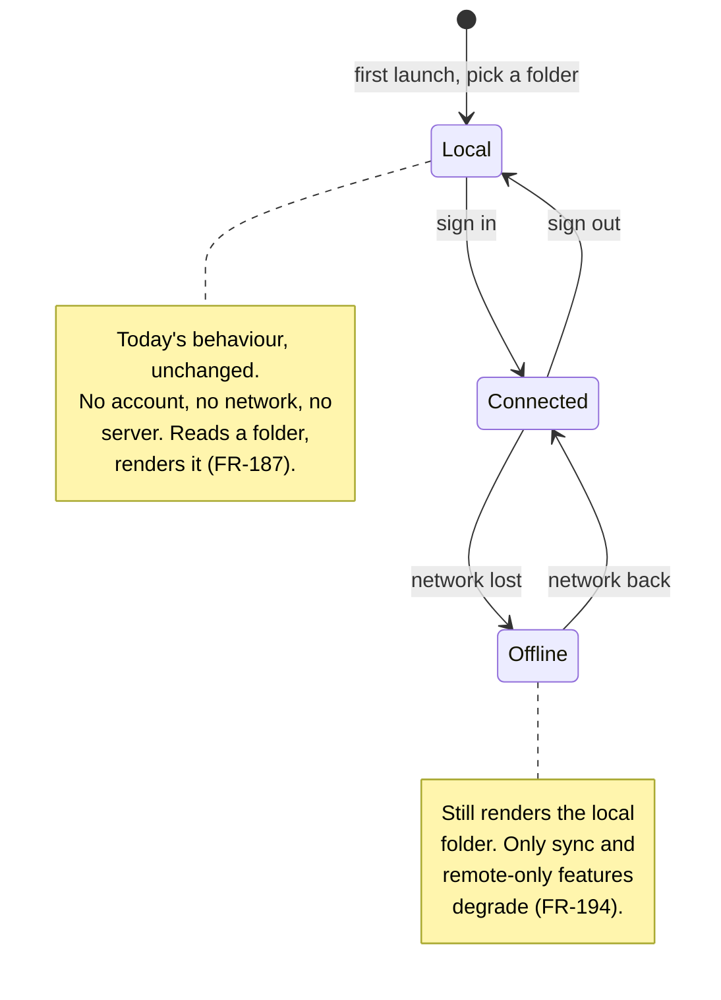
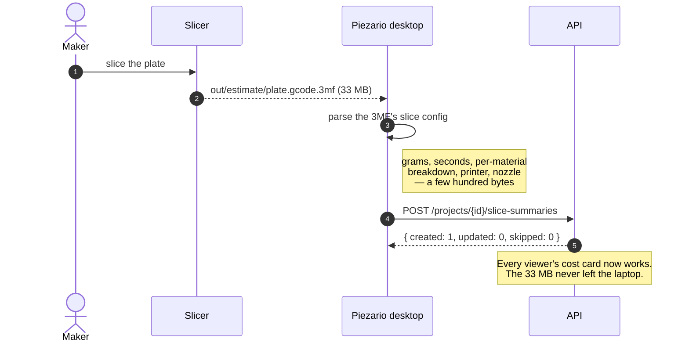
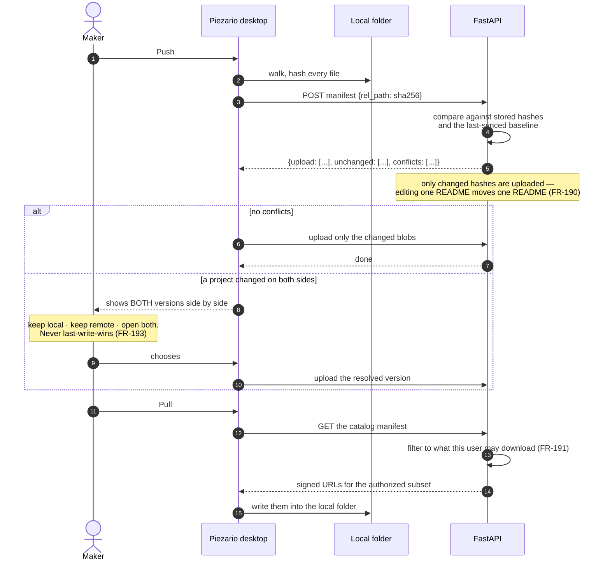

# Desktop Client

The Electron app is not deprecated. It stops being the whole product and
becomes a client — but a client that must keep working with no account,
no network, and no server.

## Why it survives

Three reasons, in order of how load-bearing they are.

**Geometry is enormous and local.** The reference catalog is 848 MB of
real content, with single files at 96 MB. A maker's working loop is
slice, print, adjust, re-slice — dozens of times before anything is worth
publishing. Forcing that loop through an upload would be slower than the
thing it replaces.

**Slicing happens on the desktop anyway.** The slicer that produces the
grams and seconds runs on the maker's machine, next to the printer. The
desktop app is already standing in the right place to read that output.

**The catalog is the maker's, not ours.** A folder on disk that keeps
working when the platform is down, or gone, is a promise worth keeping.

## Three modes

**Local mode** is what ships today and must not regress at any phase.
The folder is the catalog, `catalog.yaml` is the settings, and nothing
leaves the machine.

**Connected mode** signs in against the hosted API and binds a local
folder to a hosted catalog. The local folder stays the working copy.

**Offline** is connected mode with the network gone. The local render
keeps working; sync is queued; the UI says so plainly rather than
showing errors on every panel.

## What the desktop app is uniquely good at

### Publishing slice data without geometry

This is the highest-value thing on the roadmap, and it belongs here
because only the desktop app is standing next to the sliced files.

The same payload can be written to `.piezario/slices.yaml` and committed
to a GitHub-backed catalog, where the importer reads it (FR-051). One
mechanism, two delivery routes.

A summary is refused — counted as `skipped` — when a `parsed` row
already exists for that path. A real sliced file that the platform
actually holds always outranks a declaration about one (FR-088).

### Incremental push

A push transfers only files whose content hash changed (FR-190). The
desktop app hashes locally, asks the API which hashes it already has,
and uploads the difference. Re-publishing a catalog after editing one
README moves one README.

### Authorized pull

A pull fetches only what the signed-in user may download (FR-191) — so
pulling someone else's catalog you bought from gets you the projects you
are entitled to and nothing else. The same gate as the web download
path, no special case.

## Conflicts

The same project edited in two places is a real scenario: the maker edits
the README on their laptop and a collaborator edits it in the browser.

**Conflicts are surfaced, never resolved by last-write-wins** (FR-193).
Silently overwriting an hour of someone's writing because their clock
was behind is the worst possible failure here, and it is invisible when
it happens.

Detection is per project, by content hash against the hash the last sync
recorded. On conflict the app presents both versions and three choices:
keep local, keep remote, or open both. There is no automatic merge —
frontmatter merges cleanly in theory and disastrously in practice.

## What it does not do

- **It is not a thin client.** Local mode must never require the server.
- **It does not proxy the download gate.** It asks the API and honours
  the answer; it does not cache entitlements or decide access itself.
- **It does not hold a second implementation of the walker.** The
  invariant lives once, server-side (see
  [`catalog-sources.md`](catalog-sources.md#one-implementation-forever)).
  In local mode the desktop app runs its own copy against the local
  folder, and that copy must be kept behaviourally identical — which is
  an argument, long term, for extracting it as a shared component rather
  than maintaining two.

## Packaging

Unchanged from today: the Next.js app built with `output: "standalone"`,
launched from `desktop/main.js` using Electron's own bundled Node
(`ELECTRON_RUN_AS_NODE=1`), so the packaged AppImage needs no separate
runtime. The window loads `http://127.0.0.1:<port>`.

Connected mode adds one thing to that picture: a stored session token,
in the OS keychain rather than in a file beside the catalog.

The known Linux rendering constraints for this shell — the display
server and frame-pacing flags it needs on current Mesa — are an
operational detail of the desktop build and live in `desktop/AGENTS.md`,
not here.

## Sequencing

The desktop client is **Phase 6** (see [`roadmap.md`](../roadmap.md)),
after the web platform can stand on its own. One item arguably belongs
earlier: local slice-summary publishing (FR-192) is what makes a
GitHub-backed catalog useful, and a GitHub-backed catalog is the cheapest
path for the makers who already use git. Pulling it into Phase 2 is
worth considering.

## Related requirements

Desktop client: §3.14 (FR-187 – FR-194). Slice summaries: FR-087 –
FR-089, FR-192. The endpoints are in
[`api-specification.md`](api-specification.md#post-projectsidslice-summaries).
