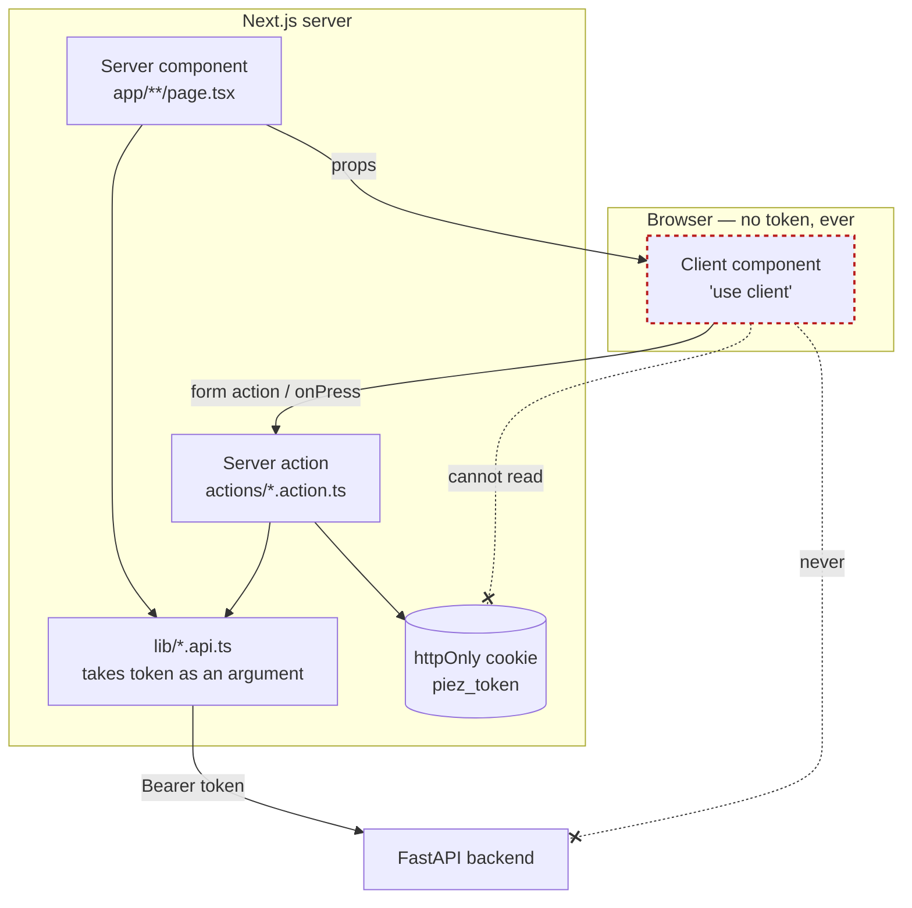
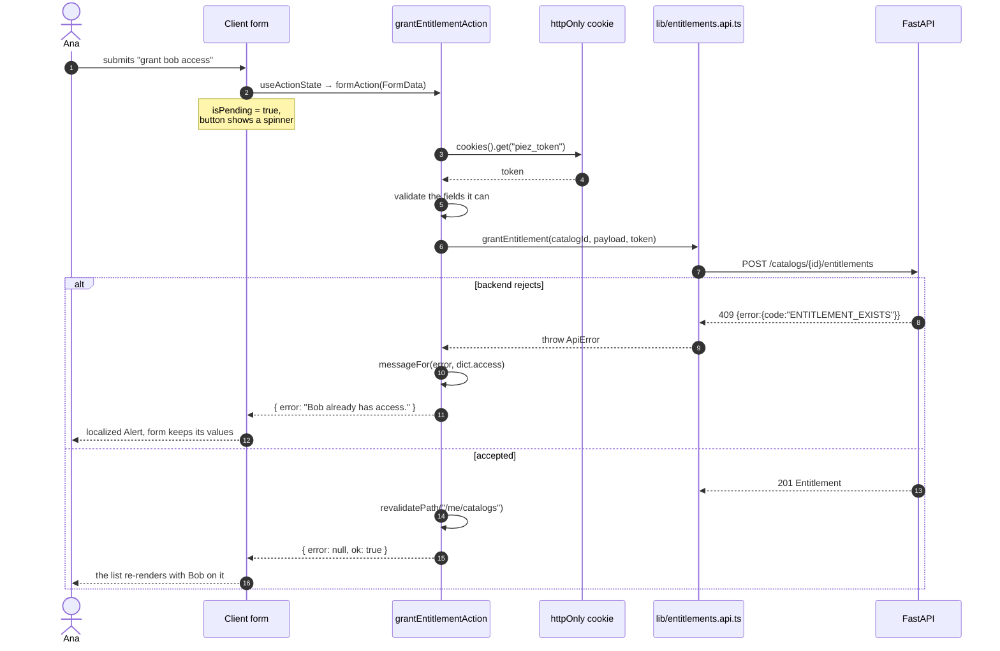

# Frontend Architecture

Next.js 16 (App Router) with React 19, Tailwind v4 and HeroUI v3. The
frontend holds no business logic: it renders what the API returns and
re-checks nothing it is not also enforcing server-side. Its one
architectural job is keeping the session token out of the browser.

## The three layers

The JWT lives in an **httpOnly cookie**, so client JavaScript cannot
read it. Every authenticated call therefore runs server-side, which
forces a clean separation:

- **`lib/*.api.ts`** — raw `fetch` wrappers around the backend. They
  take the bearer `token` as an explicit argument and are imported only
  by server code. Never by a client component.
- **`actions/*.action.ts`** — the `"use server"` files. They read the
  auth cookie, call `lib/*.api.ts`, map error codes to localized
  messages, and `revalidatePath()` after mutations.
- **`components/**/*.tsx`** — mostly `"use client"`. They handle
  interactivity and call server actions. They never touch the cookie or
  the backend directly.

Server components (`app/**/page.tsx`) fetch through `lib/*.api.ts` and
pass plain serializable data down as props.



The two crossed edges are the invariant: a client component never
touches the backend and never sees the cookie. Everything authenticated
runs on the server side of that boundary.

## Structure

```text
frontend/
├── next.config.ts          # standalone output, /media rewrite, body size limit
├── proxy.ts                # route guard (Next 16's middleware)
├── app/
│   ├── layout.tsx  providers.tsx  globals.css
│   ├── login/  register/  logout/route.ts  forgot-password/  reset-password/
│   ├── discover/                       # public catalog directory
│   ├── redeem/                         # access-code redemption
│   ├── settings/{account,cost,filaments,supplies,notifications}/
│   ├── me/{catalogs,entitlements}/
│   ├── admin/{users}/
│   └── [username]/                     # public profile — LAST segment
│       └── [catalog]/
│           ├── page.tsx                # the project grid
│           ├── settings/               # visibility, editors, source, access
│           ├── projects/[...path]/       # project detail, by path with redirects
│           ├── fonts/  icons/
│           └── access/                 # entitlements + codes (owner only)
├── actions/                # auth, catalogs, sources, projects, uploads,
│                           # entitlements, codes, inventory, cost, downloads
├── lib/                    # api.ts + one *.api.ts per domain + pure helpers
├── components/             # catalog/ project/ files/ cost/ access/ inventory/
│                           # fonts/ icons/ layout/ forms/ markdown/ common/
└── i18n/                   # config, server, provider, dictionaries/{en,es}.ts
```

Route ordering matters: `[username]` is a root-level catch-all, so every
real application route (`settings`, `discover`, `redeem`, `admin`,
`login`) must be a reserved username the backend refuses at registration
(`USERNAME_RESERVED`, see
[`api-specification.md`](api-specification.md#post-authregister)).

## `lib/api.ts`

The entire "API client" — no axios, no interceptors, no wrapper class.

```ts
export const AUTH_COOKIE_NAME = "piez_token";

/** Base URL of the backend API (`.../api/v1`). */
export function apiBaseUrl(): string {
  return (
    process.env.API_URL_INTERNAL ??
    process.env.NEXT_PUBLIC_API_URL ??
    "http://localhost:8100/api/v1"
  );
}

export class ApiError extends Error {
  readonly status: number;
  readonly code: string;
  readonly details: Record<string, unknown>;

  constructor(status: number, code: string, message: string, details = {}) {
    super(message);
    this.name = "ApiError";
    this.status = status;
    this.code = code;
    this.details = details;
  }
}

/** Parse a backend error envelope into an {@link ApiError}. */
export async function toApiError(res: Response): Promise<ApiError> {
  let body: { error?: { code?: string; message?: string; details?: object } } | null;
  try {
    body = await res.json();
  } catch {
    body = null;
  }
  return new ApiError(
    res.status,
    body?.error?.code ?? "UNKNOWN",
    body?.error?.message ?? "Something went wrong.",
    (body?.error?.details as Record<string, unknown>) ?? {},
  );
}
```

`details` is carried through deliberately. Quota and entitlement errors
put the numbers a user needs into `details`, and NFR-015 requires the UI
to show them rather than a generic failure.

Each domain file follows the same shape: types mirroring the backend
schemas 1:1 in snake_case, a local `authHeaders(token?)`,
`cache: "no-store"` on every call, `404 → null` for single reads, and
`throw await toApiError(res)` for everything else.

```ts
// lib/entitlements.api.ts — server-side only.
export async function grantEntitlement(
  catalogId: string,
  payload: GrantEntitlementPayload,
  token: string,
): Promise<Entitlement> {
  const res = await fetch(`${apiBaseUrl()}/catalogs/${catalogId}/entitlements`, {
    method: "POST",
    headers: { ...authHeaders(token), "Content-Type": "application/json" },
    body: JSON.stringify(payload),
    cache: "no-store",
  });
  if (!res.ok) {
    throw await toApiError(res);
  }
  return (await res.json()) as Entitlement;
}
```

## Server actions

The canonical `useActionState` shape, with error codes mapped to
localized copy per domain:

```ts
"use server";

function messageFor(error: unknown, t: Dictionary["access"]): string {
  if (error instanceof ApiError) {
    switch (error.code) {
      case "NOT_CATALOG_OWNER":
        return t.errorNotOwner;
      case "USER_NOT_FOUND":
        return t.errorNoSuchUser;
      case "ENTITLEMENT_EXISTS":
        return t.errorAlreadyGranted;
      default:
        return t.errorGeneric;
    }
  }
  return t.errorGeneric;
}

export async function grantEntitlementAction(
  catalogId: string,
  _prevState: GrantState,
  formData: FormData,
): Promise<GrantState> {
  const token = (await cookies()).get(AUTH_COOKIE_NAME)?.value;
  const { dict } = await getServerI18n();
  if (!token) {
    redirect(`/login?next=/me/catalogs`);
  }

  const username = String(formData.get("grantee_username") ?? "").trim();
  if (!username) {
    return { error: dict.access.errorRequired };
  }

  try {
    await grantEntitlement(catalogId, {
      grantee_username: username,
      project_id: (formData.get("project_id") as string) || null,
      note: (formData.get("note") as string) || null,
    }, token);
  } catch (error) {
    return { error: messageFor(error, dict.access) };
  }

  revalidatePath(`/me/catalogs`);
  return { error: null, ok: true };
}
```

Two idioms are load-bearing and repeated everywhere: `redirect()` must
sit **outside** any `try`/`catch` because it throws `NEXT_REDIRECT`, and
extra arguments are bound first so the action still matches
`useActionState`'s `(prevState, formData)` signature.



The error path is the interesting one: the backend's `error.code` is the
contract, and each domain's `messageFor()` is the only place it becomes
human-readable text. Nothing in a component hard-codes an English
string.

## Session and route guarding

```ts
// actions/auth.action.ts
async function setSessionCookie(token: string): Promise<void> {
  (await cookies()).set(AUTH_COOKIE_NAME, token, {
    httpOnly: true,
    sameSite: "lax",
    secure: process.env.NODE_ENV === "production",
    path: "/",
    maxAge: 60 * 60 * 24 * 7,
  });
}

/** Resolve the current user, deduped per request. */
export const getCurrentUser = cache(async (): Promise<CurrentUser | null> => {
  const token = (await cookies()).get(AUTH_COOKIE_NAME)?.value;
  if (!token) {
    return null;
  }
  try {
    return await fetchMe(token);
  } catch {
    return null;
  }
});
```

`getCurrentUser` is wrapped in React's `cache()` because the layout, the
nav and the page all call it — without it, `/auth/me` is fetched three
times per render.

`proxy.ts` guards only the routes that are meaningless without a
session (`/settings/*`, `/me/*`, `/admin/*`). It is a UX guard: the real
check is repeated in the action and enforced by the backend (NFR-006).

## Downloads: never point the browser at the backend

The API has no browser-reachable origin in production, and the download
endpoint needs a bearer token the browser cannot supply. Both problems
are solved the same way — a route handler on **this** origin that
injects the token and follows the redirect:

```ts
// app/api/download/[fileId]/route.ts
export async function GET(
  _req: NextRequest,
  { params }: { params: Promise<{ fileId: string }> },
) {
  const { fileId } = await params;
  const token = (await cookies()).get(AUTH_COOKIE_NAME)?.value;

  const upstream = await fetch(`${apiBaseUrl()}/files/${fileId}/download`, {
    headers: token ? { Authorization: `Bearer ${token}` } : {},
    redirect: "manual",
    cache: "no-store",
  });

  // The backend answers 302 with a short-lived signed object-storage URL
  // (FR-168). Hand that straight to the browser: the bytes never pass
  // through this server, and the URL expires on its own.
  const location = upstream.headers.get("location");
  if (upstream.status === 302 && location) {
    return NextResponse.redirect(location);
  }
  return NextResponse.json(await upstream.json(), { status: upstream.status });
}
```

A relative URL is also what makes `<a download>` work at all — browsers
ignore the attribute cross-origin.

Inline assets (covers, gallery images, fonts for the specimen browser)
go through a `next.config.ts` rewrite instead, so `` and
`@font-face` see same-origin URLs:

```ts
async rewrites() {
  return [
    { source: "/media/:path*", destination: `${backendOrigin}/media/:path*` },
  ];
}
```

## Upload UI

The one place the frontend does real work. Uploads bypass server actions
— a 50 MB `.3mf` through a server action would buffer in the Next
process — and go to a route handler that streams to the backend, with
`XMLHttpRequest` on the client for progress events.

The quota meter is fed from the `quota` object every upload response
carries, so it stays accurate without a separate poll. A
`507 STORAGE_QUOTA_EXCEEDED` is rendered with the real numbers from
`error.details` (NFR-015):

> Not enough space. This upload is 412 MB, you have 214 MB of your 1 GB
> used, and 786 MB free. Free up space, or ask a maintainer to raise
> your quota.

## Access-aware rendering

Every project payload carries `viewer_can_download` and `viewer_can_edit`,
computed server-side per request. The UI branches on those two booleans
and never re-derives access from `access_level` plus a guessed
entitlement — that would be a second implementation of the rule, and it
would drift.

A paid project the viewer lacks renders its page in full — cover,
description, tags, badges — with the file table replaced by an explicit
panel saying what is withheld and offering the redeem form (FR-148,
FR-176). It never pretends the files do not exist.

## Cost cards

The cost card is fetched from `/projects/{id}/cost` on the server for the
signed-in viewer and is simply absent for guests. Rows with `null` are
not rendered (FR-144); rows expand to their per-file breakdown; the
price is an editable field that posts a `target_price` and re-renders
with the back-solved markup (FR-142).

Because two different makers see two different cost cards for the same
public project, nothing about cost may ever be cached at the route level.

## UI stack

- **Tailwind v4 is CSS-first** — there is no `tailwind.config.*`. The
  configuration is `postcss.config.mjs` plus `app/globals.css`, which
  imports Tailwind and then HeroUI styles, in that order, and defines
  the palette as CSS variables. Piezario's accent carries over from the
  desktop app: `#ea580c` light, `#fb923c` dark.
- **Dark mode via `next-themes`** with `attribute="data-theme"`, to
  interoperate with HeroUI's `[data-theme="dark"]`. `<html>` needs
  `suppressHydrationWarning`, and the toggle gates on a `mounted` flag.
- **HeroUI v3** uses compound dot notation (`Card.Header`,
  `Alert.Content`), `onPress` rather than `onClick`, and
  `isPending`/`isDisabled`. No provider is required beyond
  `Toast.Provider`.
- **No `next/image`.** Covers are user-supplied and served from our own
  origin through the `/media` rewrite; allow-listing hosts buys nothing
  here.

## Forms and validation

Server actions only, `useActionState` for state, HeroUI `isRequired`
for immediate feedback, re-validation in the action, and the backend as
the actual authority whose `error.code` maps to localized copy. No zod,
no react-hook-form.

Repeatable rows — supply lines, component lines, filament colors,
purchase history — are client components that serialize to a hidden JSON
field, parsed server-side in the action.

## i18n

Hand-rolled, no library. `en.ts` is the source of truth and exports
`export type Dictionary = typeof en`; `es.ts` is typed as `Dictionary`,
so a missing or extra key is a compile error. Server components call
`getServerI18n()`; client components call `useI18n()`. Component files
contain no literal user-facing strings.

Locale resolution: an explicit `piez_locale` cookie, then
`Accept-Language`, then `en` (FR-201). Note the inversion from
PrintForHelp — this platform is English-default with Spanish shipped,
because its audience is makers on the open internet rather than one
Spanish-speaking community.

## Quality gates

`npx tsc --noEmit` and `npm run build` in CI, plus prettier and
markdownlint via pre-commit. There is no test runner on the frontend:
the logic worth testing lives in the backend, and the frontend's job is
to be a thin, typed projection of it.
