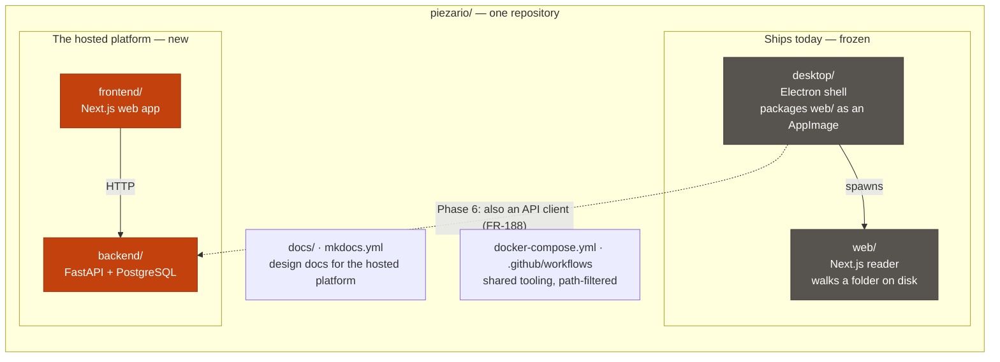

# Repository Layout

Where the new code goes, why it lives beside the old code instead of
replacing it, and the one duplication this decision creates that has to
be managed deliberately.

## The short answer

Two **new** top-level folders, `backend/` and `frontend/`. Nothing in
`web/` or `desktop/` moves, is renamed, or is edited to accommodate
them. The hosted platform is a new product in the same repository, not a
rewrite of the existing one.

| Folder | What it is | Status |
|---|---|---|
| `web/` | Next.js app that reads a catalog **folder** and renders it | Ships today. Frozen for this project. |
| `desktop/` | Electron shell that packages `web/` into an AppImage | Ships today. Changes in Phase 6 only. |
| `backend/` | FastAPI + PostgreSQL API for the hosted platform | New, Phase 0 scaffold |
| `frontend/` | Next.js app that talks to `backend/` over HTTP | New, Phase 0 scaffold |
| `docs/` | These documents | Exists |

Yes, that means **two Next.js applications in one repository**. That is
a real cost and it is deliberate — see "What happens to `web/`" below.

## Why one repository

The alternative was a separate `piezario-web` repository, which is
tempting because the two products share no code today.

| Alternative | Why we rejected it |
|---|---|
| A separate repository | The desktop app becomes an API client in Phase 6 (FR-188). Splitting now means a cross-repo dependency exactly where the coupling is tightest, plus two issue trackers for one product |
| Rename `web/` → `desktop-web/` and take the good name | A rename touches every path in `desktop/main.js`, `stage.js`, CI and `AGENTS.md` — churn in the one component that currently works, for cosmetics |
| Build the hosted app *inside* `web/` | The two have opposite invariants: `web/` must never have a database, `backend/` is nothing but one. Sharing a folder would mean sharing dependencies and lint config between apps that disagree at the root |

The deciding argument is Phase 6. `desktop/` has to speak to
`backend/`'s API, push content to it, and stay behaviourally identical
to `frontend/` where they overlap. Keeping them in one repository makes
that a normal refactor instead of a release-coordination problem.

## What happens to `web/`

**It stays. Indefinitely.**

This is worth stating plainly because the instinct is to assume the
hosted app eventually absorbs it. It cannot: FR-187 requires the desktop
app to work against a local folder with **no account and no network**,
and FR-194 requires it to keep rendering when the platform is
unreachable. Something has to render a folder offline, and that
something is `web/`.

So the long-term shape is:

- `web/` — the offline renderer. Reads a folder, no database, no auth.
- `frontend/` — the hosted renderer. Reads an API, has auth, entitlements,
  uploads, multi-tenancy.
- `desktop/` — packages `web/`, and from Phase 6 also signs in to
  `backend/` for push, pull and slice-summary publishing.

They will drift in appearance, and that is acceptable. What must **not**
drift is the meaning of a catalog — which brings us to the real problem
this layout creates.

## The invariant problem

The core invariant — *a folder with no non-output subfolders is a project*
— is the one rule everything else derives from. It exists in the
repository today in **two** implementations that must agree:

1. `web/lib/catalog.ts` → `walk()` (TypeScript)
2. `web/scripts/thumbnail.py` → `is_model_dir()` (Python)

Adding `backend/app/imports/walker.py` makes it **three**. That is a
material risk, and [`catalog-sources.md`](catalog-sources.md) claims the
rule "lives once, server-side" — true within the backend, but not true
of the repository.

Three mitigations, in order of how much they buy:

- **A shared fixture corpus.** One directory of pathological trees —
  empty folders, output dirs, dot-prefixed folders, a generator's `out/`,
  a nested category that is also a project's parent, `venv/` at depth — plus
  a JSON file naming the expected projects and categories. Every
  implementation runs against it in CI. This is cheap and catches the
  drift that actually happens.
- **The backend is the reference.** When implementations disagree,
  `backend/app/imports/walker.py` is right and the others are the bug.
  Say so in `AGENTS.md`.
- **Extract it properly, later.** If the rule changes more than once
  after Phase 2, collapse `web/`'s copy by having the desktop call a
  local importer rather than re-deriving. Not worth doing pre-emptively.

The fixture corpus belongs in Phase 2, alongside the importer itself.
It is currently **not** on the roadmap — see the gap noted below.

## Shared tooling

Four things live at the root and serve every folder:

- **`docker-compose.yml`** — today it runs only the `docs` service.
  Phase 0 adds `backend`, `postgres` and `frontend`. It never runs
  `web/` or `desktop/`; those keep their own npm scripts.
- **`.github/workflows/`** — `deploy-docs.yml` exists. Phase 0 adds a
  `ci.yml` using path filters (`dorny/paths-filter`) so a change under
  `frontend/` does not run Ruff, and a change under `web/` does not run
  pytest. The existing `test.yml` and `release.yml` for the desktop app
  are left alone.
- **`.markdownlint.json`** — repository-wide.
- **`AGENTS.md` files** — one per component, each authoritative for its
  own folder. The root `AGENTS.md` stays authoritative for the desktop
  product; `docs/` is authoritative for the hosted platform.

Port allocation, so nothing collides while all of it runs at once:

| Service | Port | Notes |
|---|---|---|
| `web/` dev server | 3000 | existing, unchanged |
| `frontend/` | 3001 | container 3000 |
| `backend/` | 8100 | container 8000 |
| `postgres` | 5433 | container 5432 |
| `docs` | 2013 | |

## Naming

`backend/` and `frontend/` are deliberately generic, matching
`printforhelp` so the two projects read the same way. The cost is that
`frontend/` and `web/` are near-synonyms describing different things,
which is genuinely confusing on first read — the folder table above and
this section are the mitigation. `web/` was not renamed for the reason
in the rejected-alternatives table.

## Sequencing

Nothing about `web/` or `desktop/` changes before Phase 6:

| Phase | `web/` | `desktop/` | `backend/` | `frontend/` |
|---|---|---|---|---|
| 0 | untouched | untouched | scaffold | scaffold |
| 1–5 | untouched | untouched | built out | built out |
| 6 | untouched | gains connected mode | gains desktop endpoints | untouched |

If a Phase 1–5 change appears to require editing `web/`, that is a
signal the change is in the wrong place.

## Documentation gaps this raises

Two items follow from this document and are **not yet on the roadmap**:

- The **shared fixture corpus** for the invariant (Phase 2, above).
- A decision on whether `frontend/` and `web/` should share a component
  library. Recommendation: **no**, not before Phase 5. They will look
  similar and diverge in what they can assume — `frontend/` has a viewer
  identity and entitlements, `web/` has neither — and extracting a shared
  library before that divergence settles usually produces a library
  shaped like whichever app was written first.

## Related requirements

Desktop local mode: FR-187, FR-194. Desktop as API client: FR-188 –
FR-193. The importer and its invariant: §3.4, and
[`catalog-sources.md`](catalog-sources.md#the-core-invariant). Component
architecture: [`backend.md`](backend.md) and
[`frontend.md`](frontend.md).
