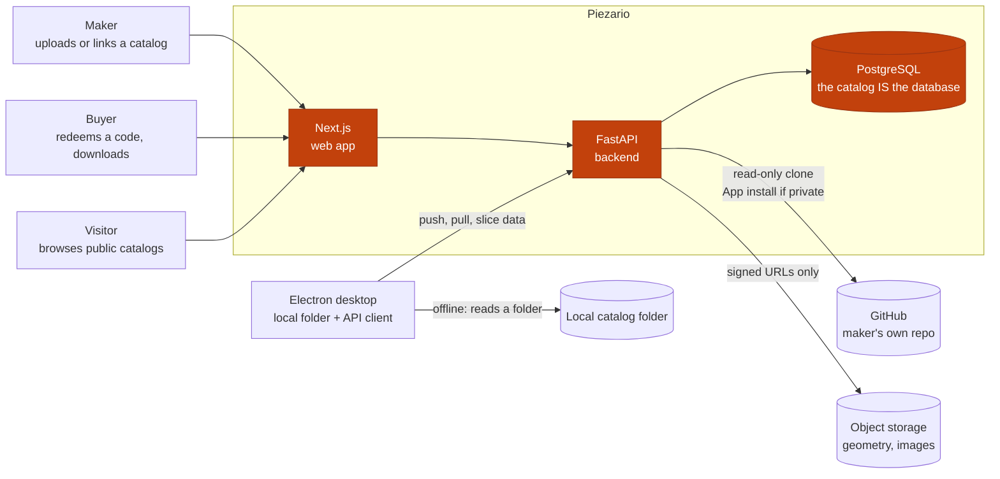

# Piezario Documentation

**Piezario** is a platform for makers to organize a catalog of
**projects**, share it publicly, collaborate with other makers, and
price what they build. It began as a desktop app that read a folder off
disk; this documentation describes the **hosted web version**, where a
catalog lives on the platform instead of on one person's laptop. The
move was forced by two things that a local folder cannot do: other
makers wanted to contribute designs without learning git, and buyers
who paid for a design needed a way to download it.

A **project** is one buildable thing. Usually that is a single printable
part — a keychain, a stamp, a lithophane — and that is the case the
product is tuned for. But it may equally be a whole build: printed
parts, purchased hardware, electronics, firmware and assembly notes,
held together as one project rather than scattered across four. Nothing
declares which kind it is; the platform derives that from what the
project contains.

!!! info "Early stage"
    The hosted platform is at Phase 0 — design documents only. No
    backend or frontend code exists yet. The existing Electron desktop
    app in `desktop/` and the Next.js reader in `web/` continue to work
    against a local catalog folder and are unaffected until Phase 6.

## How it fits together

## Planned Features

- **Multi-tenant catalogs** — every user owns one or more catalogs. A
  catalog is either **GitHub-backed** (the owner links a repository —
  public, cloned anonymously, or private via a GitHub App installation
  they control) or **hosted** (the owner uploads files through the
  browser, against a storage quota).
- **Paid access without a payment gateway** — a catalog owner grants
  entitlements directly, or issues redeemable access codes, to the
  people who bought a design. Money changes hands outside the platform
  in v1.
- **Per-user cost model** — each maker's filaments, supplies, machine
  rates and markup are private to them, so the same public project shows
  a different landed cost to every viewer who has configured one. A
  project's bill of materials — printed parts, hardware, electronics —
  prices through the same mechanism.

## Technology Stack

| Component | Technology |
|---|---|
| Backend | FastAPI (Python 3.13) |
| Database | PostgreSQL 16 |
| Frontend | Next.js 16 (App Router) + React 19 |
| Styling | Tailwind v4 + HeroUI v3 |
| Auth | JWT (HS256) + Argon2ID |
| Object storage | Local disk in dev, S3-compatible in production |
| Documentation | MkDocs Material |
| Orchestration | Docker Compose |
| Desktop client | Electron 33 (API client, offline mode retained) |
