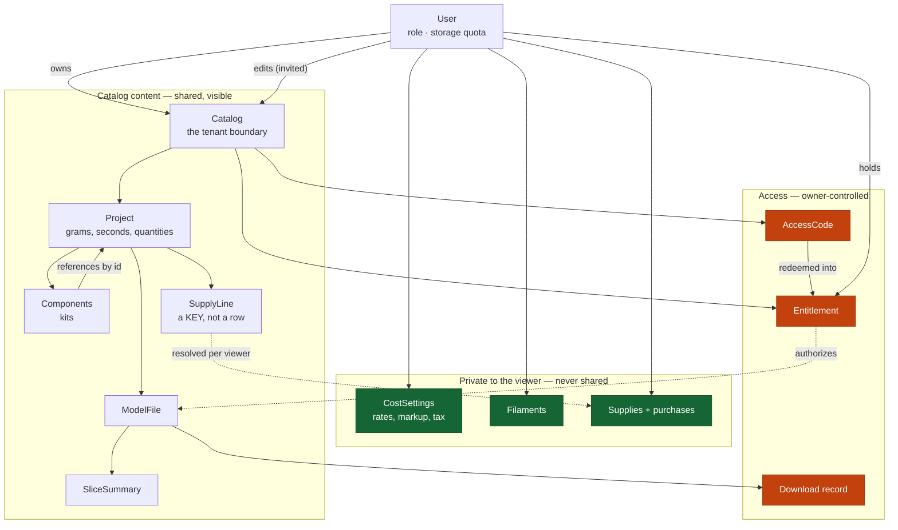
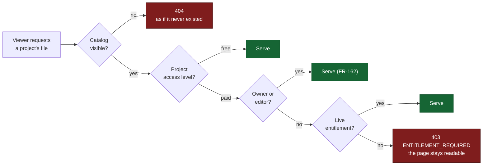
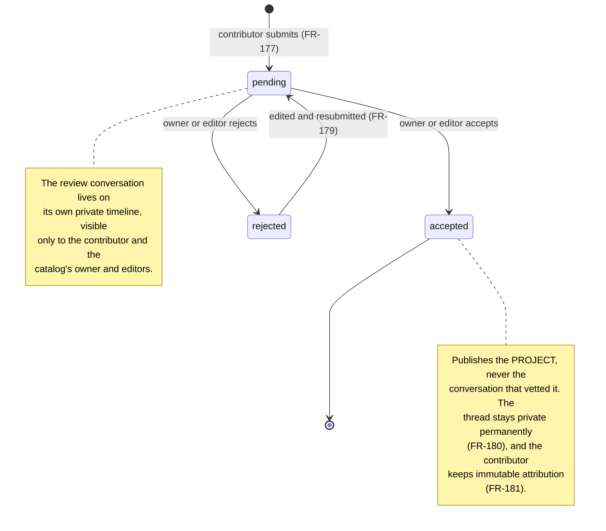

# Software Requirements Specification

## 1. Introduction

### 1.1 Purpose

This document specifies the hosted, multi-tenant version of **Piezario**.
It defines what the platform must do, for whom, and under which
constraints. Every requirement carries a stable identifier (`FR-NNN`,
`NFR-NNN`, `IR-NNN`) that the architecture and API documents cite back.

Identifiers are allocated from one flat sequence per prefix and are
**never renumbered**. A new requirement takes the next free number and
is then filed into the topically correct section, so section numbering
is not contiguous — §3.4 runs FR-039 – FR-060 and then FR-203 – FR-213.
`FR-019` and `FR-020` are unused.

### 1.2 Scope

Piezario hosts **catalogs of projects**. A catalog belongs to a user, is
browsable in a web app, and is either mirrored from a GitHub repository
or uploaded through the browser. On top of the catalog sit two things
the desktop app already does well and one it cannot do at all: a **cost
model** that prices a build from its sliced geometry and its bill of
materials, a **composition model** that prices an assembly from its
parts, and **paid access** — letting the catalog owner decide who may
download which project.

A **project** is one buildable thing. Most of the time that is a single
printable part — a keychain, a stamp, a lithophane — and that remains
the dominant case the product is tuned for. But a project is
deliberately not defined as "a 3D model": it may also be a whole build
combining printed parts, purchased hardware, electronics, firmware and
assembly instructions. A desk lamp with a printed shade, an ESP32, three
screws and a `.ino` sketch is one project, not four unrelated files.

Nothing about that requires a second entity or a mode switch. What a
project *is* stays derived from what it contains (§3.5): its capability
badges come from the kinds of files present, its printed cost from its
sliced geometry, and its non-printed parts from its supply lines, which
already price rings, chains and glue and price a microcontroller exactly
the same way.

!!! note "Naming"
    "Piezario" and the word "project" are provisional. The product name
    is expected to change, and these documents therefore avoid baking
    "3D" into the domain vocabulary: entities are `Catalog`, `Project`,
    `ProjectFile`, never `Model3D` or `Print`. Renaming the product
    should not require renaming the schema.

The platform is also **social**: public profiles with avatars and
biographies, comments with threaded replies, likes, @mentions, watches
and notifications. These are modelled on PrintForHelp, which the same
author wrote and which already has them working — the field sets,
polymorphic patterns and defaults are taken from it deliberately, so
the two products feel like siblings rather than strangers (§3.16 –
§3.18).

Out of scope for v1: payment processing, marketplace search across
catalogs, print-farm job scheduling, PCB or firmware *validation* of any
kind (electronics files are stored, listed and priced, never parsed),
direct messaging between users, and following a *person* rather than a
thing (watches attach to projects and catalogs, not to accounts).

### 1.3 Background

Piezario began as an Electron app wrapped around a Next.js reader that
walked a folder on disk. The filesystem *was* the schema: a folder with
no subfolders is a project, its parents are its categories, and a README's
YAML frontmatter carries everything conventions cannot infer. That design
is documented in the repository's `AGENTS.md` and remains authoritative
for the desktop app.

Two things broke it. Other makers started contributing designs, and some
of them will not learn git — they have a README and an STL and want a
page. And buyers paid for designs, which requires the platform to know
who is allowed to download what. Neither is expressible in a folder on
one person's laptop.

The hosted version therefore **inverts the core invariant**: the
filesystem stops being the schema and becomes an *import format*. A
folder tree is still the way a maker organizes work, and the platform
still reads one exactly as the desktop app does — but what it produces
is rows in PostgreSQL, not a render.

## 2. Overall Description

### 2.1 Product Perspective

Piezario is a standalone web application: a FastAPI backend over
PostgreSQL, a Next.js frontend, and an S3-compatible object store for
geometry. It integrates with GitHub read-only, to mirror repositories
that makers already maintain. The existing Electron shell is retained
and becomes an API client (§3.14).

### 2.2 User Classes

- **Guest** — unauthenticated. Browses public catalogs and free projects,
  downloads free files. Cannot see paid files or anyone's cost figures.
- **User** (`role = user`) — the default. Owns catalogs, uploads or
  links designs, grants entitlements over **their own** catalogs, and
  keeps a private inventory and cost model.
- **Maintainer** (`role = maintainer`) — community moderator. Reviews
  reported content, adjusts storage quotas, and can act on any catalog.
- **Admin** (`role = admin`) — everything a maintainer can do, plus user
  and role management and platform configuration.

The load-bearing distinction is that **catalog ownership, not platform
role, is what grants access to a catalog's paid projects**. A regular user
must be able to run their whole commercial operation without an admin
ever touching it.

### 2.3 Domain Overview



The two dotted edges are the whole design in miniature. A **supply line
on a public project is a string key**, resolved against whichever user is
looking — so the same project prices differently for every maker and no
one's purchase history leaks. An **entitlement authorizes a file**, not
a page — so a paid project stays fully readable while its geometry stays
withheld.

## 3. Functional Requirements

### 3.1 Accounts & Authentication

- **FR-001**: Users must be able to self-register with a username, an
  email address and a password.
- **FR-002**: Passwords must be at least 8 characters and contain at
  least one letter and one digit.
- **FR-003**: Users must be able to log in with either their username or
  their email address, case-insensitively.
- **FR-004**: A successful login must issue a signed JWT with a 7-day
  expiry.
- **FR-005**: Passwords must be stored as Argon2ID hashes and never in
  any recoverable form.
- **FR-006**: Users must be able to change their own password by
  supplying the current one.
- **FR-007**: Users must be able to request a password reset by email;
  the reset token must be single-use, time-limited, and stored hashed.
- **FR-008**: The password-reset request endpoint must respond
  identically whether or not the email is registered, so it cannot be
  used to enumerate accounts.
- **FR-009**: The system must bootstrap a default admin account from
  `DEFAULT_ADMIN_USERNAME` / `DEFAULT_ADMIN_PASSWORD` on first start.
- **FR-010**: Users must be able to deactivate their own account. A
  deactivated account cannot log in, and its catalogs become invisible
  to everyone except maintainers and admins.
- **FR-011**: Deactivating or deleting a user must never cascade to the
  entitlements they granted. A buyer who paid keeps their access even if
  the seller's account goes away.
- **FR-012**: Users must be able to set a display name, an avatar and a
  public profile blurb.

### 3.2 Roles & Permissions

- **FR-013**: The system must support exactly three platform roles:
  `user`, `maintainer`, `admin`.
- **FR-014**: Only admins may change another user's role.
- **FR-015**: The system must prevent the last active admin from being
  demoted or deactivated.
- **FR-016**: Every protected operation must be authorized server-side
  against both the caller's role **and** their relationship to the
  target catalog. Hiding a control in the UI is never the enforcement.
- **FR-017**: Maintainers and admins must have a global override for
  moderation purposes, and every use of it must be recorded in the audit
  log with the actor, the target and the reason.
- **FR-018**: A maintainer's global override must **not** extend to
  reading another user's private cost figures, inventory, or sales
  records. Moderation is about published content, not about a maker's
  books.

#### Permission Matrix

| Action | Guest | User | Catalog owner | Catalog editor | Maintainer | Admin |
|---|---|---|---|---|---|---|
| Browse public catalogs and free projects | ✓ | ✓ | ✓ | ✓ | ✓ | ✓ |
| Create a catalog | — | ✓ | n/a | n/a | ✓ | ✓ |
| Edit a catalog's projects | — | — | ✓ | ✓ | ✓ | ✓ |
| Upload files to a catalog | — | — | ✓ | ✓ | ✓ | ✓ |
| Link / re-sync a GitHub source | — | — | ✓ | — | ✓ | ✓ |
| Grant entitlements on a catalog (FR-149) | — | — | ✓ | — | — | — |
| Issue access codes (FR-155) | — | — | ✓ | — | — | — |
| Download a free file | ✓ | ✓ | ✓ | ✓ | ✓ | ✓ |
| Download a paid file without entitlement | — | — | ✓ | ✓ | — | — |
| See own cost card | — | ✓ | ✓ | ✓ | ✓ | ✓ |
| See another user's cost card | — | — | — | — | — | — |
| Change a user's storage quota (FR-057) | — | — | — | — | ✓ | ✓ |
| Unpublish / take down a catalog | — | — | ✓ | — | ✓ | ✓ |
| Change a user's role | — | — | — | — | — | ✓ |

`✓` allowed · `—` denied · `n/a` not applicable. "Catalog owner" and
"catalog editor" are relationships to one specific catalog (§3.3), not
platform roles.

### 3.3 Catalogs

A **Catalog** is the tenant boundary and the unit of ownership,
visibility, storage accounting and paid access. Everything else in the
product — projects, files, fonts, icons — hangs off exactly one catalog.
A user may own several: a public free one, a paid one, and a private
scratch one are three catalogs, not three folders.

- **FR-021**: Any authenticated user must be able to create a catalog
  with a name, a URL slug, an optional description, an optional cover
  image and a visibility setting.
- **FR-022**: A catalog's slug must be unique per owner, so a catalog's
  public address is `/{username}/{catalog-slug}`.
- **FR-023**: A catalog must declare exactly one **source type**:
  `github` or `hosted`. See §3.4.
- **FR-024**: A catalog must support three **visibility** levels:
  - `public` — listed in discovery, readable by guests
  - `unlisted` — readable by anyone holding the link, never listed
  - `private` — readable only by its owner, its editors, and users
    holding an entitlement
- **FR-025**: Visibility must be independent of per-project access
  (§3.11). A public catalog may contain paid projects; a private catalog's
  projects are invisible regardless of their access level.
- **FR-026**: The catalog owner must be able to change visibility at any
  time, and the change must take effect on the next read with no
  rebuild step.
- **FR-027**: A catalog owner must be able to invite other users as
  **editors**, who may add and edit projects but may not grant
  entitlements, issue access codes, change visibility, or delete the
  catalog.
- **FR-028**: A catalog must have exactly one owner at a time. The
  owner must be able to transfer ownership to another user, who must
  accept before the transfer takes effect.
- **FR-029**: A pending ownership transfer must expire automatically
  after 7 days.
- **FR-030**: A catalog must expose the category tree derived from its
  projects' paths, and browsing must be filterable by any category prefix.
- **FR-031**: A catalog must be searchable over project titles,
  descriptions, slugs, tags, materials, printers and file names.
- **FR-032**: A catalog must carry an `exclude` list and an
  `output_dirs` list that govern import (§3.4), defaulting to
  `["node_modules", "__pycache__", "venv", "build", "dist"]` and
  `["out", "output"]` respectively.
- **FR-033**: Deleting a catalog must be a soft delete. Its rows and its
  objects must survive, invisible to everyone but maintainers and
  admins, for a documented retention window.
- **FR-034**: Deleting or hiding a catalog must **not** revoke
  entitlements already granted over it. A buyer must retain download
  access to what they paid for, or be told explicitly that the seller
  withdrew it.
- **FR-035**: A catalog must record aggregate counters — project count,
  file count, total bytes — maintained incrementally rather than
  recomputed per request.
- **FR-036**: A user must be able to report a catalog or a project to
  maintainers, with a reason.
- **FR-037**: Maintainers must be able to unpublish a catalog, which
  forces its visibility to `private` and records the reason. The owner
  must be told the catalog was unpublished, and may appeal.
- **FR-038**: A catalog must be able to declare a default license that
  applies to projects which do not declare their own.

### 3.4 Catalog Sources: GitHub and Hosted Upload

This is the section that exists because collaborators disagree about
git. Both source types must produce the **same** database rows and the
same rendered catalog; they differ only in where the bytes come from and
who pays for storing them.

The import rule is the desktop app's core invariant, unchanged:
**a folder with no non-output subfolders is a project, and its ancestor
folders are its categories**, provided it holds at least one visible
file or one output folder. Excluded and dot-prefixed folders are neither.

#### GitHub-backed catalogs

- **FR-039**: A catalog owner must be able to back a catalog with a
  GitHub repository — **public or private** — by supplying its URL, a
  branch and an optional subdirectory.
- **FR-040**: The platform must import a GitHub-backed catalog by
  cloning the repository at the named ref and walking it with the import
  rule above.
- **FR-041**: A sync must record the commit SHA it imported, its start
  and end time, its outcome, and a per-project summary of what was
  created, updated and removed.
- **FR-042**: The owner must be able to trigger a re-sync manually, and
  the platform must additionally re-sync on a schedule.
- **FR-043**: A GitHub-backed catalog must be read-only in the web UI
  with respect to imported content. Editing a project's metadata must be
  done in the repository; the UI must say so rather than silently
  discarding the edit on next sync.
- **FR-044**: A sync that fails must leave the previously imported state
  intact and surface the error to the owner. A broken push must never
  empty a live catalog.
- **FR-045**: A sync must detect a project whose folder disappeared and
  mark it removed rather than deleting its row, so entitlements and
  download history survive a rename.

#### What a sync is allowed to change on its own

A sync applies someone's `git push` to a live storefront. It must never
publish, unpublish, or reprice anything by itself.

- **FR-218**: A newly discovered project must import as a **draft**, and
  a catalog must carry a policy controlling this — `draft` (the default)
  or `publish_free`, which an owner may opt into for a pure showcase
  catalog. A maker who pushes an unfinished design must never find it
  live on the storefront because a webhook fired.
- **FR-219**: A newly discovered project's access level must default to
  `free` and must never be set to `paid` automatically. Pricing is
  always an explicit act by the owner.
- **FR-220**: A sync must **detect a moved or renamed project** rather
  than reporting it as a removal plus an unrelated creation. Matching is
  by the set of file content hashes, with path similarity as a
  tiebreaker. A detected move must preserve the project's identity, its
  access level, its draft state, its entitlements, its download history
  and every kit reference to it, and must record the old path in the
  redirect history (FR-062).
- **FR-221**: When the match is ambiguous, the sync must record it as a
  **suspected move awaiting confirmation** rather than guessing, and
  must leave both the old and the new row intact until the owner
  confirms or rejects it.
- **FR-222**: An **update** to an existing project — changed files,
  changed frontmatter — must never alter its access level, its draft
  state or its catalog's visibility. Only the owner changes those.
- **FR-223**: The platform must present a **sync review** surface
  listing what the last sync created, updated, moved, removed and
  suspects was moved, with the owner able to publish drafts, set access
  levels, and confirm or reject a suspected move — individually or in
  bulk. A catalog on the `publish_free` policy must not require this
  step in order to go live.
- **FR-224**: The platform must notify a catalog's owner when a sync
  brings in changes that need a decision — new drafts awaiting
  publication, or a suspected move awaiting confirmation.
- **FR-225**: A project that disappeared from the repository must not
  disappear from the storefront for anyone holding an entitlement to
  it. It must be withdrawn from listings, keep serving its files to
  existing entitlement holders, and be surfaced to the owner in the sync
  review so the removal can be made deliberate.
- **FR-046**: The platform must warn the owner when an imported
  repository contains **no geometry** — the common case, because most
  makers gitignore `*.stl` / `*.3mf` as too large for git. See the
  "geometry gap" note below.
- **FR-047**: A GitHub-backed catalog must support Git LFS pointers and
  resolve them when the repository has LFS enabled.
- **FR-048**: The platform must respect a `catalog.yaml` at the root of
  the imported tree for `models_dir`, `fonts_dir`, `icons_dir`,
  `supply_images_dir`, `exclude` and `output_dirs`. A malformed
  `catalog.yaml` must fall back to defaults rather than failing the sync.
- **FR-049**: A GitHub-backed catalog must not consume the owner's
  storage quota for files that remain in the repository. Only derived
  artifacts the platform generates itself (thumbnails, extracted slice
  summaries) count.

#### Repository access and credentials

- **FR-203**: The platform must be able to read **private** repositories
  on the owner's behalf, because a repository holding paid designs
  cannot be public (see FR-210).
- **FR-204**: Access to a private repository must be granted through a
  **GitHub App installation**. The owner installs the platform's GitHub
  App on the specific repositories they choose, using GitHub's own
  installation screen, and the platform stores only the resulting
  installation identifier.
- **FR-205**: The platform must not persist any long-lived repository
  credential. It must mint a short-lived installation access token per
  operation, hold it in memory for the life of that operation, and never
  write it to the database, to a log, or to any API response.
- **FR-206**: The GitHub App must request the minimum permissions the
  product needs — repository **contents: read-only** and **metadata:
  read-only** — and must never request write access to code, issues or
  workflows.
- **FR-207**: The platform must **not** accept a personal access token,
  must **not** request an OAuth scope that grants access to all of a
  user's repositories, and must **not** use a shared machine account
  added as a collaborator. Each of these grants far more access than
  reading one repository requires.
- **FR-208**: If an installation is uninstalled, or the repository is
  deselected from it, the next sync must fail with a specific,
  actionable error naming the repository and how to restore access. The
  previously imported catalog must remain intact and readable.
- **FR-209**: The platform should subscribe to the repository's `push`
  events and sync automatically on push, so an owner never has to ask
  why their commit has not appeared.
- **FR-212**: When the target repository belongs to a GitHub
  organization, the platform must surface the case where installation
  requires an organization administrator's approval, and must show the
  request as pending rather than as a failure.
- **FR-213**: A public repository must remain usable with **no
  credential and no installation at all** — an anonymous clone. Linking
  a public showcase must not require the owner to grant anything.

!!! note "The geometry gap"
    The reference catalog gitignores every `*.stl`, `*.3mf`, `*.step`,
    `*.gcode` and friend, with the comment "far too big for git." A
    fresh clone therefore has READMEs, scripts and cover images and *no
    printable files at all* — which also means no grams and no seconds,
    so every cost card is blank. A GitHub-backed catalog is consequently
    a **showcase**, not a delivery mechanism, unless the owner commits
    geometry through LFS or attaches it to a release. FR-051 and FR-088
    exist to make this workable rather than merely diagnosable.

- **FR-050**: A catalog owner must be able to attach **hosted files** to
  a project in an otherwise GitHub-backed catalog, so the repository
  carries the text and the platform carries the geometry. These files
  count against the owner's quota.
- **FR-051**: The platform must read a committed sidecar of slice
  summaries (see FR-088) so a GitHub-backed catalog can show real cost
  figures without the `.3mf` files themselves ever being uploaded.

#### Hosted catalogs

- **FR-052**: A catalog owner must be able to upload files directly
  through the browser: individual files, a multi-file selection, or a
  `.zip` archive of a folder tree.
- **FR-053**: An uploaded `.zip` must be expanded and walked with the
  same import rule, producing the same projects and categories a
  repository would.
- **FR-054**: Uploads must be resumable and must report progress, since
  a single `.3mf` can exceed 50 MB.
- **FR-055**: The owner must be able to create, rename, move and delete
  projects and files directly in the web UI, and to edit every metadata
  field the frontmatter schema defines (§3.5).
- **FR-056**: Every hosted catalog's stored bytes must count against its
  **owner's** storage quota, aggregated across all of that owner's
  hosted catalogs.
- **FR-057**: The default storage quota must be **1 GB per user**.
  Maintainers and admins must be able to raise or lower any individual
  user's quota.
- **FR-058**: An upload that would take the owner over quota must be
  rejected before any bytes are committed, with an error naming the
  quota, the current usage and the size of the rejected upload.
- **FR-059**: A user at or over quota must still be able to browse,
  download, delete and re-organize. Only new uploads are blocked.
- **FR-060**: The platform must enforce a per-file size cap and an
  extension allowlist on upload, both configurable, and must reject
  anything else with a specific error code.

### 3.5 Projects

A **Project** is one printable thing: the unit that has a page, a cover, a
cost card and an access level. Its identity is a surrogate ID; its
`path` within the catalog is a mutable, unique field. This is a
deliberate departure from the desktop app, where the folder path *was*
the identity and renaming a folder silently broke every kit that
referenced it.

- **FR-061**: A project must belong to exactly one catalog and carry a
  `path` unique within it, plus a stable surrogate ID that never changes.
- **FR-062**: Renaming or moving a project must preserve its ID, its
  entitlements, its download history and every kit reference to it, and
  must leave a redirect from the old path.
- **FR-063**: A project must derive its **categories** from its path's
  ancestor segments.
- **FR-064**: A project's **title** must come from the `title` field, or
  else be derived from its folder name by replacing `-`/`_` with spaces
  and capitalizing the first character only.
- **FR-065**: A project's **description** must come from the
  `description` field, or else from the README's first paragraph that is
  neither a heading nor an image, with markdown punctuation stripped and
  truncated to 240 characters.
- **FR-066**: A project's **cover image** must resolve in this order: the
  declared `cover` filename; else the first image matching
  `cover.*`, `*preview*` or `*_render*`; else the first image by name;
  else none.
- **FR-067**: A project must carry the full metadata field set the desktop
  frontmatter defines: `title`, `description`, `tags`, `status`, `date`,
  `materials`, `printers`, `profiles`, `source`, `license`, `cover`,
  `supplies`, `packaging`, `components`, `failure_risk`,
  `labor_minutes`, `labor_basis`, `shipping_cost`, `markup_percent`,
  `cost_filament`, `yield`, `discount_percent`, `customize`.
- **FR-068**: `tags` must be lower-cased, de-duplicated and sorted on
  write. `materials` and `printers` must preserve case and order while
  de-duplicating case-insensitively.
- **FR-069**: The importer must accept the legacy singular spellings
  `material`, `printer` and `profile`, and the legacy `packaging_cost`
  as an alias for `shipping_cost`.
- **FR-070**: `failure_risk` must accept only `low`, `medium` or `high`;
  anything else must be treated as unset.
- **FR-071**: `labor_basis` must be `part` or `plate`, defaulting to
  `part`.
- **FR-072**: `yield` must default to 1 and must be an integer of at
  least 1.
- **FR-073**: A project must retain its README body as markdown, rendered
  with relative links rewritten to the platform's file routes.
- **FR-074**: Unrecognized frontmatter keys must be preserved verbatim
  on import and on export, so a generator script's private configuration
  survives a round trip.
- **FR-075**: A project must record `created_at`, `updated_at` and a
  content timestamp derived from its files, and the default catalog
  ordering must be by declared `date` descending, then content
  timestamp descending, then title.
- **FR-076**: A project must expose derived **capability badges** —
  `printable`, `parametric`, `editable`, `electronics`, `firmware`,
  `assembly`, `kit` — computed from the kinds of files present, from
  whether it has non-printed parts, and from whether it has components.
  Badges are how a browser distinguishes a keychain from a whole build
  without either declaring what it is.
- **FR-227**: A project must be able to carry **non-printed parts** —
  hardware, electronics, consumables — as supply lines, using the same
  mechanism and the same per-unit pricing that already covers rings,
  chains and glue (§3.9). A project's bill of materials is its supply
  lines plus its components; there must be no separate BOM entity.
- **FR-228**: A project carrying non-printed parts must render a
  **bill of materials** listing each part, its quantity and its unit,
  and must show costed totals only to a viewer who has priced those
  parts in their own inventory (FR-145).
- **FR-077**: A project must be markable as a draft, invisible to
  everyone but the catalog's owner and editors.
- **FR-078**: The catalog browser must filter by capability, with
  multiple selected capabilities combined with AND.
- **FR-079**: A project with no README must be flagged as such in the
  browser, since an unwritten README is the most common gap in an
  imported catalog.
- **FR-080**: Deleting a project must be a soft delete, and must be
  blocked with an explanatory error while any kit in the same catalog
  still references it.

### 3.6 Files & Assets

- **FR-081**: Every file must be classified into a **kind** from its
  last extension: `print` (`.3mf`, `.gcode`), `mesh` (`.stl`, `.obj`,
  `.ply`, `.glb`), `cad` (`.step`, `.stp`, `.fcstd`, `.f3d`, `.blend`,
  `.scad`), `script` (`.py`, `.sh`, `.js`, `.ts`), `electronics`
  (`.kicad_pcb`, `.kicad_sch`, `.kicad_pro`, `.sch`, `.brd`, `.fzz`,
  `.gbr`, `.drl`), `firmware` (`.ino`, `.hex`, `.bin`, `.uf2`, `.elf`),
  `image` (`.png`, `.jpg`, `.jpeg`, `.webp`, `.gif`, `.svg`), `doc`
  (`.md`, `.txt`, `.pdf`, `.csv`), or `other`.
- **FR-226**: Electronics and firmware files must be stored, listed and
  served exactly like any other kind. The platform must **not** parse,
  render, validate or compile them. A schematic is a file to be
  downloaded, not a document the platform understands.
- **FR-082**: A file whose path lies inside one of the catalog's
  `output_dirs` must be marked as an **output** file and must be listed
  under its own heading, not treated as a project of its own.
- **FR-083**: File listings must be grouped by kind in the order
  `print`, `mesh`, `cad`, `script`, `image`, `doc`, `other`, with
  output files in a trailing group.
- **FR-084**: Every stored file must record its size, its content hash
  and its object-storage key, and identical content must be stored once
  and referenced many times.
- **FR-085**: File downloads must be served through a route that
  enforces access control (§3.12), never by exposing a bucket URL that
  bypasses it.
- **FR-086**: Images, fonts and text files must be served inline; every
  other kind, and any request that explicitly asks, must be served as an
  attachment.
- **FR-087**: The platform must parse each uploaded or imported `.3mf`
  and extract a **slice summary** — grams, seconds, per-filament type
  and weight breakdown, printer, nozzle — and store it as structured
  data alongside the file.
- **FR-088**: The platform must accept a committed sidecar file
  declaring slice summaries for files that are not present, so a
  GitHub-backed catalog can price prints whose geometry lives elsewhere
  (FR-051). A summary from a real file must always win over a sidecar
  entry for the same path.
- **FR-089**: A `.3mf` that is not inside an output directory must be
  treated as a source file and must not contribute to print cost.
- **FR-090**: The platform must generate a cover thumbnail from a
  project's mesh when the project has no image, using an offscreen renderer
  that requires no display.
- **FR-091**: Generated thumbnails must be regenerable and must be
  marked as derived, so they can be purged and rebuilt without data loss.
- **FR-092**: Uploaded images must be re-encoded on ingest — which
  strips EXIF and other metadata — normalized to a supported format, and
  downscaled to a maximum dimension.
- **FR-093**: The platform must detect a `LICENSE`, `LICENCE`,
  `COPYING` or `OFL` file in a project, font or icon folder and surface it
  as that item's license, taking precedence over a declared `license`
  field while keeping the declared value as context.
- **FR-094**: File names must be treated as opaque and URL-encoded per
  path segment. Real catalog files contain spaces and `+`, and a
  hand-built URL breaks on both.

### 3.7 Kits & Components

A **kit** is a project whose `components` list is non-empty. It usually
prints nothing itself: it is a bag holding three clickers and a lip balm
holder, and its price is assembled from theirs. This is the one place
where the catalog is a graph rather than a tree, and it is the reason
project identity had to stop being a path.

- **FR-095**: A project must be able to declare components, each naming
  another project, a quantity, and which of that project's cost parts to
  include from `supplies`, `labor`, `packaging`, `shipping`.
- **FR-096**: A component's print cost must always be included. The
  default include set must be `["supplies", "labor"]`; an explicitly
  empty set must mean print-only and must not be replaced by the default.
- **FR-097**: Duplicate component lines naming the same project must merge,
  summing quantities and taking the union of their include sets.
- **FR-098**: Component references must be resolved by project ID, so a
  referenced project can be renamed or moved without breaking the kit
  (FR-062).
- **FR-099**: A component reference that cannot be resolved must render
  as a visible, explained placeholder rather than failing the page.
- **FR-100**: Component resolution must detect cycles, must cap nesting
  depth, and must cap the total number of component projects resolved for
  one page. Each cap must produce a distinct, human-readable note on the
  offending line.
- **FR-101**: Components may only reference projects in the same catalog
  in v1. Cross-catalog kits are a documented follow-up, because they
  raise an access question — a kit must not become a way to price, or
  reveal, a project the viewer is not entitled to.
- **FR-102**: A kit must carry the `kit` capability badge, derived from
  having components rather than from any file kind.

### 3.8 Fonts & Icons

- **FR-103**: A catalog must be able to carry a **fonts** tree of
  `.ttf`, `.otf`, `.woff` and `.woff2` files, browsable as a specimen
  gallery.
- **FR-104**: A font's family and style must be derived from its
  filename, and its categories from its ancestor folders.
- **FR-105**: A folder whose entire subtree contains exactly one font
  must contribute no category, applied repeatedly, so a single-font
  package folder does not create a category of one.
- **FR-106**: Every font must be served with a stable, tree-unique
  identifier usable as a CSS font-family name, and must be served inline
  so `@font-face` works.
- **FR-107**: A catalog must be able to carry an **icons** tree of
  `.svg` files, browsable at an adjustable preview size.
- **FR-108**: Icon folders must **not** be flattened, and a folder's
  `README.md` frontmatter (`description`, `tags`, `source`, `license`)
  must describe the icons directly inside it and no deeper.
- **FR-109**: The icons browser must be able to search a third-party
  public-domain SVG library and save a chosen icon into a folder of a
  hosted catalog.
- **FR-110**: An icon imported from an external library must be fetched
  only from that library's own CDN over HTTPS, must be verified to
  contain SVG markup, must land inside the target catalog's icons root,
  and must be given a unique filename rather than overwriting an
  existing icon.
- **FR-111**: Fonts and icons must count against the owner's storage
  quota on the same terms as project files.
- **FR-112**: Fonts and icons must inherit their catalog's visibility
  and must never be readable when the catalog is not.

### 3.9 Inventory: Filaments & Supplies

Inventory is **private to the user**, not to the catalog. A maker's
spools and their bag prices follow them across every catalog they own,
and are never visible to anyone else.

- **FR-113**: A user must be able to record **filament products**, each
  with an id, a name, a material, an optional brand, an optional price
  per kilogram, optional notes, and a list of colors.
- **FR-114**: A filament color must carry a name, a hex value, or both.
- **FR-115**: A filament's own price per kilogram must override the
  per-material rate table, which in turn overrides the default rate.
- **FR-116**: A user must be able to record **supplies** — rings,
  chains, bags, LED kits — each with an id, a name, a unit label, an
  optional category, an optional description and an optional photo.
- **FR-117**: A supply must carry a list of **purchases**, each with an
  optional date, an optional URL, optional notes, a package price, a
  package quantity, and a flag for whether it counts toward the price.
- **FR-118**: A supply's unit price must be **derived, never stored**,
  as total spent divided by total units across every purchase flagged as
  counting. It must be quantity-weighted, not an average of rates.
- **FR-119**: A supply with no qualifying purchase must have a null unit
  price, must contribute zero to any cost line that uses it, and must be
  listed as unresolved on that project's cost card.
- **FR-120**: A supply purchase URL must be accepted only over `http` or
  `https`, and must be rejected at parse time otherwise.
- **FR-121**: The importer must accept the legacy flat form of a supply
  — a bare `price`, `package_price`, `package_qty`, `url` and `notes` on
  the supply itself — and convert it to a single undated purchase.
- **FR-122**: A supply detail view must show which projects use it, as a
  supply and as packaging, with quantities.
- **FR-123**: A supply photo must be validated by content sniffing
  rather than by extension, must be size-capped, and must be stored
  under a name derived from the supply's id.
- **FR-124**: Replacing a supply photo must remove the previous file, so
  a `.png` replaced by a `.webp` does not linger.
- **FR-125**: Deleting a supply must delete its photo.
- **FR-126**: A user must be able to import their existing inventory
  from a `catalog.yaml`, and to export it back out in the same format.
- **FR-127**: Inventory identifiers must be normalized to lower-kebab
  form on write.
- **FR-128**: A project's supply and packaging lines must reference
  supplies **by identifier**, and an identifier that resolves to nothing
  in the viewing user's inventory must degrade to a zero-cost,
  explicitly unresolved line rather than an error.

### 3.10 Cost Model & Pricing

The cost model is the desktop app's, carried over whole. Its inputs are
split between what the **catalog** knows (grams, seconds, quantities)
and what the **viewer** knows (spool prices, machine rates, labor rate,
markup). That split is what makes the same public project show a different
price to every maker who looks at it.

- **FR-129**: Every user must have a private **cost settings** record:
  currency symbol, default filament price per kilogram, a per-material
  rate table, three failure-risk factors, printer price, maintenance
  cost, lifespan hours, power draw in watts, electricity price per kWh,
  labor rate per hour, default shipping cost, default markup percent and
  tax percent.
- **FR-130**: Failure-risk factors must default to 1.1 / 1.3 / 1.7 for
  low / medium / high.
- **FR-131**: The labor rate must fall back to 20 per hour when unset.
- **FR-132**: A print's **filament cost** must be computed per filament
  when the slice summary breaks weight down by material, and from the
  plate total otherwise. A two-material print must not be priced at one
  blended rate.
- **FR-133**: The **machine rate per hour** must be
  `(printer_price + maintenance_cost) / lifespan_hours` plus
  `(power_watts / 1000) × electricity_per_kwh`, and must be null when
  neither half is configured.
- **FR-134**: The failure-risk factor must scale **both** filament and
  machine cost, because a reprint wastes both.
- **FR-135**: Filament and machine cost must be divided by the project's
  `yield`. Labor must be divided by `yield` only when
  `labor_basis = plate`. Supplies, packaging and shipping must never be
  divided, because they are per finished piece by nature.
- **FR-136**: Printed files must be grouped for costing: files directly
  in an output directory form the reference **Estimate** group, and each
  named subdirectory beneath it forms its own batch group, summed
  independently.
- **FR-137**: **Landed cost** must be the sum of filament, machine,
  supplies, packaging, shipping, labor, and the cost of any components.
- **FR-138**: **Profit** must be the project's own landed cost times its
  markup, plus each component's own profit. A price back-solved on a
  part must survive being sold inside a kit.
- **FR-139**: A **discount** must be taken out of profit, never out of
  cost, so a discount deeper than the margin shows as a negative profit
  rather than as a cheaper part.
- **FR-140**: **Tax** must be applied exactly once, to the whole pre-tax
  total, after markup and discount.
- **FR-141**: A project must be able to override the default markup,
  shipping cost and preferred filament. Tax must have no per-project
  override.
- **FR-142**: The user must be able to type a **target price** and have
  the markup — or, for a kit, the discount — back-solved and saved.
- **FR-143**: Every cost row must be expandable to the per-file or
  per-line arithmetic that produced it.
- **FR-144**: A missing input must hide its row, never fail the page. A
  project with no rate, no slice data and no priced supplies must render
  with no cost card at all.
- **FR-145**: A cost card must be computed for, and visible only to, the
  requesting user. Cost figures must never appear in a guest response
  or in another user's response.
- **FR-146**: A user must be able to see the effective blended markup
  for a kit, distinguishing their own margin from the margins their
  components carry.

### 3.11 Access, Entitlements & Access Codes

This is why the platform exists in hosted form. The rule that governs
everything below: **the catalog owner is the authority over their own
paid content.** No admin approval, no platform intermediation, no
payment gateway in v1.



- **FR-147**: Every project must carry an **access level**: `free` — any
  viewer who can see the catalog may download it — or `paid` — only
  viewers holding an entitlement may.
- **FR-148**: A paid project must still be **visible** in a public
  catalog: its page, cover, description, tags and capability badges must
  render for everyone. Only its downloadable files are withheld, and the
  page must say so plainly rather than pretending they do not exist.
- **FR-210**: A project must be markable as `paid` **regardless of its
  repository's visibility**. The download gate governs downloads *from
  Piezario* in every case; what changes with visibility is only whether
  the same bytes are obtainable elsewhere.
- **FR-214**: The platform must classify every file as either
  **`protected`** — its bytes live in the platform's object storage, or
  in a private repository, so Piezario is the only way to them — or
  **`public_source`** — the same bytes sit in a public repository and
  can be obtained by anyone who finds it. Classification is derived from
  where the bytes are, never declared.
- **FR-215**: Before a project is marked `paid` for the first time, and
  whenever the mix changes, the platform must show the owner the
  classification of that project's files: how many of the files a buyer is
  paying for are `protected`, and how many are `public_source`. The
  owner decides; the platform's duty is to make the decision informed.
  The platform must never imply protection it cannot deliver.
- **FR-216**: A project whose repository holds only **generators** — a
  script, a README, a `catalog.yaml` — while the deliverable files are
  hosted attachments or generated output must classify as fully
  `protected` and must produce **no warning at all**. The repository
  contains the recipe; the platform holds the dish. This is a first-class
  case, not an exception, and it must be frictionless.
- **FR-211**: The platform must record the repository's visibility on
  every sync and re-derive file classification from it. If a repository
  that holds paid projects becomes public, the platform must tell the
  owner promptly and name the files that changed classification. It must
  **not** block new grants, and must **not** revoke entitlements already
  granted: the owner may have made the change deliberately, and revoking
  would not un-publish anything.
- **FR-217**: The platform must not display a catalog's repository URL
  on public pages unless the owner opts in, and must default to not
  showing it for catalogs containing paid projects. This must be presented
  as **reducing discoverability, not as access control** — it is a
  deterrent, and the platform must never describe it as protection.
- **FR-149**: A catalog **owner** must be able to grant an entitlement
  to a named user, scoped either to a single project or to a whole
  catalog. This must require no platform role beyond owning the catalog.
- **FR-150**: An entitlement must record who granted it, when, its
  scope, its source, an optional expiry, and an optional free-text note
  for the seller's own reference.
- **FR-151**: A catalog owner must be able to revoke an entitlement they
  granted, and revocation must take effect on the next download attempt.
- **FR-152**: The platform must never silently revoke an entitlement.
  Expiry must be explicit and visible to the grantee in advance.
- **FR-153**: A catalog owner must be able to see every entitlement they
  have granted, filterable by project and by grantee, and exportable.
- **FR-154**: A user must be able to see every entitlement they hold, in
  one place, with the catalog and project each covers.
- **FR-155**: A catalog owner must be able to issue **access codes** — a
  redeemable string that grants a specified entitlement to whoever
  redeems it.
- **FR-156**: An access code must carry a scope, a maximum redemption
  count, a redemption counter, an optional expiry, and an optional note.
- **FR-157**: An access code must be stored **hashed**. The full code
  must be shown to its issuer exactly once, at creation.
- **FR-158**: Redeeming an access code must require an authenticated
  account, must be idempotent for a user who already redeemed it, and
  must fail with a distinct error for expired, exhausted, revoked and
  unknown codes.
- **FR-159**: A code redemption must create a normal entitlement,
  recording the code as its source, so a seller can trace any access
  back to how it was granted.
- **FR-160**: A catalog owner must be able to revoke an unredeemed code
  without affecting entitlements already created from it.
- **FR-161**: Access-code redemption must be rate-limited per account
  and per IP, since a redeemable string is guessable in a way a session
  token is not.
- **FR-162**: The catalog owner and the catalog's editors must always be
  able to download their own paid files without an entitlement.
- **FR-163**: Maintainers and admins must **not** be granted download
  access to paid files by virtue of their role. Moderation requires
  reading a project's metadata and its reports, not its geometry.
- **FR-164**: An entitlement must survive the seller deactivating their
  account, and must survive the catalog being made private (FR-034).
- **FR-165**: The platform must expose, to the catalog owner only, a
  simple ledger view: per project, how many entitlements exist, how many
  came from codes, and how many downloads each has produced.
- **FR-166**: Payment-provider integration is explicitly **out of scope
  for v1**. The data model must nonetheless leave room for an
  entitlement to record an external order reference, so a gateway can be
  added later without a migration to the entitlement table.

### 3.12 Downloads & Delivery

- **FR-167**: Every file download must be authorized at request time
  against the catalog's visibility, the project's access level and the
  caller's entitlements.
- **FR-168**: An authorized download must be served through a
  short-lived, single-purpose signed URL rather than by streaming the
  bytes through the application indefinitely.
- **FR-169**: A signed download URL must expire, must be bound to the
  file it was issued for, and must not be transferable into a
  general-purpose bucket credential.
- **FR-170**: A denied download must return `404` when the caller cannot
  see the catalog at all, and a specific `403` when the caller can see
  the project but lacks an entitlement. A leaked private link must stay
  worthless.
- **FR-171**: A user must be able to download every file of a project as a
  single archive, subject to the same authorization.
- **FR-172**: Every download must be recorded with the file, the project,
  the user or the fact that it was anonymous, and the time.
- **FR-173**: Download records must be visible to the catalog owner in
  aggregate, and must never expose a buyer's identity beyond the
  username the buyer chose.
- **FR-174**: The platform must rate-limit downloads per account and per
  IP to make bulk scraping of a paid catalog impractical.
- **FR-175**: The platform must apply a per-file and per-request size
  ceiling on archive generation, and must refuse rather than time out.
- **FR-176**: A project's page must show, for the current viewer, exactly
  which files they may download and why the others are withheld.

### 3.13 Collaboration & Moderation



- **FR-177**: A user must be able to submit a project to a catalog they do
  not own, as a **contribution** the catalog owner reviews.
- **FR-178**: A contribution must carry a moderation status —
  `pending`, `accepted`, `rejected` — separate from the project's
  visibility, and only `accepted` contributions may appear in the
  catalog.
- **FR-179**: A rejected contribution must be editable and
  re-submittable; rejection must not be terminal.
- **FR-180**: A contribution's review conversation must live on its own
  private timeline, visible only to the contributor and the catalog's
  owner and editors, and must remain private after acceptance.
  Accepting a contribution publishes the project, not the conversation
  that vetted it.
- **FR-181**: A contributor must retain **attribution** on an accepted
  project — their authorship is recorded immutably and displayed — while
  the catalog owner holds the project.
- **FR-182**: A contributor must be able to declare the license under
  which they contribute, and the platform must refuse to mark a
  contributed project as `paid` unless its license permits it.
- **FR-183**: Users must be able to comment on a public project, and the
  catalog owner must be able to disable comments per catalog.
- **FR-184**: A project must carry an activity timeline recording
  creation, edits, file changes and moderation transitions.
- **FR-185**: Maintainers must be able to act on a report by unpublishing
  the offending catalog or project, and every such action must be audited.
- **FR-186**: Every consequential action must write an append-only audit
  entry that is never edited or deleted.

### 3.14 Desktop Client

The Electron shell survives. It stops being the whole product and
becomes a client — but a client that must keep working on an aeroplane.

- **FR-187**: The desktop app must be able to operate in **local mode**
  against a folder on disk, exactly as it does today, with no account
  and no network.
- **FR-188**: The desktop app must be able to sign in and operate in
  **connected mode** against a hosted catalog.
- **FR-189**: In connected mode, the desktop app must be able to push a
  local folder tree into a hosted catalog, and to pull a hosted catalog
  down into a local folder.
- **FR-190**: A push must be incremental, transferring only files whose
  content hash changed.
- **FR-191**: A pull must fetch only the files the signed-in user is
  authorized to download.
- **FR-192**: The desktop app must be able to compute slice summaries
  locally and upload **only the summaries**, so a maker can publish
  accurate cost figures without uploading gigabytes of geometry.
- **FR-193**: A sync conflict — the same project edited on both sides —
  must be surfaced for the user to resolve, never silently resolved by
  last-write-wins.
- **FR-194**: The desktop app must continue to render its local catalog
  when the platform is unreachable, degrading only the features that
  genuinely need the server.

### 3.15 Discovery & Navigation

- **FR-195**: The platform must present a public directory of `public`
  catalogs, sortable by recency and by project count.
- **FR-196**: A public user profile must list that user's public
  catalogs.
- **FR-197**: Discovery must never surface a `private` or `unlisted`
  catalog, or a draft project, to a caller not authorized to see it.
- **FR-198**: The web app must present a project's page with its README,
  its facts, its files grouped by kind, its cost card and its gallery.
- **FR-199**: Navigation must retain the six-tab shape of the desktop
  app — Projects, Fonts, Icons, Filaments, Supplies, Settings — scoped to
  the active catalog for the first three and to the signed-in user for
  the last three.
- **FR-200**: Every list view must paginate server-side.
- **FR-201**: The UI must be bilingual, English and Spanish, with the
  locale resolved from an explicit choice, then the `Accept-Language`
  header, then a default.
- **FR-202**: A parametric project's **customizer** must be able to run
  its generator server-side, in a sandbox, and return the generated
  files — deferred past v1 (see §5), but the data model must carry the
  `customize` specification from day one so nothing is lost on import.

### 3.16 Public Profiles

Every user has a public page at `/{username}`. It is the closest thing
the platform has to an identity, so it carries the things a maker wants
strangers to see and nothing they did not choose to publish.

- **FR-229**: A user must have a public profile page listing their
  public catalogs and their public activity.
- **FR-230**: A user must be able to set a **display name**, a
  **biography** capped at 280 characters, and an **avatar image**.
- **FR-231**: An avatar must store a **crop rectangle** — position and
  size as percentages of the source image — rather than a focal point,
  so the user can both pan **and zoom** when picking the circle. The
  values must be percentages so the same numbers render an identical
  crop at every avatar size, and `0/0/100/100` must mean "no crop
  chosen" and render as a centred cover fit.
- **FR-232**: A user without an avatar must fall back to their initials
  rather than to a generic placeholder.
- **FR-233**: A user must be able to change their username, and the
  platform must keep a **rename history** so old references remain
  explicable.
- **FR-234**: Username changes must be rate-limited by a cooldown, and
  the cooldown must read from the rename history rather than from a
  separate counter.
- **FR-235**: A maintainer or admin must be able to **hide** an
  individual rename from the public timeline — a handle that was
  someone's email address should not be permanently on display — while
  the row itself survives so the cooldown stays correct. Hidden must be
  a separate flag from soft deletion, because soft-deleting a rename
  would corrupt the cooldown it feeds.
- **FR-236**: A profile must show an **activity timeline** grouped by
  month, paginated with a timestamp cursor rather than an offset, so
  that a month cannot be split across pages and the view stays correct
  when new activity lands mid-scroll.
- **FR-237**: A profile must show a **contribution calendar** — a
  per-day density grid for a selected year, with a year selector.
- **FR-238**: A profile must only ever surface activity the viewer is
  allowed to see. Activity on a private or unlisted catalog must be
  absent for everyone else, not merely unlinked.
- **FR-239**: Users must be searchable by username and display name, for
  @mentions and for granting entitlements, returning a small capped
  result set.
- **FR-240**: A user must carry generic yes/no **flags** in a key-value
  table, one row per pair, where an absent row means *unknown* — giving
  a tri-state rather than a boolean.
- **FR-241**: The flag registry must distinguish **traits**, which are
  self-declared personalisation and **must never authorise anything**,
  from **capabilities**, which are granted by an admin or maintainer and
  may gate access. Adding a flag must require a registry entry, not a
  migration.

### 3.17 Comments, Replies, Reactions & Mentions

- **FR-242**: Users must be able to comment on any entity that supports
  discussion — a project, a catalog, and the private contribution review
  thread — using one **polymorphic** comment mechanism rather than a
  table per entity type.
- **FR-243**: A comment must support **one level of replies**: a reply
  carries the id of the top-level comment it answers, and a reply to a
  reply must attach to the same top-level comment. Arbitrary nesting is
  deliberately not supported.
- **FR-244**: A comment author must be able to edit their own comment,
  and an edited comment must be visibly marked with the time it was
  edited.
- **FR-245**: A comment author must be able to delete their own comment,
  and a catalog owner, maintainer or admin must be able to delete any
  comment on their own surface. Deletion must be soft.
- **FR-246**: A catalog owner must be able to disable comments for a
  whole catalog.
- **FR-247**: Comments must be rendered as Markdown, sanitised, with the
  same rules as project descriptions.
- **FR-248**: Users must be able to **like** any project, catalog or
  comment. A like must be one row per `(user, entity, kind)`, and the
  kind must be stored as a column so a future multi-emoji reaction
  needs no migration even though v1 ships only `like`.
- **FR-249**: Liking must be idempotent, and un-liking must remove the
  reaction rather than record a negative one.
- **FR-250**: Reaction counts, and whether the current viewer has
  reacted, must be returned with the entity so the UI never needs a
  second request to render the button state.
- **FR-251**: A comment must support **@mentions**, resolved against
  usernames at render time, linking to the mentioned user's profile.
- **FR-252**: Mentioning a user must notify them (§3.18), and a mention
  must never be a way to reach a user who cannot see the surface the
  comment is on.
- **FR-253**: Comment listings must paginate with a timestamp cursor.
- **FR-254**: Every entity carrying comments must also carry an
  **activity timeline** — an append-only log of `(entity, actor, action,
  changes)` — and the two must be presented together, so a reader sees
  what happened and what was said in one place.

### 3.18 Notifications

- **FR-255**: The platform must deliver **in-app notifications**, each
  recording the recipient, the actor, the entity, the reason it was
  generated, the event, an optional comment reference, a JSON payload,
  and when it was read.
- **FR-256**: A notification's **reason** must distinguish `mention`,
  `watch` (the recipient subscribed to the entity) and `moderation` (a
  queue event, which is not a subscription).
- **FR-257**: Users must be able to **watch** an entity — a project or a
  catalog — and to unwatch it, with one active watch per
  `(user, entity)`.
- **FR-258**: Acting on an entity should watch it automatically —
  commenting on a project, or being granted an entitlement to one —
  subject to the user being able to unwatch.
- **FR-259**: Notifications must be grouped into **categories** that are
  what the user actually sees in preferences: `mention`, `comment`,
  `reaction`, `project_updated`, `project_added`, `contribution_reviewed`,
  `contribution_queue`, `sync_failed`, `entitlement_granted`,
  `access_code_redeemed`.
- **FR-260**: A single mapper must convert a `(reason, event)` pair to a
  category. There must be exactly one such function.
- **FR-261**: Notifications must be **multi-channel** — in-app and email
  — with delivery gated per recipient at one choke point that every
  fan-out writer calls.
- **FR-262**: Every category must have an **opt-out** default: in-app on
  for all; email on for all except the high-volume ones, which default
  off. A user must be able to override either channel per category.
- **FR-263**: An absent preference row must mean "use the default",
  never "disabled".
- **FR-264**: Email must be written to a **transactional outbox** in the
  same database transaction as the event that caused it, never sent
  inline. A worker must drain the outbox with row-level locking that
  skips locked rows, so several workers or replicas can never
  double-send.
- **FR-265**: The outbox must record attempts and the last error, and a
  failing email must not block the ones behind it.
- **FR-266**: Notification emails must be `multipart/alternative` — a
  plain-text part and a styled HTML part with inlined CSS and no
  external assets — and all user-supplied text must be HTML-escaped.
- **FR-267**: Every notification email must link to the preference
  centre, and the platform must support **signed, no-login unsubscribe
  links** that turn off a category or unwatch an entity. Unsubscribing
  must be a `POST`, never a `GET`, so that inbox scanners which follow
  links cannot silently unsubscribe people.
- **FR-268**: A user must never be notified about their own action.
- **FR-269**: A notification must never disclose anything the recipient
  could not otherwise see. If a user loses access to an entity, its
  notifications must stop being readable.
- **FR-270**: The platform must expose an unread count cheaply enough to
  poll from a header badge, and must support marking one, or all,
  notifications read.

## 4. Non-Functional Requirements

### 4.1 Performance

- **NFR-001**: A catalog page of 100 projects must render server-side in
  under 500 ms at the 95th percentile, excluding image transfer.
- **NFR-002**: Cost computation for a project, including a kit resolved to
  the depth cap, must complete in under 200 ms.
- **NFR-003**: Slice-summary extraction, thumbnail generation and
  repository sync must run as background jobs and must never block a
  request.
- **NFR-004**: The platform must never read a project's binary geometry to
  render its page. Everything a page shows must come from the database.

### 4.2 Security

- **NFR-005**: Passwords must be hashed with Argon2ID.
- **NFR-006**: Every protected endpoint must enforce role, ownership and
  entitlement server-side. The frontend hiding a control is UX only.
- **NFR-007**: Object storage must not be publicly readable. Every
  object must be reachable only through a signed URL the platform issued
  after an authorization check.
- **NFR-008**: All file writes must be confined to the target catalog's
  own storage prefix, verified after path resolution, so a crafted
  filename cannot escape it.
- **NFR-009**: Archive extraction must be hardened against path
  traversal, absolute paths, symlinks and decompression bombs.
- **NFR-010**: Repository cloning must run with a size cap, a time cap
  and no credential inheritance, and must treat the repository's
  contents as untrusted input. A clone must carry only the short-lived
  token minted for that one repository, and that token must never be
  written to disk, to a job record, or to a log line — including the
  command echoed on failure.
- **NFR-021**: The GitHub App's private key and webhook secret must come
  from the environment or a secret manager, never from the database, so
  that a database compromise grants no access to any customer's
  repository.
- **NFR-022**: Every inbound webhook must be verified against its HMAC
  signature before its body is parsed, and rejected otherwise.
- **NFR-011**: Any server-side execution of a catalog's own scripts
  (FR-202) must run sandboxed, without network access and without
  filesystem access outside its own run directory.
- **NFR-012**: Authentication, password reset and access-code redemption
  must be rate-limited.
- **NFR-013**: Secrets must come from the environment and must never be
  committed. The application must refuse to start with a default secret
  outside debug mode.

### 4.3 Usability

- **NFR-014**: A maker with no git knowledge must be able to publish a
  project — upload, title, description, cover, price — without leaving the
  browser.
- **NFR-015**: Every error surfaced to a user must say what happened and
  what to do about it. Quota, entitlement and sync errors especially
  must name the actual numbers involved.
- **NFR-016**: The UI must be usable on a phone, since a maker checks a
  print's cost while standing at the printer.

### 4.4 Reliability

- **NFR-017**: A failed sync, a failed upload or a failed job must never
  leave a catalog in a partially imported state visible to readers.
- **NFR-018**: Deletes must be soft throughout. Historical attribution,
  entitlements and download records must survive the deletion of what
  they point at.
- **NFR-019**: The database must be the single source of truth for what
  a catalog contains. Object storage holds bytes; it is never scanned to
  answer a question.

### 4.5 Internationalization

- **NFR-020**: All user-facing copy must live in a translation layer,
  with English and Spanish shipped. Code identifiers, table names, enum
  values, URL segments and documentation must be English-only.

## 5. Technical Constraints

- Must use FastAPI on Python 3.13, with PostgreSQL 16 and SQLAlchemy 2.
- Must use Next.js 16 with the App Router, React 19, Tailwind v4 and
  HeroUI v3.
- Must use an S3-compatible object store, with local disk as the
  development backend behind the same interface.
- Must be deployable with Docker Compose, and must run every schema
  migration through Alembic.
- Must keep the existing Electron desktop app buildable throughout.
- Must not require a payment provider to be configured for v1 to
  function.

## 6. Data Requirements

### 6.1 User Schema

```text
- id: UUID
- username: String (unique, case-insensitive)
- email: String (unique, case-insensitive)
- password_hash: String
- display_name: String (nullable)
- avatar_url: String (nullable)
- bio: Text (nullable)
- role: Enum (user, maintainer, admin)
- storage_quota_bytes: BigInt (default 1073741824)
- storage_used_bytes: BigInt (default 0)
- preferred_locale: String (default 'en')
- active: Boolean
- created_at: DateTime
- updated_at: DateTime
```

Invariants:

- At least one active user with `role = 'admin'` at all times (FR-015).
- `storage_used_bytes` counts hosted-catalog bytes only (FR-049).

### 6.2 Catalog Schema

```text
- id: UUID
- owner_user_id: UUID (FK User, required)
- slug: String (unique per owner)
- name: String
- description: Text (nullable)
- cover_asset_id: UUID (FK Asset, nullable)
- source_type: Enum (github, hosted)
- visibility: Enum (public, unlisted, private)
- default_license: String (nullable)
- comments_enabled: Boolean (default true)
- exclude: String[] (default the five noise folders)
- output_dirs: String[] (default ['out', 'output'])
- project_count: Integer (default 0)
- file_count: Integer (default 0)
- total_bytes: BigInt (default 0)
- active: Boolean
- created_at: DateTime
- updated_at: DateTime
```

Invariants:

- `(owner_user_id, slug)` unique among active catalogs (FR-022).
- A `github` catalog has exactly one CatalogSource row (§6.3).

### 6.3 Catalog Source Schema

```text
- id: UUID
- catalog_id: UUID (FK Catalog, unique among active)
- repo_url: String
- branch: String (default 'main')
- subdirectory: String (nullable)
- lfs_enabled: Boolean
- last_commit_sha: String (nullable)
- last_synced_at: DateTime (nullable)
- last_status: Enum (never_run, running, ok, failed)
- last_error: Text (nullable)
- active: Boolean
```

### 6.4 Project Schema

```text
- id: UUID
- catalog_id: UUID (FK Catalog, required)
- path: String (unique per catalog)
- title: String
- description: Text (nullable)
- body: Text (README markdown, frontmatter stripped)
- tags: String[]
- status: String (nullable)
- declared_date: Date (nullable)
- materials: String[]
- printers: String[]
- profiles: String[]
- source_url: String (nullable)
- license: String (nullable)
- cover_file_id: UUID (FK ModelFile, nullable)
- access_level: Enum (free, paid)
- is_draft: Boolean (default false)
- failure_risk: Enum (low, medium, high; nullable)
- labor_minutes: Numeric (nullable)
- labor_basis: Enum (part, plate; default 'part')
- shipping_cost: Numeric (nullable)
- markup_percent: Numeric (nullable)
- discount_percent: Numeric (nullable)
- yield_units: Integer (default 1)
- preferred_filament_key: String (nullable)
- customize: JSONB (nullable)
- extra_frontmatter: JSONB (unrecognized keys, preserved; FR-074)
- contributor_user_id: UUID (FK User, nullable; immutable attribution)
- content_updated_at: DateTime
- active: Boolean
- created_at: DateTime
- updated_at: DateTime
```

Invariants:

- `yield_units >= 1` (FR-072).
- `path` unique per catalog among active projects; superseded paths live
  in ModelPathHistory (FR-062).
- Cost fields are **catalog-side facts only**. Rates and prices live on
  the viewing user (§6.9), never here.

### 6.5 Project File Schema

```text
- id: UUID
- project_id: UUID (FK Project, required)
- rel_path: String (unique per project)
- kind: Enum (print, mesh, cad, script, image, doc, other)
- is_output: Boolean
- is_derived: Boolean (thumbnails and other generated assets)
- size_bytes: BigInt
- content_hash: String (sha256)
- storage_key: String (nullable; null when the bytes live in git)
- origin: Enum (upload, github, generated)
- active: Boolean
- created_at: DateTime
- updated_at: DateTime
```

Invariants:

- `(project_id, rel_path)` unique among active rows.
- Rows with the same `content_hash` share one stored object (FR-084).

### 6.6 Slice Summary Schema

```text
- id: UUID
- project_file_id: UUID (FK ModelFile, nullable)
- project_id: UUID (FK Project, required)
- rel_path: String (the file it describes, present or not)
- grams: Numeric (nullable)
- seconds: Integer (nullable)
- filaments: JSONB  [{ type, grams, color }]
- printer: String (nullable)
- nozzle: String (nullable)
- origin: Enum (parsed, sidecar, desktop)
- active: Boolean
```

Invariants:

- At most one active row per `(project_id, rel_path)`.
- `origin = 'parsed'` wins over `sidecar` for the same path (FR-088).

### 6.7 Project Component Schema

```text
- id: UUID
- parent_project_id: UUID (FK Project, required)
- component_project_id: UUID (FK Project, required)
- quantity: Integer (>= 1)
- include_parts: String[] (subset of supplies, labor, packaging, shipping)
- active: Boolean
```

Invariants:

- `parent_project_id != component_project_id`.
- Unique active row per `(parent_project_id, component_project_id)`;
  duplicates merge on import (FR-097).
- Both projects belong to the same catalog in v1 (FR-101).

### 6.8 Project Supply Line Schema

```text
- id: UUID
- project_id: UUID (FK Project, required)
- supply_key: String (the identifier, resolved per viewer)
- quantity: Numeric (> 0)
- line_kind: Enum (supply, packaging)
- active: Boolean
```

Invariants:

- Unique active row per `(project_id, supply_key, line_kind)`.
- `supply_key` is deliberately **not** a foreign key: it resolves
  against the viewing user's private inventory (FR-128).

### 6.9 Cost Settings Schema

```text
- id: UUID
- user_id: UUID (FK User, unique)
- currency: String (default '$')
- filament_per_kg: Numeric (nullable)
- filament_per_kg_by_type: JSONB (uppercased material -> rate)
- failure_risk_low / _medium / _high: Numeric (1.1 / 1.3 / 1.7)
- printer_price: Numeric (nullable)
- maintenance_cost: Numeric (nullable)
- lifespan_hours: Numeric (nullable)
- power_watts: Numeric (nullable)
- electricity_per_kwh: Numeric (nullable)
- labor_per_hour: Numeric (nullable; falls back to 20 at use)
- shipping_cost: Numeric (nullable)
- markup_percent: Numeric (nullable)
- tax_percent: Numeric (nullable)
- updated_at: DateTime
```

### 6.10 Filament Schema

```text
- id: UUID
- user_id: UUID (FK User, required)
- key: String (lower-kebab, unique per user)
- name: String
- material: String (nullable)
- brand: String (nullable)
- price_per_kg: Numeric (nullable)
- notes: Text (nullable)
- colors: JSONB  [{ name, hex }]
- active: Boolean
```

### 6.11 Supply Schema

```text
- id: UUID
- user_id: UUID (FK User, required)
- key: String (lower-kebab, unique per user)
- name: String
- unit: String (default 'piece')
- category: String (nullable)
- description: Text (nullable)
- image_asset_id: UUID (nullable)
- active: Boolean
```

Invariants:

- The unit price is **derived from purchases and never stored**
  (FR-118).

### 6.12 Supply Purchase Schema

```text
- id: UUID
- supply_id: UUID (FK Supply, required)
- purchased_on: Date (nullable)
- url: String (nullable; http/https only)
- notes: Text (nullable)
- package_price: Numeric (nullable)
- package_quantity: Numeric (nullable, > 0)
- counts_toward_price: Boolean (default true)
- active: Boolean
```

### 6.13 Entitlement Schema

```text
- id: UUID
- grantee_user_id: UUID (FK User, required)
- catalog_id: UUID (FK Catalog, required)
- project_id: UUID (FK Project, nullable; null means whole-catalog scope)
- granted_by_user_id: UUID (FK User, required)
- source: Enum (manual, access_code, transfer)
- access_code_id: UUID (FK AccessCode, nullable)
- external_order_ref: String (nullable; reserved for FR-166)
- note: Text (nullable; seller-private)
- expires_at: DateTime (nullable)
- revoked_at: DateTime (nullable)
- created_at: DateTime
```

Invariants:

- Unique active row per `(grantee_user_id, catalog_id, project_id)`.
- `project_id`, when set, must belong to `catalog_id`.
- Never cascade-deleted by user, catalog or project removal (FR-011,
  FR-034, FR-164).

### 6.14 Access Code Schema

```text
- id: UUID
- catalog_id: UUID (FK Catalog, required)
- project_id: UUID (FK Project, nullable; null means whole-catalog scope)
- created_by_user_id: UUID (FK User, required)
- code_hash: String (sha256 of the code; the code itself is never stored)
- code_prefix: String (first characters, for the owner's own reference)
- max_redemptions: Integer (nullable; null means unlimited)
- redemption_count: Integer (default 0)
- expires_at: DateTime (nullable)
- note: Text (nullable)
- revoked_at: DateTime (nullable)
- created_at: DateTime
```

Invariants:

- `redemption_count <= max_redemptions` when the cap is set.
- A revoked code cannot be redeemed, but entitlements it already
  produced remain valid (FR-160).

### 6.15 Download Record Schema

```text
- id: UUID
- project_file_id: UUID (FK ModelFile, required)
- project_id: UUID (FK Project, required)
- user_id: UUID (FK User, nullable; null for anonymous)
- entitlement_id: UUID (FK Entitlement, nullable)
- bytes_served: BigInt
- created_at: DateTime
```

### 6.16 Contribution Schema

```text
- id: UUID
- catalog_id: UUID (FK Catalog, required)
- project_id: UUID (FK Project, nullable until accepted)
- contributor_user_id: UUID (FK User, required)
- moderation_status: Enum (pending, accepted, rejected)
- declared_license: String
- reviewed_by_user_id: UUID (FK User, nullable)
- reviewed_at: DateTime (nullable)
- active: Boolean
- created_at: DateTime
- updated_at: DateTime
```

### 6.17 Audit Log Schema

```text
- id: UUID
- actor_user_id: UUID (FK User, nullable)
- action: String
- target_type: String
- target_id: UUID
- details: JSONB
- created_at: DateTime
```

Append-only. No `active`, no `updated_at`, never edited or deleted.

### 6.18 GitHub Installation Schema

```text
- id: UUID
- installation_id: BigInt (GitHub's own installation id)
- account_login: String
- account_type: Enum (user, organization)
- installed_by_user_id: UUID (FK User, required)
- repository_selection: Enum (all, selected)
- suspended_at: DateTime (nullable)
- revoked_at: DateTime (nullable)
- active: Boolean
- created_at: DateTime
- updated_at: DateTime
```

Invariants:

- **There is no token column, and there must never be one** (FR-205).
  An installation access token is minted on demand from the App's
  private key, lasts about an hour, and is held only in the memory of
  the job that uses it.
- The App's private key and webhook secret live outside the database
  (NFR-021).

### 6.19 Comment Schema

```text
- id: UUID
- entity_type: String (project, catalog, contribution_review)
- entity_id: UUID
- author_user_id: UUID (FK User, required)
- parent_comment_id: UUID (FK Comment, nullable; null = top-level)
- body: Text (Markdown)
- edited_at: DateTime (nullable)
- active: Boolean
- created_at: DateTime
- updated_at: DateTime
```

Invariants:

- A reply's `parent_comment_id` must reference a **top-level** comment;
  replying to a reply attaches to the same parent (FR-243).
- `(entity_type, entity_id)` is a polymorphic pointer with no FK, by
  design — one mechanism serves every commentable surface.

### 6.20 Reaction Schema

```text
- id: UUID
- user_id: UUID (FK User, required)
- entity_type: String (project, catalog, comment)
- entity_id: UUID
- reaction_type: String (default 'like')
- active: Boolean
- created_at: DateTime
- updated_at: DateTime
```

Invariants:

- One active row per `(user_id, entity_type, entity_id, reaction_type)`
  — liking twice is idempotent (FR-249).
- `reaction_type` is a column, not a boolean, so multi-emoji reactions
  need no migration (FR-248).

### 6.21 Watch Schema

```text
- id: UUID
- user_id: UUID (FK User, required)
- entity_type: String (project, catalog)
- entity_id: UUID
- active: Boolean
- created_at: DateTime
- updated_at: DateTime
```

Invariant: one active watch per `(user_id, entity_type, entity_id)`.

### 6.22 Notification Schema

```text
- id: UUID
- recipient_user_id: UUID (FK User, required)
- actor_user_id: UUID (FK User, required)
- entity_type: String
- entity_id: UUID
- reason: String (mention, watch, moderation)
- event: String
- comment_id: UUID (nullable)
- payload: JSONB
- read_at: DateTime (nullable)
- active: Boolean
- created_at: DateTime
```

Invariant: `recipient_user_id != actor_user_id` (FR-268).

### 6.23 Notification Preference Schema

```text
- id: UUID
- user_id: UUID (FK User, required)
- category: String
- in_app_enabled: Boolean (default true)
- email_enabled: Boolean (default true)
- active: Boolean
```

Invariant: one row per `(user_id, category)`; an absent row means the
category default, never "off" (FR-263).

### 6.24 Notification Email Outbox Schema

```text
- id: UUID
- recipient_user_id: UUID (FK User, required)
- actor_user_id: UUID (FK User, required)
- entity_type: String
- entity_id: UUID
- category: String
- event: String
- comment_id: UUID (nullable)
- payload: JSONB
- sent_at: DateTime (nullable)
- attempts: Integer (default 0)
- last_error: Text (nullable)
- active: Boolean
- created_at: DateTime
```

Invariant: written in the same transaction as the event it describes,
so the outbox is atomic and durable (FR-264).

### 6.25 Username Change Schema

```text
- id: UUID
- user_id: UUID (FK User, required)
- from_username: String
- to_username: String
- hidden: Boolean (default false)
- active: Boolean
- created_at: DateTime
```

Invariants:

- `active` is the **rename-cooldown source of truth**, so a rename is
  never soft-deleted (FR-234).
- `hidden` is a separate flag used to withhold a rename from the public
  timeline without disturbing the cooldown (FR-235).

### 6.26 User Flag Schema

```text
- id: UUID
- user_id: UUID (FK User, required)
- key: String
- value: Boolean
- source: String (self, admin)
- set_by_id: UUID (FK User, nullable)
- active: Boolean
```

Invariants:

- Unique per `(user_id, key)`. **An absent row means unknown**, which is
  the point: the tri-state is what lets the UI ask once (FR-240).
- Self-assignable keys are **traits** and must never authorise anything
  (FR-241).

### 6.27 Activity Log Schema

```text
- id: UUID
- entity_type: String
- entity_id: UUID
- actor_user_id: UUID (FK User, required)
- action: String
- changes: JSONB
- active: Boolean
- created_at: DateTime
```

Distinct from §6.17 `audit_log`: the activity log is **user-facing** and
drives timelines and profiles; the audit log is internal, append-only
and never displayed.

## 7. Integration Requirements

### 7.1 Source Control

- **IR-001**: The platform must integrate with GitHub read-only, over
  HTTPS, for public and private repositories, resolving Git LFS pointers
  where the repository uses them. Access to private repositories must be
  obtained through a **GitHub App installation** (FR-203 – FR-209), not
  through a stored user credential.

### 7.2 Authentication (Future)

- **IR-002**: The platform should support Google OAuth as an
  alternative sign-in method.

### 7.3 Payments (Future)

- **IR-003**: The platform should be able to create an entitlement
  automatically in response to a payment-provider webhook, recording the
  provider's order reference on the entitlement (FR-166).

### 7.4 Notifications (Future)

- **IR-004**: The platform should notify a catalog owner by email when a
  contribution is submitted, when an access code is redeemed and when a
  sync fails.
- **IR-005**: The platform should notify a buyer by email when an
  entitlement is granted to them, with a direct link to the download.
