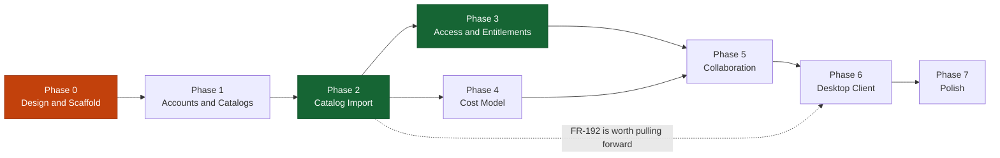

# Project Roadmap

The ordering reflects what is actually blocking the project today.
Collaborators are waiting to upload designs and buyers have already paid
for projects they cannot download — so the shortest path to a useful
platform is **catalog in, catalog out, paid access on top**. The cost
project, which the desktop app already does well and which nobody is
blocked on, comes after.

Requirements are numbered in [`requirements.md`](requirements.md) and
cited here as `FR-NNN`. The schema they imply is in
[`architecture/database-schema.md`](architecture/database-schema.md).

Phases 2 and 3 (green) are the ones people are actually waiting on:
Phase 2 unblocks collaborators, Phase 3 unblocks buyers. Phase 4 depends
only on Phase 2, so cost work can run in parallel with access work if
there is capacity.

## Guiding Constraints

- **The catalog owner is the authority over their own paid content.**
  Granting access, issuing codes and revoking them require owning the
  catalog and nothing else — no admin approval, no platform
  intermediation (FR-149, FR-155). An admin who has to click something
  for every sale is a bottleneck the product cannot afford.
- **No payment provider in v1.** Money changes hands outside the
  platform, as it does today, and the owner records the result as an
  entitlement or hands over a code (FR-166). Adding a gateway later must
  not require migrating the entitlement table.
- **Both upload paths produce the same rows.** A GitHub-backed catalog
  and a hosted one differ in where the bytes live and who pays for
  storing them — never in what a reader sees (§3.4). If a feature works
  for one and not the other, that is a bug, not a tier.
- **The desktop app keeps working throughout.** It ships today against a
  local folder and must continue to, with no account and no network, at
  every phase (FR-187). It becomes an API client in Phase 6; it never
  becomes a thin one.
- **Storage is metered, and the meter is per user.** 1 GB by default,
  adjustable by maintainers (FR-057). A GitHub catalog costs its owner
  nothing but the derived artifacts (FR-049) — that asymmetry is the
  incentive, and it should stay visible in the UI.

## Phase 0: Design & Scaffold 🚧

Goal: agree on the project before writing code. This phase produces
documents, not endpoints.

- [x] `docs/` scaffold — MkDocs Material, nav, theme, stylesheet
- [x] Requirements SRS — 268 FRs, 22 NFRs, 5 IRs, 27 data schemas
- [x] Roadmap with phased v1 scope
- [x] Architecture: backend, frontend, database, API
- [x] Architecture: catalog sources, access control, cost model,
      desktop client
- [ ] Review and sign-off on the entity model, especially the
      catalog-as-tenant boundary and the entitlement scope rules
- [x] Repository layout decision — `backend/` and `frontend/` as new
      siblings; `web/` and `desktop/` untouched
      ([`architecture/repository-layout.md`](architecture/repository-layout.md))
- [ ] `backend/` and `frontend/` scaffolds, Dockerfiles, compose file
- [ ] CI: Ruff, Pyright, pytest, `tsc --noEmit`, frontend build — path
      filtered so `web/` and `desktop/` jobs stay independent
- [ ] Alembic initialization + `0001_initial_users_audit_log`

## Phase 1: Accounts &amp; Catalogs 📅

Goal: a user can sign up, create an empty catalog, and see it at a
public URL.

### Backend

- [ ] `POST /auth/register`, `POST /auth/login` — JWT + Argon2ID
      (FR-001 – FR-005)
- [ ] `GET /auth/me`, `PUT /auth/me/password` (FR-006)
- [ ] Password reset by email, hashed single-use tokens (FR-007,
      FR-008)
- [ ] Default admin bootstrap from env (FR-009)
- [ ] Last-admin lockout guard (FR-015)
- [ ] Catalog CRUD with slug uniqueness per owner (FR-021, FR-022)
- [ ] Visibility enforcement — the single `can_view_catalog` gate every
      read path must go through (FR-024, FR-025, FR-197)
- [ ] Catalog editors: invite, accept, remove (FR-027)
- [ ] Audit log (FR-186)

### Frontend

- [ ] `/login`, `/register`, `/logout` — JWT in an httpOnly cookie
- [ ] `/{username}` public profile listing public catalogs (FR-196)
- [ ] `/{username}/{catalog}` catalog shell, empty state
- [ ] `/settings/account`
- [ ] ES/EN dictionaries wired from the start (FR-201, NFR-020)

Self-registration ships **enabled** here, unlike PrintForHelp — this
platform has no manual-provisioning phase to fall back on, because the
whole point is that makers arrive on their own.

## Phase 2: Catalog Import 📅

Goal: point the platform at a folder or a repository and get a
browsable catalog out. This is the phase that unblocks collaborators.

### The importer

- [ ] The core invariant, implemented **once**: a folder with no
      non-output subfolders is a project (§3.4)
- [ ] `exclude` / `output_dirs` pattern matching, including the
      dot-prefix rule and the path-vs-name distinction (FR-032)
- [ ] `catalog.yaml` parsing with fallback-to-defaults (FR-048)
- [ ] Frontmatter parsing: all 24 fields, plus legacy singular
      spellings and `packaging_cost` (FR-067, FR-069)
- [ ] Unknown-key preservation (FR-074)
- [ ] Derivation rules: title, description, cover, categories, kinds,
      capabilities (FR-063 – FR-066, FR-076, FR-081)
- [ ] `.3mf` slice-summary extraction as a background job (FR-087,
      NFR-003)
- [ ] Content-hash dedupe on stored objects (FR-084)
- [ ] **Shared invariant fixture corpus** — pathological trees plus the
      expected projects/categories, run in CI against the backend importer
      **and** `web/lib/catalog.ts` **and** `web/scripts/thumbnail.py`, so
      the three implementations cannot drift apart
      ([repository layout](architecture/repository-layout.md#the-invariant-problem))

### Hosted upload

- [ ] Resumable multi-file upload, and `.zip` expansion (FR-052 –
      FR-054)
- [ ] Archive hardening: traversal, absolute paths, symlinks, bombs
      (NFR-009)
- [ ] Quota accounting and pre-commit rejection (FR-056 – FR-059)
- [ ] Extension allowlist and per-file cap (FR-060)

### GitHub sync

- [ ] Link a repo; clone at a ref with size and time caps (FR-039,
      FR-040, NFR-010)
- [ ] **GitHub App**: registration, install flow, installation storage,
      short-lived token minting, least-privilege scopes (FR-203 –
      FR-207). A private repo is one of the two ways a paid file becomes
      exclusively ours to serve — the other is a hosted attachment
- [ ] Installation revocation and org-approval states (FR-208, FR-212)
- [ ] Signature-verified `push` webhook → auto-sync (FR-209)
- [ ] Record repository visibility on every sync (FR-211)
- [ ] Sync records: commit SHA, outcome, per-project diff (FR-041)
- [ ] Manual re-sync + scheduled re-sync (FR-042)
- [ ] **A sync never publishes and never prices** — new projects arrive as
      drafts, `free`, per the catalog's `new_project_policy` (FR-218,
      FR-219, FR-222)
- [ ] **Move detection by content hash** so renaming a folder does not
      destroy a project's price, entitlements and kit references; ambiguous
      matches held as suspected moves (FR-220, FR-221)
- [ ] Sync review surface: created / updated / moved / removed, with
      bulk publish and move confirmation (FR-223, FR-224)
- [ ] A project removed upstream keeps serving its entitlement holders
      (FR-225)
- [ ] Failed sync leaves prior state intact (FR-044, NFR-017)
- [ ] Removed-project detection without deletion (FR-045)
- [ ] Git LFS pointer resolution (FR-047, IR-001)
- [ ] The **geometry-gap warning** (FR-046) and the slice-summary
      sidecar that answers it (FR-051, FR-088)

### Frontend

- [ ] Catalog grid: cover, categories, capability filter, tag filter,
      search (FR-030, FR-031, FR-078)
- [ ] Project detail: README, facts, files grouped by kind, gallery
      (FR-083, FR-198)
- [ ] Upload UI with progress and quota meter
- [ ] Sync status panel with the last error in plain language (NFR-015)

## Phase 3: Access &amp; Entitlements 📅

Goal: a maker can mark a project paid, hand a buyer a code, and have the
buyer download it. This is the phase the paying customers are waiting
for.

- [ ] `access_level` on a project; paid projects stay **visible**, only
      files are withheld (FR-147, FR-148)
- [ ] Owner-granted entitlements, project- and catalog-scoped (FR-149 –
      FR-151)
- [ ] Access codes: issue, hash-at-rest, show-once, redeem, revoke
      (FR-155 – FR-160)
- [ ] Redemption rate limiting (FR-161, NFR-012)
- [ ] The download gate: signed short-lived URLs, `404` vs `403`
      semantics, per-file authorization (FR-167 – FR-170)
- [ ] Bulk project archive download (FR-171)
- [ ] Download records and the owner's ledger view (FR-165, FR-172,
      FR-173)
- [ ] **Per-file protection classification** — `protected` (our storage
      or a private repo) vs `public_source` (also sits in a public repo)
      — surfaced to the owner before they set a price, and re-derived on
      every sync (FR-210, FR-211, FR-214, FR-215). The generator-only
      case must produce no warning at all (FR-216)
- [ ] Repository link hidden on public pages unless the owner opts in,
      described as a deterrent and never as protection (FR-217)
- [ ] Owner UI: entitlement list, code manager, per-project access toggle
- [ ] Buyer UI: "My access" page listing every entitlement held
      (FR-154)

**Scope note:** maintainers and admins get **no** download override
here (FR-163). It is tempting to give them one for moderation, but a
platform role that can read every paid file is exactly the thing a
seller is trusting us not to build.

## Phase 4: Cost Model 📅

Goal: the desktop app's pricing, per user, on the web.

- [ ] Private cost settings per user (FR-129 – FR-131)
- [ ] Filaments and colors (FR-113 – FR-115)
- [ ] Supplies with purchase history and the quantity-weighted derived
      unit price (FR-116 – FR-121)
- [ ] Legacy flat-supply import (FR-121) and `catalog.yaml` inventory
      import/export (FR-126)
- [ ] Per-file costing: per-material filament pricing, machine rate,
      risk buffer, yield division (FR-132 – FR-135)
- [ ] Output-group batching — Estimate vs named batches (FR-136)
- [ ] Kits: component resolution by ID, include-sets, cycle/depth/count
      caps, per-line explanatory notes (FR-095 – FR-102)
- [ ] Landed → profit → discount → tax, in that order (FR-137 –
      FR-140)
- [ ] Back-solved markup and kit discount from a target price (FR-142)
- [ ] Expandable per-row breakdowns (FR-143)
- [ ] Cost cards computed per viewer and never leaked (FR-145, FR-018)

**Scope note:** cost is the one feature where the *catalog* and the
*viewer* each hold half the inputs. Grams and seconds belong to the
project; spool prices and machine rates belong to whoever is looking. Any
design that stores a price on the project is wrong.

## Phase 5: Collaboration &amp; Moderation 📅

- [ ] Contributions: submit to someone else's catalog, review, accept,
      reject, resubmit (FR-177 – FR-179)
- [ ] The private review thread, permanently private after acceptance
      (FR-180)
- [ ] Immutable contributor attribution (FR-181)
- [ ] Contribution licensing gate on marking a project paid (FR-182)
- [ ] **Public profiles**: avatar with pan-and-zoom crop rectangle, bio,
      display name, username rename with cooldown and hideable history
      (FR-229 – FR-235)
- [ ] Profile activity timeline (month-grouped, cursor-paginated) and
      contribution calendar (FR-236 – FR-238)
- [ ] User search for @mentions and grants (FR-239)
- [ ] User flags: tri-state key/value, traits vs capabilities registry
      (FR-240, FR-241)
- [ ] **Comments** with one-level replies, edit/delete, Markdown,
      per-catalog toggle (FR-242 – FR-247, FR-183)
- [ ] **Reactions** (likes) on projects, catalogs and comments, with
      counts and viewer state carried on the entity (FR-248 – FR-250)
- [ ] **@mentions** resolved at render, never reaching someone who
      cannot see the surface (FR-251, FR-252)
- [ ] Activity timeline per entity, shown beside comments (FR-184,
      FR-254)
- [ ] **Watches**: subscribe/unsubscribe, auto-watch on interaction
      (FR-257, FR-258)
- [ ] **Notifications**: in-app feed, unread badge, mark read, ten
      categories, per-category channel preferences with opt-out defaults
      (FR-255 – FR-263, FR-270)
- [ ] **Email via a transactional outbox** — written in the event's own
      transaction, drained with FOR UPDATE SKIP LOCKED so replicas never
      double-send; multipart text+HTML, escaped (FR-264 – FR-266)
- [ ] Signed no-login unsubscribe, POST-only (FR-267, IR-004, IR-005)
- [ ] Reports and maintainer takedown (FR-036, FR-037, FR-185)
- [ ] Catalog ownership transfer with acceptance and 7-day expiry
      (FR-028, FR-029)
- [ ] Fonts and icons tabs, including the online icon search and its
      SSRF-hardened import (FR-103 – FR-112)

## Phase 6: Desktop Client 🔮

- [ ] Connected mode: sign in from Electron (FR-188)
- [ ] Incremental push by content hash (FR-189, FR-190)
- [ ] Authorized pull (FR-191)
- [ ] **Local slice-summary upload** — publish real cost figures without
      uploading geometry (FR-192). The highest-value item in this phase
      and arguably worth pulling into Phase 2.
- [ ] Conflict surfacing, never last-write-wins (FR-193)
- [ ] Offline degradation (FR-194)

## Phase 7: Polish &amp; Integrations 💫

- [ ] Google OAuth (IR-002) — the `google_sub` column and the
      `username_chosen` gate already exist for it
- [ ] Payment-provider webhook creating entitlements (IR-003, FR-166)
- [ ] Public catalog directory with ranking (FR-195)
- [ ] Server-side customizer runs, sandboxed (FR-202, NFR-011)
- [ ] Slicer profiles as a first-class entity, replacing the free-text
      `profiles` list

---

**Legend:**

- ✅ Completed
- 🚧 In Progress
- 📅 Planned
- 🔮 Future Consideration
- 💫 Polish Phase
